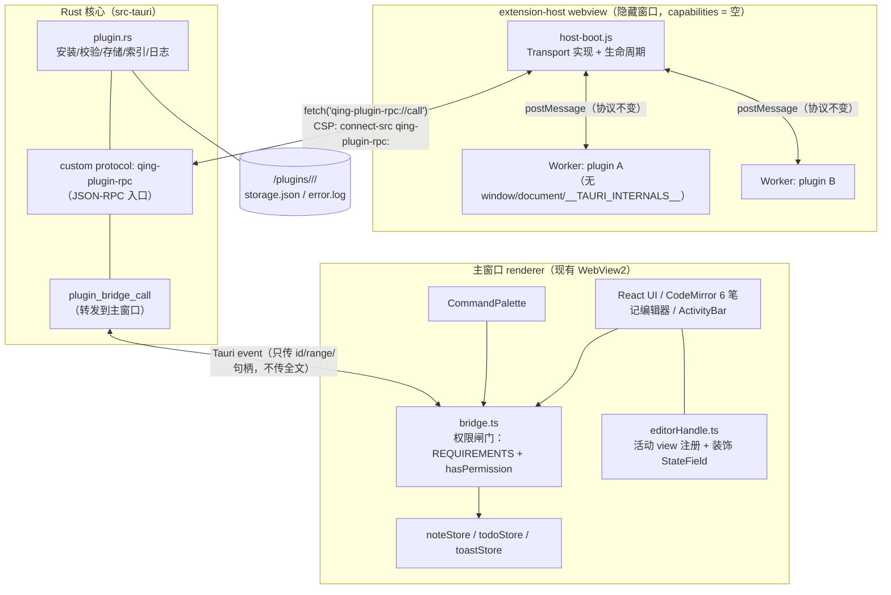

# 架构评审：把 Worker 插件机制改造成 VS Code 式扩展宿主

> **TL;DR**（0.7.3 起；体积数字本机实测，工期为人日量级估算）
> - 推荐：**保留 Worker 为唯一代码执行边界**，包格式与 API 向 VS Code 形态对齐；**不自带 Node**；"独立宿主进程"用隐藏 webview 承载 Worker（0 MiB）。
> - 不自带 Node 的两条硬依据：安装包 26.05 → 约 51–56 MiB（`node.exe` 83 MiB）；Node 官方自认权限模型"不防恶意代码"，一旦有 Node 进程 `fs`/`net` 就绕过 `bridge.ts`。
> - **跑不了 `.vsix`**：`require('vscode')` 是边界，不是运行时差异；"VS Code 式"只能做到形状（`package.json` + JS 脚本），做不到生态。
> - 分期：P0 8–12 / P1a 10–14 / P1b 12–18 人日 / P2 可选 Node（不随包）。与 L1 全增量、已装用户零迁移。
> - 笔记正文是 **CodeMirror 6 + Markdown**（TipTap 仅画布富文本）；编辑器 API 已按落地实现记法，未验证项见附录 B。

> 评审对象：`0.7.3` 上刚落地的 L1 插件机制（`docs/verification-plugin-l1.md`）。
> 评审输入：用户新诉求（脚本、独立扩展宿主、`package.json` 声明、可操作界面/文本/命令/侧边栏）。
> 本文件只做判断与取舍，不含实现代码。所有体积数字均为本机实测，工期为人日量级估算。

---

## 1. 结论先行

**能做到，但"VS Code 式"只能做到形状，做不到生态——推荐走「保留 Worker 作为唯一代码执行边界 + 对外形态改成 VS Code 风格包与 API + 独立进程只作为可选增强 + 不自带 Node」这条路。**

一句话拆开说：

| 用户诉求 | 能否满足 | 代价 | 结论 |
| --- | --- | --- | --- |
| 不用 `.qnp`，直接写 JS/TS 脚本 | ✅ 完全能 | ≈ 0.5 人日 | 做（`.zip`/文件夹/`.qnp` 三收，布局不变，**零迁移**） |
| `package.json` 声明 `main`/`activationEvents`/`contributes`/`engines` | ✅ 能，`plugin.json` 已有 4 个字段中的 3 个 | 3–5 人日 | 做（改名 `package.json`，`contributes` 用 VS Code 词汇） |
| 插件能操作编辑器界面/文本/命令/侧边栏 | ✅ 能，但必须经宿主代理 | 10–14 人日 | 做（P1，声明式侧边栏 + CodeMirror 6 文本读写/装饰 API） |
| 插件跑在**独立扩展宿主进程** | ⚠️ 能，但**不能是 Node 进程** | 12–18 人日 | 有条件做（专用隐藏 webview 承载 Worker） |
| 自带 Node 运行时以便 `require('fs')`/npm | ⚠️ 能，但**会同时废掉现有安全模型并让安装包翻倍** | +25–30 MiB + 10–15 人日 | **不做**，改为"用户自备 Node"的可选后端 |
| 直接跑现成 `.vsix` | ❌ **不能，且不建议追** | — | 不做 |

**决定性的一条依据**：Node 官方文档对自带权限模型的自我定性是
> "This feature does not protect against malicious code… Malicious code can bypass the permission model and execute arbitrary code without the restrictions imposed by the permission model."（[nodejs.org/api/permissions.html](https://nodejs.org/api/permissions.html)，`--permission` 自 v22.13/v23.5 起 stable）

也就是说：**一旦插件拿到 Node 进程，`fs`/`net`/`child_process` 就绕过了 `bridge.ts`，而 Node 自身无法把权限收回来。** 项目当前唯一的安全性差异化（"权限可见 + 安装时逐条告知 + 运行时强制"）会随之消失——这正是 `docs/analysis-vscode-extension-ecosystem.md` §5.2 记录的 VS Code 根本缺陷（extension host 是崩溃隔离，不是安全隔离）。为了跑 npm 包而重新踩进去，是本末倒置。

---

## 2. 选项对比

打分 1–5，5 最好。"安全性"= 能否在插件作恶时仍然只给它授权的能力。

| 选项 | 体积增量（实测/估算） | 工期（人日） | Node 兼容 | 安全性 | 结论 |
| --- | --- | --- | --- | --- | --- |
| **a) 保留 blob Worker（现状）** | **0 MiB** | 0 | 1（无 `require`/内置模块） | **5**（Worker 全局对象上根本没有 `__TAURI_INTERNALS__`） | 基线，保留 |
| **b) 打包 `node.exe` 作 sidecar** | **+25–30 MiB**（见 §2.1 实测推导）→ 安装包 26.05 → **约 51–56 MiB** | 12–16 | **5** | **1**（Node 官方承认权限模型不防恶意代码；且 `fs:scope`/CSP 全部失效） | 不做 |
| **c) 嵌 Rust JS 引擎** | `deno_core`(V8)：量级与 b 同源（V8+ICU 就是 `node.exe` 83 MiB 的主体）；`rquickjs`(QuickJS)：约 +1–2 MiB；`boa`：约 +2–3 MiB。**均未在本仓库实测** | 10–14 | 1–2（无 npm、无 Node API；QuickJS 对 ES2023 覆盖不全） | 4–5（默认可零能力，完全自定义） | 不推荐（小体积选项牺牲兼容性，大体积选项不如 b 省事） |
| **d) 双运行时（Worker 默认 + 可选 Node）** | **0 MiB**（Node 不随包，检测用户环境或用户指定路径） | 22–30（含 a 的全部 + 桥接） | 4（仅对装了 Node 的用户） | 3（Worker 侧仍 5；Node 侧需单独"全信任"红字授权） | **采用，但只作为 P2 出口** |
| **e) 专用隐藏 webview 作扩展宿主（本评审补充）** | **0 MiB**（复用已打包的 WebView2） | 12–18 | 1 | 4（renderer 进程隔离 + capability 为空的 deny-by-default；代价是 `__TAURI_INTERNALS__` 存在而非缺失） | **推荐作为"独立进程"诉求的答案（P1b）** |

### 2.1 体积数据（本机实测，非引用）

| 项 | 字节 | MiB | 来源 |
| --- | --- | --- | --- |
| `QingNotepad_0.7.1_x64-setup.exe`（L1 之前） | 27,001,499 | **25.75** | `src-tauri/target/release/bundle/nsis/` + `build-tauri.log` 末行 `(25.75 MiB)` |
| `QingNotepad_0.7.3_x64-setup.exe`（L1 之后） | 27,317,882 | **26.05** | 同上 |

→ **L1 整套插件机制（两阶段安装 + zip 防护 + sha256 + Worker 运行时 + 6 个界面组件）净增 316,383 B ≈ 0.30 MiB。**
这条基线很重要：`zip` + `sha2` + Worker 方案的成本几乎可以忽略，说明"体积敏感"不等于"不能做功能"。

| 项 | 字节 | 说明 |
| --- | --- | --- |
| `node.exe` v22.22.2 (win-x64) | 87,074,816（**83.04 MiB**） | 本机实测 |
| 同文件 `gzip -9`（deflate） | 33,050,633（**31.52 MiB**） | 本机实测，压缩比 ≈ 2.63:1 |

NSIS 用 LZMA（比 deflate 通常再小 10–20%），据此估 **+25–30 MiB**。该 LZMA 比率**未在本机用真实 `makensis` 验证**，标注为估算；但无论取区间哪一端，结论都是"安装包接近翻倍"。

### 2.2 为什么"作者自己 bundle 依赖"已经覆盖了 Node 的绝大部分价值

现有规范要求插件是**单文件产物**（三个示例的 `package.json` 都是 `esbuild --bundle --format=esm --platform=browser`）。这已经覆盖了纯 JS npm 依赖（markdown 转换、日期库、格式化器）——`main.js` 里内联即可，体积记在插件包上（单文件上限 5 MB）。

于是打包 Node 实际只多买到三样东西：**未 bundle 的 `node_modules`、原生插件（`.node`）、`fs`/`net`/`child_process`**。而：

- 原生模块已被安装器硬拒（`plugin.rs::is_native_module`，6 种后缀）；
- `fs`/`net`/`child_process` 正是我们**不想给**的能力。

**结论：为这三样付出 +25–30 MiB 和整个权限模型，性价比不成立。**

---

## 3. 推荐方案

### 3.1 推荐：a + e + P2 可选 d

> **代码执行边界永远是 Worker；包与 API 向 VS Code 对齐；"独立宿主进程"用隐藏 webview 承载 Worker 实现；Node 只作为不自带的、默认关闭的第二后端。**

三条关键判断：

1. **`Worker` 是唯一一处"对象不存在"的隔离。** 实测 `window=undefined document=undefined tauri=undefined fetch=blocked`（release 包）。webview 里 `__TAURI_INTERNALS__` 一定存在（Tauri 必注入），只能靠 capability 白名单拒绝调用——这是"约束"不是"缺失"。两者都可用，但**不要为了形式统一而把 Worker 换成 webview 主线程执行**。
2. **用户要"独立进程"，真实收益是崩溃与内存隔离，不是权限隔离。** 现状 `headless.ts` 全文没有内存上限或监控：一个插件在 Worker 里吃光内存，会带走整个 renderer（主界面一起没）。VS Code 的 extension host 解决的正是这件事。把它做成"隐藏 webview 里跑 Worker"，可以**同时**拿到进程隔离和"无 `window`/无 `__TAURI_INTERNALS__`"，且插件代码零改动。
3. **`bridge.ts` 必须留在原位。** 数据 API（笔记/待办/编辑器）的真实状态在主窗口的 zustand store 里，权限判断和状态访问天然同址。P1b 后链路变长，但闸门位置不动。

### 3.2 目标架构（P1 完成态）

P0 阶段同一张图去掉 `EH` 与 `RP`：Worker 仍在主窗口，`headless.ts` 直接调 `dispatchPluginCall`（= 今天的样子）。**Transport 抽成接口，两条路径共用同一套协议与权限表**，切换是配置项而不是分支重写——这是控制风险的关键。

### 3.3 五个关键决策点

| # | 决策 | 选择 | 依据 |
| --- | --- | --- | --- |
| K1 | 插件代码在哪执行 | Worker（P0 在主窗口 / P1 在 extension-host） | 唯一"对象缺失"级隔离；插件代码零改动 |
| K2 | 权限在哪强制 | 数据 API 在 `bridge.ts`；存储/剪贴板/网络在 Rust；编辑器在 `bridge.ts` 新分支 | 状态所在处判断，避免跨进程裁决 |
| K3 | 大文本怎么传 | **传句柄不传值**：`{noteId, from, to}`，由持有文件的进程读写 | 已有先例：`notes.get` 返回纯文本、`notes.update` 落盘 + 双事件广播 |
| K4 | 侧边栏形态 | **声明式树**（VS Code `TreeDataProvider` 式） | 3–4 人日、复用现有 `PluginSidebar` 样式、无新进程/CSP |
| K5 | Node 怎么给 | 不随包；用户可选启用，启用即"全信任"红字授权 | Node 官方权限模型不足以当边界；+25–30 MiB |

### 3.4 "VS Code 扩展能不能直接拿来跑"——真实边界

| 能力 | Worker（现状/P0/P1） | Node 后端（P2） | 说明 |
| --- | --- | --- | --- |
| `require('fs')` | ❌ 没有 `require`，没有内置模块 | ✅ | Worker 里只有 ESM 全局，`import 'node:fs'` 直接解析失败 |
| npm 依赖（已 bundle） | ✅ | ✅ | 三个示例就是这么做的（esbuild 单文件） |
| npm 依赖（未 bundle 的 `node_modules`） | ❌ | ✅ | 需要模块解析 + 目录树，与"单文件 5 MB"限制冲突 |
| ESM | ✅ | ✅ | blob module worker 只认 ESM |
| CJS（`module.exports`） | ⚠️ 可垫片 | ✅ | boot 前注入 6–10 行 `module/exports` 垫片即可吃掉大部分 CJS 脚本，成本极低，建议 P0 做 |
| `require('vscode')` | ❌ | ❌ | **这才是 `.vsix` 跑不起来的真正原因**，不是运行时 |
| `contributes` 语法 | ❌ 不兼容 | ❌ | VS Code 用 `command` 不是 `id`，另有 `when` 子句、`menus`、`viewsContainers` |
| Monaco / LSP / DAP | ❌ | ❌ | **笔记正文是 CodeMirror 6 + Markdown 源模式**（`NoteEditor.tsx` 挂 `<MarkdownSourceEditor>`，默认视图 `"source"`）；画布富文本另有 TipTap，两者不是同一个编辑面。没有语言服务与调试协议 |

**所以"能跑 VS Code 扩展"是假的；能跑的是"用 `package.json` 描述、`main` 指向单个 JS 文件的脚本"——只共享形状。**

---

## 4. 分期交付计划

每期都以"能在真实 release 包上验收"为界，沿用 `verification-plugin-l1.md` 的验收风格。

### P0｜包格式与清单对齐（8–12 人日，体积 ±0）

**可验收的最小成果**：丢进一个文件夹或 `.zip`（根目录有 `package.json`）就能装，`package.json` 用 VS Code 的字段名，现有三个示例插件不改一行代码仍能装。

| 内容 | 说明 |
| --- | --- |
| `plugin.json` → `package.json` | 双读：`package.json` 优先，`plugin.json` 兜底（已装用户不动） |
| 接受 `.zip` / `.qnp` / **目录** | Rust 侧本来就是"按字节当 zip 读"，改的是前端 dialog filter（`install.ts:317` 一行）+ 目录分支 |
| 清单校验扩展 | `main` 允许 `.mjs`；新增 `contributes.commands[].command`（VS Code 拼写）与 `id`（现状）双收 |
| CJS 垫片 | `worker-boot.js` 前置 `module/exports`，把"写了 CJS 直接崩"变成"能跑" |
| `qing.workspace` 命名空间 | `workspace.activeNote`（只读 id/title）、`workspace.onDidChangeActiveNote` |

**验收**：目录安装成功；`package.json` 版本安装成功；`.qnp` 旧包安装成功；CJS 示例能跑。

### P1a｜API 面扩张（10–14 人日，体积 ±0）

> **编辑器部分已按落地实现校正**（`a4637bb` 功能 + `8670e8e` 收尾）。下面写的是**代码里实际存在的 API**，
> 不是最初设计稿；与设计稿的差异见本节末尾「未做与待落地的两项」。

**可验收的最小成果**：一个插件能声明一个侧边栏树、读到当前笔记的选中文本、把选中文本替换掉，全程走权限。

| 贡献点 | 最小 API 面 |
| --- | --- |
| **命令** | 已有 `commands.register`；补 `commands.execute(id)` 仅限**自己**的命令（跨插件仍禁止，D6 不变） |
| **侧边栏（声明式树）** | `contributes.views: [{id,title,icon}]`（第 6 个 ActivityBar 图标，或并进 plugins 页左栏）；`qing.views.registerTreeProvider(id, {getChildren})`；节点 `{id,label,description,icon,tooltip,command,collapsibleState}`；`onView:xxx` 激活事件 |
| **编辑器（CodeMirror 6，已落地 4 个方法）** | 编辑面是 CM6 的 Markdown 文档，位置一律是 **CM6 doc 偏移**（UTF-16 码元）。 `getText(range?)` → 不传 / `undefined` / `null` 返回整篇（`doc.toString()`）；传 `{from,to}` 返回 `doc.sliceString(from,to)`（与 `replace` 同一套区间语义）：`from/to` 必须是整数且 `0 <= from <= to <= doc.length`，越界/小数/`from > to` → `E_RANGE_INVALID`；`from === to` 返回 `""`（空区间不是错误，就是"没有选区"）；多余字段忽略，可直接把 `getSelection()` 的结果丢进去 `getSelection()` → `{from, to, anchor, head, text}`（`from/to` 归一化且 `from <= to`；`anchor/head` 是 CM6 原生字段，用于判断光标在哪一端；`text = sliceDoc(from,to)`） `replace({from,to}, text)` → 半开区间 `[from,to)`，`from/to` 必须是整数，越界或小数 → `E_RANGE_INVALID`；`text` 上限 1,000,000 字符 → `E_TOO_LARGE` `setDecorations(key, ranges)` → `ranges: {from,to,kind}[]`，`kind ∈ {error,warning,success,muted,highlight}`，`key` 截断到 64 字符，单 key 上限 1000 段 → `E_TOO_LARGE` 无活动笔记一律 `E_NO_EDITOR` |
| **界面** | `ui.toast` 已有；补 `ui.showQuickPick(items)`（复用 `CommandPalette` 的渲染） |
| 新权限码 | **当前全集 11 个** = 8 个 L1（`storage` / `notes:read|write` / `todo:read|write` / `clipboard:read|write` / `notify`）+ 3 个编辑器（`editor:read|write|decorate`）。映射：`getText|getSelection → editor:read`、`replace → editor:write`、`setDecorations → editor:decorate`。 **注意 `editor:read` 不被 `editor:write` 隐含**（与 `notes:write → notes:read` 不同）：能改不等于能读，两个码独立授予。 **尚未落地的 2 个**：`views`（侧边栏贡献点，随声明式树交付）；`editor:selection`（移动用户光标与滚动位置），**不并入 `editor:write`**，排 **P1a-2**。理由是这套权限模型的卖点即"可见即可管"：「改正文」与「移动你的光标」是两种不同的用户风险，混在一个码里会让"只允许它读笔记"的人被迫连光标一起让出去。终态是 `editor:read|write|decorate|selection` 四码并列 |

**CodeMirror 6 映射的七条硬约束**（写进实现与文档）：

> 读者区分：本清单是**宿主实现者**的完整纪律（7 条）；`examples/qing-editor-demo/README.md` 的「三条硬约束」是给**插件作者**的最小集（CM6 偏移 / Markdown 源 / `replace` 走编辑器变更管线），两者是刻意的两种粒度，不是漂移。示例 README 不必改成七条。

1. **写操作走正常事务，不要加 `externalDocumentUpdate` 注解。** 那个注解（`MarkdownSourceEditor.tsx:25`，用于 `:151` 附近的回灌 effect）是反方向的：宿主把外部值塞进 CM6 时用它抑制 `onChange` 回环。插件的编辑要等价于用户键入，让 `updateListener → handleMdChange → updateNote + markDirty → 自动保存` 这条链正常走完；混用会导致"改完没保存"，且只在重启后暴露。`scripts/verify-plugin-runtime/run.mjs` 已加静态断言（剥注释后 `bridge.ts` 不得出现该注解）。
2. **不要照搬 `notes.update` 的收尾。** 数据 API（`notes.update`）是"落盘 + `emit(NOTE_EXTERNAL_SAVE_EVENT)` + `emit("sticky:note-updated")`"；**编辑器写入不走这条**——它走编辑器自己的保存链，`NoteEditor.tsx:207` 自己就会 emit `sticky:note-updated`。两条路径混用会重复落盘。
3. **写入的是 Markdown，不是 HTML。** 历史笔记存储为 HTML，加载时经 turndown 转换（`NoteEditor.tsx:291` `isStoredEditorHtml(content) ? htmlToMarkdown(content) : content`，`:331` 同）；因此插件写回 Markdown 字符串可被正确加载，**不要**让插件自己产出 HTML（会绕过 `:60` / `:69` 的规范化规则）。
4. **装饰是语义 kind，不是 class 名。** 插件无法传任何类名或属性：5 个 kind 由宿主映射到固定的 `.qing-dec-<kind>`（定义在 `index.css`）。只用 `Decoration.mark`，**不开 `Decoration.replace` / `Decoration.widget`**（那两个能嵌 DOM）。
5. **装饰字段是"一个字段 + Map"，不是"每插件一个字段"。** `StateField<Map<\`pluginId::key\`, DecorationSet>>`，经 `EditorView.decorations.from(field, flatten)` 合并渲染；停用一个插件 = 删掉带该前缀的所有 key（语义仍是整套撤销，且天然支持同插件多 key）。理由：CM6 里动态增删字段要走 `Compartment` 重新配置扩展，代码量与出错面都更大。
6. **位置漂移必须 `.map(tr.changes)`**，每次事务把每个 owner 的 set 映射过去；已验证断言：标记 `0..5`，在其前插入 `XX` 后必须落在 `2..7`。
7. **永不开放 CM6 扩展/`StateField` 注入、Markdown 语法扩展**（维持 D2 的精神）。这是"笔记数据完整性"的最后一条线。装饰是唯一例外，且由宿主托管。

**边界：P1a-1 不覆盖云笔记。** `setActiveEditor` 全仓只有 `NoteEditor.tsx:558` 一处调用，`Workspace/CloudNoteEditor.tsx` 从不调用它；因此活动面是云笔记时 `qing.editor.*` 返回 `E_NO_EDITOR`，不会写进协同文档。注意反向的一条：**预览/分栏模式仍然有编辑器**（`NoteEditor.tsx:807` 只是用 CSS `hidden` 藏起源码窗格，并未卸载 view），只有"完全没打开笔记"才返回 `E_NO_EDITOR`。

**未做与待落地的两项**（明确记录，避免下一个人当成漏项或"漏改"）：

- **`getDoc()`（含 `length`）不做**，它是 `getText()` 的冗余（`length` 即 `getText().length`）。
- **`setSelection()` 排 P1a-2，权限归属已定：新码 `editor:selection`**（不并入 `editor:write`，理由见上表）。落地前不得顺手加进 `editor:write`；`setSelection` 与该码一起交付，不拆开。

> `getText(range?)` 的区间变体已在 `175f71c` 落地（`bridge.ts:294-306`、`worker-boot.js:203-211`），已从本清单摘除。区间读取用 `doc.sliceString`，所以统计类插件不必把整篇拉进 worker——示例 `examples/qing-editor-demo` 就是这么用的（有选区只取选区）。

**加一个新权限码：6 处同步点 + 2 张蕴含表（5 个函数镜像）+ 1 个计数绊线**（P1a-2 加 `editor:selection` 时照这张单子走，漏一处就红或漏授权项）：

**A. 必改的 6 处同步点**

1. `src-tauri/src/plugin_manifest.rs::KNOWN_PERMISSIONS` —— 不在表里会被安装器以 `E_PERMISSION_UNKNOWN` 直接拒；
2. `src/plugin/types.ts::PLUGIN_PERMISSIONS` —— 同时决定 `PluginPermission` 类型；
3. `src/plugin/types.ts::PERMISSION_LABEL_KEYS` —— `Record<PluginPermission, …>`，漏了 tsc 直接红；
4. `src/utils/i18n.ts` **三处**：`TranslationKeys` 接口、zh 表、en 表（如 `pluginPermEditorSelection`）；
5. `src/plugin/bridge.ts::REQUIREMENTS` —— 决定哪个方法要这个码；
6. `src/components/Plugin/PermissionList.tsx:29` 的 `ICONS` —— `Record<PluginPermission, ComponentType>`，漏了 tsc 红，而且授权弹窗里那一行没有图标。

**B. 2 张蕴含表、5 个函数镜像——只在"新码需要蕴含关系"时才改；`editor:selection` 明确不改**

蕴含关系是"授权 A 就自动带上 B"，现在只有 `notes:write → notes:read`、`todo:write → todo:read` 两条。**它们不是同步点**，是产品决策：

- **正向展开 2 个**：`plugin.rs::expand_permissions`、`types.ts::expandPermissions`；
- **反向放行 3 个**：`plugin.rs::is_grantable`、`types.ts::hasPermission`、**`install.ts::67` 的 `isDeclared`**。

三个反向镜像漏改的症状各不相同，所以要分列：漏 `is_grantable`/`hasPermission` 是"授权了却调用被拒"（或反过来授权过多）；漏 `isDeclared` **更隐蔽**——它在 `commitPreparedInstall`（`install.ts:238` 的 `previous.grantedPermissions.filter((p) => isDeclared(p, declared))`）里决定**升级/回滚时旧的 `grantedPermissions` 哪些能带过去**，漏改的结果是"新版本装上了、用户此前授过的权限被静默丢掉"，表面上像"升级后功能坏了"，很难回溯到权限规则。

按本节的纪律，**`editor:selection` 不被 `editor:write` 隐含**（同 `editor:read`），所以这 5 个函数在 P1a-2 里**必须原样不动**。单子只写"同步 6 处"而不点名这里，下一个人大概率会顺手把蕴含补上——那条纪律就废了。

**C. 1 个计数绊线：`plugin_manifest.rs:1197` 的 `assert_eq!(KNOWN_PERMISSIONS.len(), 11)`**

连同紧邻的"无重复"断言。加 `editor:selection` 或 `views` 时它**必然红，这是故意的**——只改一处就会红，逼作者把 6 处走完，再回来把 `11` 改成 `12`/`13`。实现 P1a-2 的人看到它**不要当"测试过时了"随手删掉或放宽**，它就是那道拦网；也不要为了绿而在没改完 6 处时先改这个数。

> `editor:selection` 交付时的三条纪律（已定，写在这里防止 P1a-2 走样）：**与 `setSelection` 一起交付，不拆开**（不能只加方法不加码，也不能只加码不校验）；**不被 `editor:write` 隐含**（与 `editor:read` 同一条纪律）；**授权文案已定稿**，弹窗写「**移动你的光标与滚动位置**」，不复用 `editor:write` 的"修改正文"（措辞已进 P1a-2 实现规格，除非 UI 上放不下，不必再跟产品对）。

### P1b｜独立扩展宿主进程（12–18 人日，体积 ±0）

**可验收的最小成果**：任务管理器里多一个 renderer 进程；插件里 `while(1){}` + 内存炸弹只死那个进程，主窗口存活并弹出"扩展宿主已重启"。

| 内容 | 说明 |
| --- | --- |
| 第二个 Vite 入口 `extension-host.html` | 只加载 `host-boot.js`，不含 React |
| 隐藏 `WebviewWindow`（label `extension-host`） | 新增 `capabilities/extension-host.json`，`permissions: []` → deny-by-default |
| `qing-plugin-rpc` custom protocol | Rust `register_asynchronous_uri_scheme_protocol`；请求体 JSON，响应体 JSON；**大文本走句柄** |
| CPS | `default-src 'none'; script-src 'self'; worker-src 'self' blob:; connect-src qing-plugin-rpc:` |
| 监督者 | 心跳 + 崩溃计数（沿用"连崩 3 次停用"）+ 指数退避重启 |
| Transport 抽象 | `headless.ts` 抽出 `Transport` 接口，P0 路径用 `inprocess` 实现，P1b 用 `protocol` 实现 |

**未验证项（必须实测后再排期确认）**：
- 隐藏 WebView2 窗口是否稳定拿到**独立 renderer 进程**（Chromium 进程模型下通常成立，但本项目未测）；
- `register_asynchronous_uri_scheme_protocol` 在 P1 的 CSP 下与 blob worker 共存的时序；
- 隐藏窗口的内存基线（量级参考 30–60 MB，未测）。

### P2｜可选 Node 后端（10–15 人日，体积 ±0）

**只有在 P0/P1 上线后确有"必须用 npm 原生能力"的真实需求时才启动。**

- 检测顺序：用户显式指定路径 → `PATH` 里的 `node` → 不启用（**绝不静默回退到某个捆绑二进制**）；
- 协议：`stdio` 上的 **JSON-RPC 2.0，按行分隔（NDJSON）**，不用 LSP 的 `Content-Length` 头（多一层解析、无收益）；
- 启动参数尽量收：`node --permission --allow-fs-read=<pluginDir> --allow-fs-write=<dataDir>/plugins/<id> --allow-net=false`。**明确告知：这是"安全带"不是"边界"**（Node 官方原文见 §1）；
- 安装授权：单独一段红字 + 独立的 `runtime:node` 权限码，与现有 11 个权限码并列展示（新增一个码是「6 处同步点 + 2 张蕴含表 / 5 个函数镜像 + 1 个计数绊线」，见 §4 P1a 末尾清单）；
- 索引策略：带 `runtime:node` 的插件在列表里明确标注"需要本机 Node"，且不进入默认推荐；
- 更强的隔离（AppContainer / 受限令牌）列为**未验证的后续项**，不要写进这一期的承诺。

### 4.1 工期汇总（量级，不是承诺）

| 期 | 人日 | 累计 |
| --- | --- | --- |
| P0 | 8–12 | 8–12 |
| P1a | 10–14 | 18–26 |
| P1b | 12–18 | 30–44 |
| P2（可选） | 10–15 | 40–59 |
| 若改"打包 node.exe"（不推荐） | +3（sidecar 配置与 NSIS 侧车替换）+ 前述隔离工作的重做 | — |

---

## 5. 与现有 L1 的关系

**核心结论：没有一处需要重写，全部是增量。已装用户与新装用户的磁盘布局完全不变。**

| 现有资产 | 处置 | 说明 |
| --- | --- | --- |
| `plugin.rs`（1295 行） | **保留** | 只改两处：接受 `.zip`/目录入口；`main` 后缀校验放宽到 `.mjs` |
| `plugin_manifest.rs` | **改** | 加 `contributes.views`、`editor` 相关字段；`KNOWN_PERMISSIONS` 加 4 个码；其余校验（id/semver/engines/越界/原生模块）**一条都不动** |
| `bridge.ts` | **保留为唯一闸门** | 新增 `workspace`/`editor`/`views` 三个 namespace 的 `REQUIREMENTS` 行与实现分支 |
| `headless.ts` | **保留 + 抽接口** | Worker 生命周期、5 s 超时、连崩 3 次停用全部沿用；只把"怎么把消息送出去"抽成 `Transport` |
| `worker-boot.js` | **保留 + 扩** | `qing` 对象加命名空间；加 CJS 垫片 |
| `types.ts` | **改** | 权限码 + 贡献点类型 |
| `components/Plugin/*` | **保留 + 加** | 加 `ViewTree` 渲染器（复用现有侧栏样式），其余不动 |
| `capabilities/default.json`、`tile.json` | **不动** | 新增 `extension-host.json`（空权限） |
| `tauri.conf.json` 的 CSP | **不动** | 主窗口 `connect-src` 不加任何新域；extension-host 窗口单独 CSP |
| 三个示例插件 | **改 3 行** | `plugin.json` → `package.json`；`pack.mjs` 的 SKIP 列表加 `package.json` 改为"打包时重命名" |
| 索引仓库 `index.json` | **不动** | `download` 是 URL，`sha256` 是字节哈希，与扩展名无关 |

**包格式的迁移成本几乎为零，原因是**：Rust 侧把入口文件按字节当 zip 读（`plugin.rs:532` 只是给临时文件起名 `.qnp`），`install.ts:317` 的 `extensions: ["qnp"]` 是唯一硬编码扩展名的地方。同时 `tauri.conf.json` 里**没有 `fileAssociations`**——`.qnp` 从来没有真正注册为文件关联，"双击安装"这件事本来就没实现，所以放弃 `.qnp` 不损失任何东西。

**双格式并存，不硬切**：新文档只写 `.zip` 与文件夹；`.qnp` 永久接受但不再宣传。

---

## 6. 风险与"不做什么"

### 6.1 前三大风险

| # | 风险 | 触发条件 | 缓解 |
| --- | --- | --- | --- |
| R1 | **编辑器 API 污染文档结构**（最严重） | 插件写坏 Markdown / CM6 文档结构；或借装饰做视觉伪装 | 只读能力先上线；装饰只接受 5 个语义 kind（插件无法传 class/属性），由宿主唯一的 `StateField` 施加；写操作走编辑器正常事务与保存链；CM6 扩展/Markdown 语法扩展注册**永久不开放**；云笔记不发布为活动编辑器（`E_NO_EDITOR`），远程事务合并**未验证**因此不碰 |
| R2 | **P1b 链路变长导致难调试** | 三跳（Worker → ext-host → Rust → 主窗口），时序/超时/错误码归属混乱 | P0 就把 `Transport` 抽出来，两种 transport 共用一套协议与权限表；用 `qing-isolation-probe` 同款插件做端到端探针（时延、崩溃注入、权限拒绝）；feature flag 可回退到 in-process |
| R3 | **Node 后端的"假安全感"** | 用户以为"有权限弹窗所以安全"，实际 Node 侧 `fs` 全开 | 默认关闭；独立红字授权；只在用户显式指定时启用；索引对 `runtime:node` 插件显著标注；不做自动更新（D4）；把"Node 插件 = 全信任"写进开发者文档第一屏 |

### 6.2 明确不做（即使做了也拿不到 VS Code 那种生态）

- ❌ **`.vsix` 兼容 / `vscode` 命名空间 shim**。`require('vscode')` 是 10 万扩展的第一行代码，实现一个语义正确的 shim 等于重做一个 Monaco 语义层，且永远追不上版本。**投多少人都追不上，这是结构性事实，不是工期问题。**
- ❌ **LSP / DAP**。笔记正文是 CM6 + Markdown（不是文件式工作区，也没有语言服务器可接），画布富文本同理；协议化的前提不存在。
- ❌ **Monaco 式 `TextEditor` 语义**（多编辑器组、语言服务、跳转定义、断点）。
- ❌ **编辑器内核扩展注册**：CM6 扩展 / `StateField` / Markdown 语法扩展（笔记正文），TipTap Extension（画布富文本）。均维持 D2 的边界；装饰是唯一例外（宿主托管）。
- ❌ **插件间 `import` 与依赖解析**（D6 维持）。
- ❌ **自动更新**（D4 维持；生态分析里 GlassWorm 的投递通道正是自动更新）。
- ❌ **下载量排行**（已定结论：只给"最近更新 / 兼容区间 / 权限数量"）。

### 6.3 一个必须说清的结构性事实

VS Code 的生态来自"平台方自己就是最大开发者 + 10 万扩展 + 协议化（LSP/DAP）+ 编辑器即工作台"。青记是笔记应用，插件能触达的只有富文本、待办、画布——**同样的机制只能长出"几十个垂直小插件"的量级**，这已经是成功的定义。按 VS Code 的规模去设计 API 面，是为不存在的问题付成本。

---

## 7. 待用户决策（4 条）

1. **目标是"VS Code 式的开发者手感"，还是"能跑现成的 VS Code 扩展"？**
   前者 P0+P1a 就能交付；后者建议当场放弃（理由见 §3.4 / §6.2）。这个答案决定后面全部排期。

2. **"独立扩展宿主进程"是硬需求还是"希望别一个插件崩掉整个应用"的手段？**
   若是后者，P1b（隐藏 webview 承载 Worker，12–18 人日，0 MiB）是答案；若只是要"像 VS Code"，P0+P1a 就够，P1b 可以推迟到真的出现"一个插件拖垮应用"的事故之后。

3. **安装包从 26.05 MiB 涨到约 51–56 MiB，可接受吗？**
   若不可接受 → Node 只能走"用户自备"路线（P2）。若可接受 → 我仍不建议：+25–30 MiB 换来的能力与现有安全模型互斥（§2.1 / §2.2）。

4. **侧边栏先做声明式树，还是一步到位做 webview 面板？**
   建议声明式树（3–4 人日，视觉与现有侧栏一致）；webview 面板（5–8 人日 + 每面板一份内存与 CSP）留给真正需要图表/画布的插件，等有具体需求再开。

---

## 附录 A：本次评审确认的现状事实（代码为准）

| 事实 | 证据 |
| --- | --- |
| 只有 `commands` 一个贡献点 | `plugin_manifest.rs::Contributions` 只有 `commands` 字段；`types.ts::PluginManifest.contributes` 同 |
| D1 的 Track B（插件独立窗口）**未落地** | `capabilities/` 只有 `default.json`、`tile.json`，无 `plugin-window.json`；全仓搜不到 `plugin-window` |
| 权限校验位置 | `bridge.ts::REQUIREMENTS` + `hasPermission`；当前 **11 个**权限码（8 L1 + 3 `editor:*`）。新增一个码：**6 处同步点** + **2 张蕴含表 / 5 个函数镜像（需蕴含时才改）** + **1 个计数绊线**（`plugin_manifest.rs:1197` 的 `assert_eq!(…, 11)`，加码必红、故意的）——完整清单见 §4 P1a 末尾 |
| 两张权限表当前完全一致 | `plugin_manifest.rs::KNOWN_PERMISSIONS` 与 `types.ts::PLUGIN_PERMISSIONS` 均为 11 个，**内容与顺序逐项相同**（已用脚本比对）；P1a-2 加码时可直接拿这个顺序当 diff 锚点。**顺序锚点的前提**：新增项插在哪一位都行（如 `notify` 之后），但**两张表必须插到同一位置**——顺序一旦分叉，锚点就失效，diff 看不出漏改 |
| RPC 超时 5 s / 连崩 3 次停用 | `headless.ts:36–37` |
| Worker 无内存上限 | `headless.ts` 全文无内存监控逻辑；堆受 renderer 进程约束 |
| CSP 关键位 | `tauri.conf.json`：`script-src` 无 `blob:`（主线程不能 `import(blob)`）、`worker-src 'self' blob:`、`connect-src` 显式列表 |
| 安装限制 | 单文件 5 MB / 总量 20 MB / 2000 条目 / 禁 `.dll .node .exe .so .dylib .wasm` |
| 私有存储配额 | 1 MB（`STORAGE_QUOTA_BYTES`），日志 100 行，索引 24 h 缓存双源 |
| `.qnp` 无文件关联 | `tauri.conf.json` 无 `fileAssociations`；唯一硬编码是 `install.ts:317` 的 dialog filter |
| Rust 侧与扩展名无关 | `plugin.rs:532` 仅用 `.qnp` 作暂存文件名，读的是字节 |
| **笔记正文 = CodeMirror 6 + Markdown 源模式** | `NoteEditor.tsx:816` 挂 `<MarkdownSourceEditor>`，`markdownViewMode` 初值 `"source"`（`:142`）；`MarkdownSourceEditor.tsx:127` `new EditorView({state, parent})`（`@codemirror/view`） |
| **编辑器句柄是独立模块** | `src/utils/editorHandle.ts`：活动 view 注册（`setActiveEditor`，全仓仅 `NoteEditor.tsx:558` 调用）+ 装饰 `StateField`；`bridge.ts` 与 `headless.ts` 都用它，但都不能 import 组件 |
| **装饰 = 一个字段 + Map** | `editorHandle.ts:107` `StateField<Map<"pluginId::key", DecorationSet>>`，`provide: EditorView.decorations.from(field, flatten)`；`docChanged` 时逐 owner `.map(transaction.changes)`；停用按前缀删 key |
| **装饰只有 5 个语义 kind** | `editorHandle.ts:37` `DECORATION_KINDS = error/warning/success/muted/highlight` → `.qing-dec-<kind>`（样式在 `index.css`）；插件无法传 class 或属性 |
| **编辑器 API 限额** | `bridge.ts:58/60`：`MAX_EDITOR_INSERT = 1_000_000` 字符、`MAX_DECORATION_KEY_LENGTH = 64`；`editorHandle.ts:56` `MAX_DECORATION_RANGES = 1000`；区间必须是整数，越界 → `E_RANGE_INVALID`，超限 → `E_TOO_LARGE` |
| **云笔记不发布为活动编辑器** | `Workspace/CloudNoteEditor.tsx` 从不调用 `setActiveEditor` → `qing.editor.*` 返回 `E_NO_EDITOR`（`bridge.ts::requireEditor`） |
| **TipTap 只用于画布富文本** | `@tiptap/react` 仅出现在 `src/components/Canvas/`（`CanvasRichTextEditor.tsx`、`CanvasTextToolbar.tsx`、`CanvasView.tsx`），与笔记正文无关 |
| **存储是 HTML、编辑面是 Markdown** | `NoteEditor.tsx:78` `htmlToMarkdown()`（turndown + gfm），`:291` `isStoredEditorHtml(content) ? htmlToMarkdown(content) : content`，`:331` 同 |
| **协同只在云笔记，本地笔记无 Yjs** | `Workspace/CloudNoteEditor.tsx:980/1126` `yCollab(...)`（`y-codemirror.next`）+ `HocuspocusProvider`；`src/components/Editor/` 内搜不到 `yjs`/`yCollab`/`hocuspocus` |
| **CM6 外部写入的既有机制** | `MarkdownSourceEditor.tsx:25` `externalDocumentUpdate` 注解，`:151` 用它 + `Transaction.addToHistory.of(false)` 同步外部值；用途是抑制 `onChange` 回环，不是给插件复用 |

## 附录 B：未验证项清单（不要当成结论引用）

- NSIS LZMA 对 `node.exe` 的实际压缩比（§2.1 的 +25–30 MiB 是估算）；
- `deno_core` / `rquickjs` / `boa` 嵌入后的真实二进制增量；
- 隐藏 WebView2 窗口是否稳定拿到独立 renderer 进程、其内存基线；
- **云笔记**（`Workspace/CloudNoteEditor.tsx`，CM6 + `yCollab` + Hocuspocus）在协同在场时，插件驱动的写回是否与远程事务正确合并——**这项尚未验证，且当前不触碰**：P1a-1 已定不覆盖云笔记，`CloudNoteEditor` 不发布为活动编辑器，`qing.editor.*` 直接返回 `E_NO_EDITOR`。只有将来明确决定接云笔记时，这条才变成排期前提；到那时仍不能当已验证来估。
- `register_asynchronous_uri_scheme_protocol` 与 blob worker 在同一 CSP 下的共存时序。
