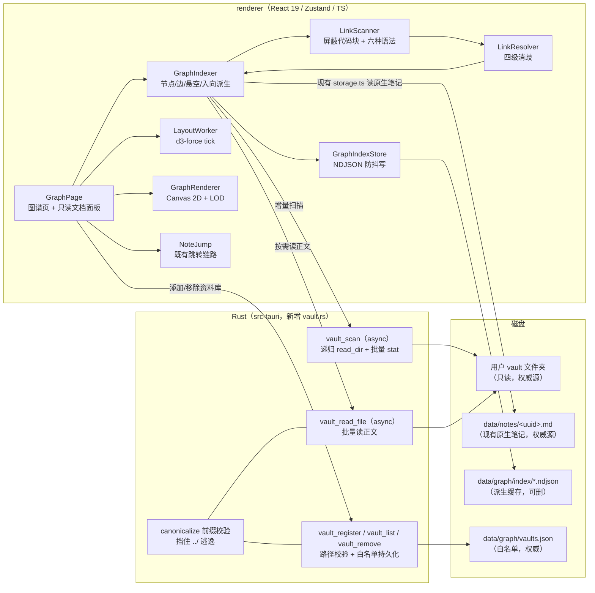
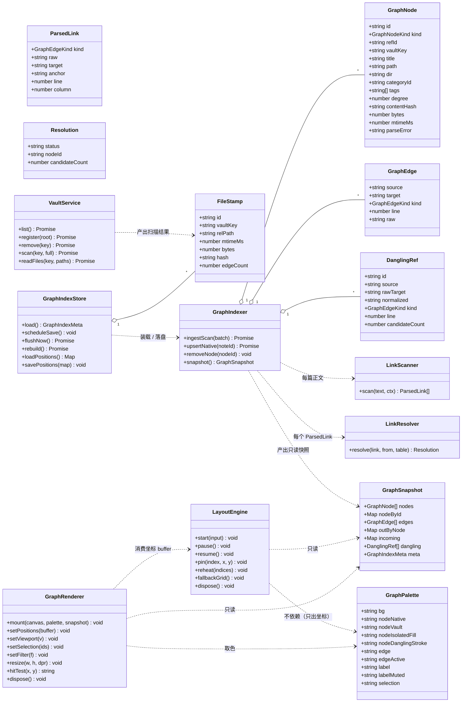
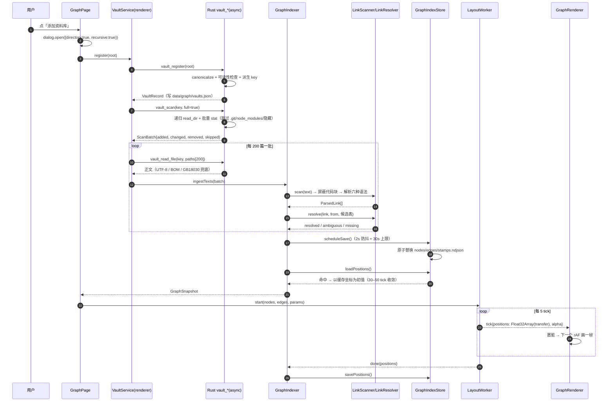
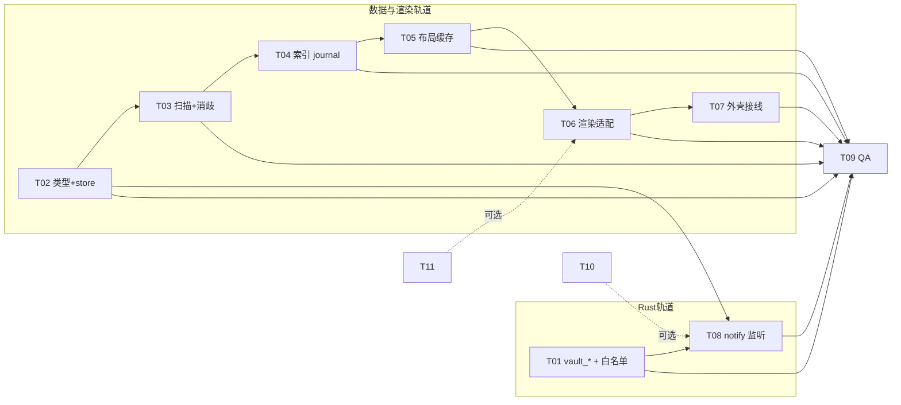

# 决策记录：本地文件夹知识库 + 双向链接解析 + 知识图谱可视化

> **TL;DR**
> - 在 Qing-Notepad 内部新增一个**只读**的「资料库（vault）」子系统：用户选一个文件夹，我们**不复制**、不写入，只把它当作链接与图谱的权威源，原生笔记（`data/notes/<uuid>.md`）作为第二来源并存，两者在图里用不同颜色区分。
> - 文件系统访问**全部收敛到 Rust**（新增 `vault_*` 命令族 + `data/graph/vaults.json` 白名单），renderer 不申请任何外部 `fs:scope`。解析与索引留在 renderer（TypeScript 单实现，可单测）。
> - 图谱渲染**唯一新增依赖是 `d3-force@3.0.0`（ISC，8 KB min）**，绘制用自写 Canvas 2D 渲染器（视口裁剪 + LOD + 颜色分桶批量绘制），力导向跑在 Worker 里。不引入 sigma / force-graph / cytoscape。
> - 索引落 `data/graph/index/*.ndjson`（派生缓存，可整目录删除后重建），写入走 2 s 防抖 + 30 s 上限的合并写：一次编辑会话最多 ~2.1 MB I/O，而现有 `notes/index.json` 在 5000 篇规模下是 ~4.2 MB/**次元数据变更**（且自动标题会让它按敲键触发）。
> - 5000 节点 / ~15000 条的规模假设贯穿全文；所有与规模有关的结论都给量化依据，来源分 ［官］官方文档 / ［实测］本仓库实测 / ［估］估算。

---

## 0. 阅读前提

### 0.1 已固定的约束（不重新讨论）

| 项 | 结论 | 来源 |
| --- | --- | --- |
| 落地形态 | 在现有仓库内新增模块，不做独立应用 / 纯 Web 原型 | 主理人已确认 |
| 技术底座 | Tauri v2 + React 19 + TS + Zustand + Tailwind v4 + TipTap + CodeMirror 6 | `package.json` 实际依赖 |
| 规模 | 500–5000 篇笔记 | 主理人已确认 |
| 持久化入口 | `src/utils/storage.ts` 是唯一持久化入口，原子写 = 临时文件 + rename | `storage.ts:949-1020` |
| 笔记 id 白名单 | `NOTE_ID_PATTERN = /^[A-Za-z0-9_-]{1,64}$/`，非法 id 直接抛错 | `storage.ts:72-82` |
| fs 权限姿态 | `fs:scope` 只放行 `$RESOURCE/**`、`$EXE/**`、`$APPDATA/**`，明确不设通配符 | `src-tauri/capabilities/default.json:46-54` |
| 视觉硬规则 | `text-accent` 一律写 `text-accent-text`；色块上用 `text-on-*` 不写 `text-white`；磨砂只在 `.surface-glass::before` | `docs/decisions-colour-contrast.md`、`docs/decisions-ui-polish.md`（D1/D11） |

### 0.2 本次核实到的事实（后文引用，不再重复论证）

| 事实 | 证据 | 口径 |
| --- | --- | --- |
| `fs:scope` 是**运行时内存 scope**，重启即失效，所以启动时必须 `register_startup_roots` 重新注册 | `src-tauri/src/storage.rs:289-298`、`lib.rs:176` | ［实测］ |
| 运行时扩 scope 的 API 是 `app.fs_scope().allow_directory(path, recursive)` + `asset_protocol_scope()` | `storage.rs:163-180` | ［实测］ |
| dialog 选中目录时，`recursive: true` 才会把子目录一起授权；该授权同样不落盘 | `node_modules/@tauri-apps/plugin-dialog/dist-js/index.d.ts:56-60` | ［官］ |
| `readDir` 只列一层，递归遍历要自己写 | 同上 `plugin-fs/index.d.ts:555-572`（官方示例即手写递归） | ［官］ |
| `watch` / `watchImmediate` 存在，但**需要 Rust 插件打开 `watch` Cargo feature**；`fs:allow-watch`、`fs:allow-unwatch` 已在生成的 ACL schema 中 | `plugin-fs/index.d.ts:962-1001`、`src-tauri/Cargo.toml:27`（当前未开 feature）、`src-tauri/gen/schemas/desktop-schema.json` | ［官］+［实测］ |
| **非 `async` 的 Tauri command 跑在主线程**，会卡 UI；异步命令走 `async_runtime::spawn` | Tauri v2 官方 *Calling Rust from the Frontend*：Commands without the *async* keyword are executed on the main thread | ［官］ |
| `writeNoteIndex` 每次写都会把 primary 复制成 backup（读 1 + 写 2） | `storage.ts:995-1014` | ［实测］ |
| `noteIndexFingerprint` **包含 title**，所以"边敲边自动改标题"会按敲键触发索引写 | `src/utils/noteIndexFingerprint.ts:39-43`、`App.tsx:648-661` | ［实测］ |
| `consumeDirtyNoteIds()` 是**读后清空**契约，只有一个消费者能拿到 | `src/utils/ai/knowledgeDirty.ts:44-48` | ［实测］ |
| 画布 ref 节点跳笔记的既有链路是 `setActiveNoteId` + `openTab(id,{preview:false})` + 外壳路由 | `src/components/Canvas/CanvasView.tsx:1659-1665` | ［实测］ |
| `tabStore.openTab` 内部会 `activateIfNeeded(noteId)`，即开标签顺带完成选中 | `src/stores/tabStore.ts:57-81` | ［实测］ |
| 编辑器加载正文靠 `activeNoteId` → `loadNoteContent(id)` 读 `data/notes/<uuid>.md` | `App.tsx:1029`、`storage.ts:1022-1038` | ［实测］ |

### 0.3 复用的既有结论（标注来源，不重复讨论）

- **原子写模式**：临时文件 + rename（Windows 上是 `MoveFileEx(MOVEFILE_REPLACE_EXISTING)`），串行 promise 链避免并发冲突 —— 见 `src/utils/storage.ts:960-1020`，本模块的索引写直接照抄这一套，不重新发明。
- **禁止把"可用路径"交给 capability 列表**：`open_data_path` 之所以存在，是因为"数据目录可以被迁移到任意位置，而 capability 只能写构建期路径" —— 见 `src-tauri/src/storage.rs:320-330`。vault 根路径同理，必须走命令而不是 capability。
- **`fs:scope` 收紧的来历**：P0-2 的整改结论 —— 见 `docs/review-performance-security.md:46-80`。本设计不重开这个口子。
- **前景色 token 双轨**：`--color-accent` 是填充色（只对 `--color-on-accent` 保证 4.5:1），`--color-accent-text` 才是文字色 —— 见 `docs/decisions-colour-contrast.md:15-21`。图谱画布取色必须区分这两者（见 §4.5）。
- **Worker 隔离先例**：向量检索已经跑在 blob Worker 里（`src/utils/ai/vectorWorker.ts`），布局 Worker 沿用同一套模式，不需要新的打包配置。
- **未来语义边的既有资产**：`knowledgeRetrieval.ts` + `vectorIndex.ts`（切块 + bge-small-zh 量化 + ORT WASM + BM25 融合）已在仓库里。v1 不依赖它，只在 §2 的 v2 行与 §5 提及。

---

## 1. 结论速览

一屏话讲清这套模块怎么拼起来：

> 用户点「添加资料库」选一个文件夹 → **Rust** 生成 key、把规范化后的绝对路径写进 `data/graph/vaults.json`（唯一的权威白名单），递归遍历并把「路径 + mtime + 字节数」批量吐给前端 → **renderer** 按 mtime 比对决定哪几篇要重解析，把正文交给「链接扫描器」（先屏蔽代码块与行内代码，再扫 `[[…]]`、`![[…]]`、`[文字](相对路径.md)`）→「消歧器」按"相对路径 → 同目录同名 → 全局唯一文件名 → 全局唯一标题"四级规则解析出目标节点，解析不到的进悬空表 →「图索引」维护节点表、边表（只存出向）、悬空表，入向边运行时派生 → 索引以 NDJSON 分片落在 `data/graph/index/`（派生缓存，可删可重建）→ 打开图谱页时把节点/边喂给 **Worker 里的 d3-force** 算坐标（收敛后缓存到 `positions.ndjson`），主线程用自写 **Canvas 2D 渲染器**画（视口裁剪 + LOD + 按颜色分桶批量 fill）→ 点节点：原生笔记走既有 `setActiveNoteId` + `openTab` 进 TipTap 编辑器，vault 笔记走右侧只读 Markdown 面板（不进编辑器，因为 v1 不写用户文件）。



**一句话分工**：Rust 只做"文件系统代理 + 白名单看守"，renderer 只做"解析 + 索引 + 画"，磁盘上只有两样东西是权威（用户文件夹、`data/notes`），其余全是可重建的缓存。

---

## 2. (A) 核心功能模块划分

分组原则：按「谁会改它」分组 —— Rust 一组（改代码要过安全评审）、解析与索引一组（要单测）、渲染一组（要跑性能基准）、外壳一组（要过视觉审计）。

| # | 模块 | 职责 | 进程 | 依赖的现有代码 | v1 |
| --- | --- | --- | --- | --- | --- |
| 1 | **VaultRegistry**<br/>资料库注册 | 记录 vault（key / 绝对路径 / 显示名 / 扫描时间）；路径规范化（`\\?\` 前缀、大小写、UNC）；**canonicalize 后做前缀比对**，拒绝任何逃出白名单的路径 | Rust | 照 `storage.rs` 的 `plain_path()` / `data_root()` 模式 | ✅ |
| 2 | **VaultScanner**<br/>目录扫描 | 递归 `read_dir`；跳过 `.git`/`node_modules`/`.obsidian`/隐藏目录；按扩展名 `md/markdown/txt` 过滤；批量 `stat` 出 mtime + 字节数；与上次 stamps 比对得出 `added/changed/removed` | Rust（`async`） | 无（新增） | ✅ |
| 3 | **VaultFileReader**<br/>正文读取 | 批量读文本（一批 200 个）；UTF-8 BOM 剥离；非 UTF-8 尝试 GB18030 兜底；单文件 > 2 MB 直接跳过并记入 `skipped` | Rust（`async`） | 无（新增） | ✅ |
| 4 | **NoteSourceAdapter**<br/>正文抽取 | 从两种正文形态里取出可解析文本：①纯 Markdown（vault 的 md）；②TipTap 落盘的 Markdown 混排（原生笔记经 `htmlToMarkdown` 后仍是 Markdown，但导入的 txt 会被包成 `<p>` HTML —— 见 `App.tsx:982-988`）；剥 frontmatter、抽首个 H1 作为标题候选 | renderer | `src/utils/htmlToMarkdown.ts`、`src/utils/markdown.ts` | ✅ |
| 5 | **LinkScanner**<br/>链接扫描 | 单遍状态机：先把围栏代码块 / 行内代码 / HTML 注释 / `<pre>`、`<code>` 段**等长屏蔽**（用空格替换，保留换行与偏移），再扫六种语法，产出 `ParsedLink[]`（含 1-based 行号与原文） | renderer（纯函数） | 无（不依赖 `marked` 的 token，理由见 §3.3.4） | ✅ |
| 6 | **LinkResolver**<br/>目标消歧 | 四级解析：相对路径 → 同目录同名 → 全局唯一文件名 → 全局唯一标题；命中多个 → `ambiguous`（不建边）；命中零个 → `missing`（进悬空表） | renderer（纯函数） | 无 | ✅ |
| 7 | **GraphIndexer**<br/>图索引 | 维护节点表 / 边表（只存出向）/ 悬空表；运行时派生入向索引；`upsert` 单节点与 `removeNode`；对外只暴露快照 | renderer | `knowledgeDirty.ts`（v1 不消费，理由见 §3.5.4） | ✅ |
| 8 | **GraphIndexStore**<br/>索引持久化 | 读 `nodes/edges/stamps/meta/positions.ndjson`；schemaVersion 不符或 JSON 坏 → 整目录重建；写走 2 s 防抖 + 30 s 上限 + 原子替换 | renderer | 照抄 `storage.ts` 的原子写与串行链 | ✅ |
| 9 | **GraphPage**<br/>图谱页 | 视图路由入口、工具栏（刷新/筛选/搜索/布局重算）、画布容器、右侧只读文档面板、反链列表 | renderer | `App.tsx` 视图分支（1233/1274 行）、`ActivityBar`、`CommandPalette` | ✅ |
| 10 | **LayoutEngine**<br/>布局 | Worker 内跑 d3-force；分批 tick 回传 `Float32Array`；坐标缓存；超规模/失败时降级为分簇网格 | renderer（Worker） | 沿用 `vectorWorker.ts` 的 blob Worker 模式 | ✅ |
| 11 | **GraphRenderer**<br/>渲染 | Canvas 2D 绘制；均匀网格视口裁剪；三级 LOD；按 fillColor 分桶批量 `fill`；调色板从 CSS 变量读 | renderer | `src/index.css` 的 `--color-*` | ✅ |
| 12 | **GraphInteraction**<br/>交互 | 滚轮缩放到光标、拖拽平移、拖拽节点（`fx/fy` 固定 + 局部重热）、单击选中、双击跳转、搜索定位带动画 | renderer | 无 | ✅ |
| 13 | **NoteJump**<br/>跳转 | 原生节点 → 既有编辑器链路；vault 节点 → 只读面板 + 反链；悬空节点 → 提示"断链"并可跳到引用它的那一行 | renderer | `noteStore`、`tabStore`、`CanvasView.tsx:1659` 同形链路 | ✅ |
| 14 | **GraphSettings**<br/>设置与容错 | 单文件上限、是否解析 txt、是否显示悬空节点、强制全量重建；失败清单 UI（哪些文件被跳过、为什么）；扫描进度 | renderer + Rust | `SettingsModal` | ✅ |
| 15 | **VaultWatcher**<br/>目录监听 | 打开 `tauri-plugin-fs` 的 `watch` feature + `fs:allow-watch`，防抖 800 ms 后触发增量扫描 | Rust + renderer | 无 | ⛔ v2 |
| 16 | **WriteThrough**<br/>原地编辑 | 让编辑器可写回 vault 文件（含原子写、外部改动冲突提示） | renderer | `NoteEditor` 需大改 | ⛔ v2 |
| 17 | **LocalGraph**<br/>局部图 | 当前笔记 N 跳邻居的子图（右栏或侧栏抽屉） | renderer | 复用 9/10/11 | ⛔ v2 |
| 18 | **SemanticEdges**<br/>语义关联边 | 复用 `vectorIndex` 的余弦相似度，画虚线"弱关联"边，可开关 | renderer | `knowledgeRetrieval.ts`、`vectorIndex.ts` | ⛔ v2 |
| 19 | **AliasTable**<br/>别名表 | frontmatter `aliases: []` 参与消歧 | renderer | 无（schema 先留字段） | ⛔ v2 |
| 20 | **GraphExport**<br/>导出 | 当前视图导出 PNG / SVG | renderer | 参考 `utils/canvasExport.ts` | ⛔ v2 |

### 2.1 三条不可越过的隔离线

1. **不造"幽灵 Note"**：vault 笔记**不**写进 `noteStore.notes`、不进 `notes/index.json`、不进侧栏文件树、不进回收站、不进 AI 检索语料。
   - 理由：一旦塞进去，这 5 个子系统全部要处理一批"不可编辑、不可删除、无 uuid、无分类"的条目；`index.json` 的写放大（§3.5.1）会从 4.2 MB/次涨到 5.6 MB/次，而 `noteStore.getFilteredNotes()` 的搜索会开始返回"打开了就报错"的条目。
2. **vault 文件只读**：v1 对用户文件夹**零写入**。
   - 理由：写错一次就是用户原始数据损坏，而"查看"已经满足需求（需求原文是"浏览与查看"）。
3. **renderer 不拿 vault 的 fs scope**：所有 vault 读写都过 Rust 命令。
   - 理由：`fs:scope` 是"渲染进程被攻破后能读什么"的唯一闸门（`review-performance-security.md` 的 P0-2 结论）。`allow_directory(vault, true)` 等于把用户整个笔记目录交给一个跑着 TipTap + 插件的 renderer；而 dialog 在选目录时**已经**临时授权了一次（插件行为），这个"意外的授权"不能作为设计依据 —— 重启后它就不存在了，持久化它才是真正的开口子。

---

## 3. (B) 数据组织与链接解析方式

### 3.1 磁盘布局

```
<data>/                              # 现有数据根，可被用户迁移（storage.rs 指针）
├── notes/
│   ├── <uuid>.md                    # 原生笔记正文（权威源，既有）
│   └── index.json                   # 原生笔记元数据（权威源，既有，不改结构）
└── graph/                           # 新增，整体可删（删除后下次打开自动重建）
    ├── vaults.json                  # 已注册 vault 白名单（权威，Rust 读写）
    └── index/
        ├── meta.json                # schemaVersion / builtAt / counts / 跳过清单
        ├── nodes.ndjson             # 一行一节点
        ├── edges.ndjson             # 一行一源节点的全部出边（聚拢写，行数 = 有出边的节点数）
        ├── stamps.ndjson            # 一行一文件：id / relPath / mtimeMs / bytes / hash
        └── positions.ndjson         # 布局坐标缓存（v1 可选，缺了就重算）

<用户选的任意目录>/                    # vault 根本体，v1 只读，不移动、不复制、不建索引文件
├── 项目/会议纪要.md
├── 读书笔记/卡片（一）.md
└── 随手记.txt
```

**决策 D1：vault 原地注册（只读镜像），不复制进 `<data>`。**

- 理由一：复制会让"我在别的编辑器里改了这篇笔记"永久不可见，而这正是 Obsidian 式知识库的核心价值 —— 用户要的是"我那个文件夹变成知识库"，不是"把我的文件夹导入成另一个软件的数据"。
- 理由二：复制等于自建同步器。5000 篇 × 平均 4 KB ≈ 20 MB 复制一次不贵 ［估］，但之后每次用户改动都要判增量、处理冲突、处理删除，工作量远超本模块本身。
- 理由三：只读是**最小承诺**。写入外部文件需要原子写 + 冲突检测 + 权限失败回滚，v1 不做这个承诺，就不会在这上面出事故。
- 代价（明确接受）：v1 不能在应用里编辑 vault 笔记；`WriteThrough` 排到 v2（模块 16）。

**决策 D2：`graph/` 整个目录是派生缓存，删掉只损失一次重建。**

- 理由：权威数据只有两处（用户文件夹、`data/notes`）。把派生缓存和权威数据分开，意味着任何"索引坏了"的工单都可以用"删目录重启"解决，而不需要写迁移代码。`storage.ts` 里 `notes/index.json` 之所以复杂（primary + backup + 覆盖率比对 + 从正文重建，见 `loadNoteList`），正是因为它同时是权威和缓存。

**决策 D3：`vaults.json` 由 Rust 独占读写，不放进 `index/`。**

- 理由：它是权威而非缓存，删掉 = 用户要重新添加资料库。放在 `graph/` 根而不是 `index/` 子目录，就是为了让"清缓存"这个动作不可能误删它。

**决策 D4：vault 目录里不写任何文件**（不建 `.qing/`、不建缓存）。

- 理由：用户可能把这个目录放进 git、放进网盘、和 Obsidian 共用。往里写字会让它变成"被两个软件争夺的目录"，还会在用户的 git status 里出现噪音。

### 3.2 索引结构

#### 3.2.1 数据模型（只给 schema，不含实现）

```ts
/** 节点来源。dangling 是"被引用但不存在"的虚拟节点，不落盘为独立记录。 */
export type GraphNodeKind = "native" | "vault" | "dangling";

/** 边类型决定布局长度与视觉：embed 更短更粗，markdown 与 wiki 同权。 */
export type GraphEdgeKind = "wiki" | "embed" | "markdown";

/**
 * 节点 id 的字符集刻意与 storage.ts 的 NOTE_ID_PATTERN 对齐
 * （/^[A-Za-z0-9_-]{1,64}$/）。这些 id 永远不该被传进 storage.ts，
 * 但对齐后即使误传也只会得到"非法 id"而不是路径逃逸。
 *   native   → "n-<uuid>"                       38 字符
 *   vault    → "v-<vaultKey8>-<sha256(relPath)[0..16]>"  26 字符
 *   dangling → "d-<sha256(normalizedTarget)[0..16]>"     18 字符
 */
export interface GraphNode {
  id: string;
  kind: GraphNodeKind;
  /** 取文件/写回时用的真实身份：native=uuid，vault=根相对路径，dangling=归一封目标 */
  refId: string;
  vaultKey: string | null;
  title: string;
  /** vault：根相对路径（保留用户原名，中文/空格/括号原样）；native：null */
  path: string | null;
  /** vault：所在目录（筛子图用）；native：null */
  dir: string | null;
  /** native：现有 Note.categoryId，用于按文件夹筛 */
  categoryId: string | null;
  tags: string[];
  /** 派生：出度 + 入度，用于节点尺寸与"孤立节点"判定 */
  degree: number;
  /** 前 512 字节 + 长度的摘要，用于重命名修补（§3.4.3），不做内容去重 */
  contentHash: string | null;
  bytes: number;
  mtimeMs: number;
  /** 非 null 表示这篇解析失败（编码错、超限、读失败），图里画成灰点 */
  parseError: string | null;
}

export interface GraphEdge {
  source: string;          // GraphNode.id
  target: string;          // GraphNode.id（悬空目标也有节点）
  kind: GraphEdgeKind;
  /** 1-based 行号，供"跳到正文该行"与断链定位 */
  line: number;
  /** 原始链接文本，如 "[[会议纪要|纪要]]"，断链修复时原样展示 */
  raw: string;
}

/** 悬空引用：目标没解析到，或解析到多个候选（后者 candidateCount > 1）。 */
export interface DanglingRef {
  id: string;              // == 虚拟节点 id
  source: string;          // 谁指向它
  rawTarget: string;       // 用户写的原文
  normalized: string;      // 归一化后的目标（消歧失败也留下它，便于提示"你是不是想写 X"）
  kind: GraphEdgeKind;
  line: number;
  /** 1 = 真的不存在；>1 = 歧义（同名多篇），两种在 UI 上文案不同 */
  candidateCount: number;
}

/** 文件戳：增量扫描的唯一依据。5000 行 × ~100 B ≈ 0.5 MB ［估］ */
export interface FileStamp {
  id: string;
  vaultKey: string;
  relPath: string;
  mtimeMs: number;
  bytes: number;
  hash: string;
  /** 上次解析结果里出边条数，用于"戳没变但边没了"的异常自检 */
  edgeCount: number;
}

export interface VaultRecord {
  key: string;             // 8 位十六进制，由规范化路径派生，路径不变则 key 不变
  root: string;            // 规范化后的绝对路径
  name: string;            // 显示名 = 目录名
  addedAt: string;
  lastScanAt: string | null;
  enabled: boolean;
  fileCount: number;
}

/** 别名表 schema 先定、v1 不写入（v2 由 frontmatter 填充）。 */
export interface AliasEntry {
  nodeId: string;
  alias: string;
  normalized: string;
}

export interface GraphIndexMeta {
  schemaVersion: 3;              // 标题规则版本，见文末「标题候选链（2026-10-29 修订）」§4
  builtAt: string;
  nodeCount: number;
  edgeCount: number;
  danglingCount: number;
  /** 被上限跳过的文件（>2 MB、非文本、编码失败），UI 里可展开看 */
  skipped: { relPath: string; reason: string }[];
}
```

派生结构（**不落盘**，加载后重建）：

```ts
/** 入向索引：targetNodeId → 来源节点 id 列表。反链面板与"被引用次数"都读它。 */
export type IncomingIndex = Map<string, string[]>;

/** 运行期唯一快照，渲染器与面板都只读它。 */
export interface GraphSnapshot {
  nodes: GraphNode[];
  nodeById: Map<string, GraphNode>;
  edges: GraphEdge[];
  outByNode: Map<string, GraphEdge[]>;
  incoming: IncomingIndex;
  dangling: DanglingRef[];
  meta: GraphIndexMeta;
}
```

#### 3.2.2 为什么边表"聚拢成行"

`edges.ndjson` 一行一源节点（`{s: nodeId, e: [{t,k,w}...]}`），而不是一行一条边。

- 理由：解析总是以"一篇笔记"为单位完成的（读完一篇就知道它所有出边）。按源节点聚拢，写入时就地替换一行即可语义完整；按边一行，删除一篇笔记要扫全文件才能删干净它的出边。行数从 ~15000 降到 ~3000（5000 节点里只有约六成有出边）［估］。

#### 3.2.3 索引体积估算（5000 篇、平均出度 3 → ~15000 边）

| 文件 | 量级 | 估算 | 口径 |
| --- | --- | --- | --- |
| `nodes.ndjson` | 5000 行 × ~120 B | ≈ 0.6 MB | ［估］ |
| `edges.ndjson` | ~3000 行 × ~220 B | ≈ 0.7 MB | ［估］ |
| `stamps.ndjson` | 5000 行 × ~100 B | ≈ 0.5 MB | ［估］ |
| `positions.ndjson` | 5000 行 × ~40 B | ≈ 0.2 MB | ［估］ |
| **合计** | | **≈ 2.0 MB** | ［估］ |
| 内存驻留（节点对象 + 边对象 + 两张 Map） | | ≈ 6–10 MB | ［估］ |

对照：现有 `notes/index.json` 在 5000 篇时 ≈ **1.4 MB**（实测样本 295 B/条 × 5000）［实测］。也就是说**图索引的体积与原索引同量级**，但它不是"每次元数据变更就整份重写"的那条路径（见 §3.5）。

#### 3.2.4 类与职责边界（给实现者的骨架，只给签名不给实现）



三条边界（实现时不要跨）：

1. `GraphIndexer` 是**唯一的写入口**（节点/边/悬空的增删改都过它），`GraphSnapshot` 是唯一的读出口（渲染器、面板、反链都只读快照）。
2. `LayoutEngine` 只认 `{id, x, y, degree}` 与 `{s, t, kind}`，不认 `GraphNode` —— 这样换渲染器/换布局算法时不用改数据层。
3. `GraphRenderer` 只吃 `Float32Array` 坐标 + `GraphPalette`，不碰任何 store —— 所以它可以被单独基准测试（§5 风险 1 的验收就靠这条）。

### 3.3 链接语法与解析规则

#### 3.3.1 支持的语法（六种）

| # | 语法 | 解析成 | 说明 |
| --- | --- | --- | --- |
| 1 | `[[目标]]` | `wiki` 边 | 目标可以是文件名（去扩展名）、相对路径、或标题 |
| 2 | `[[目标\|别名]]` | `wiki` 边 | 别名只影响显示，不参与消歧 |
| 3 | `[[目标#标题]]` | `wiki` 边 | 锚点忽略；`[[#标题]]`（只有锚点）= 自引用，**不建边** |
| 4 | `![[目标]]` | `embed` 边 | 嵌入；目标若是图片/PDF（非 md/txt）→ 不建边，只记"非笔记嵌入"计数 |
| 5 | `[文字](相对路径.md)` | `markdown` 边 | 仅当目标无 scheme、且扩展名是 `md/markdown/txt`、且解析后仍在 vault 内 |
| 6 | `[文字](https://…)` | 不建边 | 外链不是知识关联；计入"外链数"统计，不进图 |

**TXT 的处理（明确结论）：v1 只把 `.txt` 当节点，不解析任何链接。**

- 理由：纯文本没有链接语法。"谁出现谁的标题就成边"会在这个规模上失控 —— 5000 篇笔记里高频词（"周报"、"会议"、"复盘"）会命中数百篇，产生数千条假边，把真边淹没。一张有 5000 条假边的图比一张只有 50 条真边的图更没有用。用户想连边就应该用 md。

#### 3.3.2 归一化策略（同时作用于链接目标和候选键）

按顺序做，全部是纯字符串变换：

| 步骤 | 规则 | 理由 |
| --- | --- | --- |
| 1 | **NFKC** 归一化 | 把全角字母/数字/括号/冒号折叠成半角：`（`→`(`、`Ａ`→`A`、`：`→`:`。中文输入法下打出的全角字符是"看起来一样但匹配不上"的最大来源 |
| 2 | 路径分隔符统一 `\` → `/` | 用户从资源管理器复制来的路径是反斜杠 |
| 3 | URL 解码（`%20`→空格，`%E4%B8%AD`→中文） | Markdown 链接里空格常被编码 |
| 4 | **大小写折叠**：`toLowerCase()` | Windows 文件系统本身大小写不敏感（`Note.md` 与 `note.md` 不能共存），折叠不会引入新歧义，只会修掉"用户把 `Readme.md` 写成 `readme`"的断链 |
| 5 | 空白处理：`\u3000`（全角空格）→ 普通空格；连续空白折叠为一个；首尾 trim | 中文环境下全角空格与多余空格极常见，而 Windows 文件名允许它 |
| 6 | 去扩展名：匹配阶段剥掉末尾 `.md`/`.markdown`/`.txt` | `[[笔记.md]]` 与 `[[笔记]]` 必须等价 |
| 7 | **不做**简繁转换、**不做**拼音近似 | 理由：简繁一对多（"干"→"乾/幹"）会造出错误目标，而错的边比断链更有害（断链至少诚实地画成虚线） |

原始文本（`raw`）与归一化结果（`normalized`）都保留：显示用 `raw`，匹配用 `normalized`，断链提示用两者做"你是不是想写 X"的近似提示（v2）。

#### 3.3.3 消歧规则（四级，先命中者胜）

```
给定：来源节点 from（含 dir）、目标归一化串 t
 1. 路径式（t 含 "/"）
    1a. 以 "/" 开头 → 按 vault 根相对路径精确匹配
    1b. 否则 → 相对 from 所在目录规范化后精确匹配（含 ../ 处理，越界即失败）
    命中唯一 → resolved
 2. 同目录同名：from.dir 下存在 basename(t) → 命中即 resolved
    （理由：Obsidian 的"就近优先"，也避免 a/笔记.md 与 b/笔记.md 互相打断）
 3. 全局唯一文件名：所有节点的 basename 归一化后等于 t 的集合 size == 1 → resolved
 4. 全局唯一标题：所有节点 title 归一化后等于 t 的集合 size == 1 → resolved
 5. 以上有任一集合 size > 1 → ambiguous（candidateCount = size），不建边
 6. 全部为空 → missing，建 dangling 节点
```

**歧义不猜，这是硬规则。** 理由：猜错的边会让用户对整张图失去信任（"这条线我根本没写过"）；而 ambiguous 在 UI 上可以明确表达成"`[[笔记]]` 命中 3 篇，请写路径"，是一个可修复的提示。悬空节点用反向样式画，用户点一下就能看到"它是被谁引用的"。

#### 3.3.4 必须屏蔽代码块与行内代码

屏蔽范围（**等长替换**，被屏蔽字符换成空格，保留换行符）：

1. 围栏代码块 ` ``` ` / ` ~~~ `，包含未闭合到文末的情况
2. 行内代码 `` `…` ``
3. HTML 注释 `<!-- … -->`
4. `<pre>` / `<code>` 段 —— 原生笔记正文可能是 TipTap 落盘的 HTML 混合体（导入的 txt 就被包成 `<p>`），粗体/代码块在 HTML 里的形态必须一起屏蔽

**理由（三条，都是真实会发生的）**：

- 一篇讲"怎么写双向链接"的笔记里，示例 `[[目标]]` 会被当成真链接，一次造出几十条悬空节点。
- 贴一段 Obsidian 配置或 Markdown 语法表，会凭空产生几十条指向不存在文件的假边，让"断链统计"这个功能彻底失真。
- 屏蔽用**等长**替换，是为了让字符偏移与原文严格对齐：断链/反链要能"跳到正文那一行"以及"高亮那一列"，如果屏蔽后长度变了，所有偏移计算都要再做一次映射表，出错概率翻倍。

#### 3.3.5 为什么不用 `marked` 的 token 流做解析

`marked` 已经在依赖里（`marked@^18.0.5`），它输出 `Tokens.Link` 与 `Tokens.Code`。但：

- 理由一：`marked` 不认识 `[[…]]`，wiki 链接只会落在 `Tokens.Text` 里，仍然要自己扫；等于两条解析路径并存，一致性难保证。
- 理由二：`marked` 不提供**字符偏移**，行号要自己回算，屏蔽代码块这件事还得自己做一遍。
- 理由三：解析器必须是纯函数、可单测、能对 5000 篇批量跑，自己写一个状态机（约 150 行）比适配 token 流更可控。

（`marked` 仍用于 vault 文档面板的渲染，见 §4.4.2 —— 那里要的正是"渲染"，不是"解析链接"。）

### 3.4 双向链接怎么算

#### 3.4.1 只存出向边，入向运行时派生

**决策：`edges.ndjson` 只保存出向边；入向索引在加载后由出向边一次遍历建出来。**

- 理由一：入向完全由出向决定，两张表都落盘时，任何一次修补遗漏都会把"笔记 A 说链到 B，但 B 的反链里没有 A"这种不一致永久化。
- 理由二：派生成本可忽略 —— 15000 条边建 `Map<target, sources[]>` 大约 3–6 ms ［估］，内存 ≈ 2–3 MB ［估］。
- 理由三：写入路径只剩一处（改 A 的出边），不会出现"A 的边更新了、B 的入边忘了更新"的半更新窗口。

反链面板 = `incoming.get(nodeId)` → 按来源标题排序 → 显示"哪篇、第几行、原文链接"。

#### 3.4.2 删除笔记时

| 情况 | 处理 |
| --- | --- |
| 节点被删（文件不在了） | 移除节点与其出边；指向它的所有边 → 转为 `dangling`（`rawTarget` 保留原文） |
| 悬空节点已无任何入边 | 回收（不在快照里出现） |
| 悬空节点仍有入边 | 保留为 `kind: "dangling"` 的虚拟节点，图上画虚线圆 |

- 理由：断链不该"安静消失" —— 用户删了一篇笔记，其他笔记里指向它的链接还在正文里，如果图上什么都不显示，用户永远不会知道要去修；画成虚线并统计"断链 N 条"才是可行动的信息。

#### 3.4.3 重命名时（本次扫描发现"少了一个多了一个"）

处理顺序：

1. 先按 `(bytes, mtimeMs)` 快速配对 —— 命中则直接判定为 rename（同一秒内的同名改动几乎不可能撞上）
2. 未命中的，用 `contentHash`（前 512 字节 + 长度）做一次一对一配对
3. 仍然一对多的（同一份内容被复制成两篇）→ **不猜**，按"删除 + 新增"处理

- 理由：重命名后 nodeId 变化会导致入边全部变悬空、坐标丢失、筛选状态失效，用户会觉得"我改个文件名，图就散了一半"。用内容指纹修复是最小代价的解法。
- 理由：只取"前 512 字节 + 长度"是因为 5000 篇全量哈希要读 20 MB，而重命名修补在启动扫描里做，不能拖慢启动；前面的 512 字节在个人笔记里已经足够区分（同一份内容被复制才会撞）［估］。
- 保守（不猜）的理由：错配会把两篇不相关的笔记合并成一个节点，用户看到的是"我的两篇笔记变成一篇了"，比坐标丢失严重得多。

#### 3.4.4 边去重与自环

- 同一对 (source, target) 的多条边**保留全部**（不同行号是不同事实，反链面板要能列出"3 处引用"），但布局与渲染时按"一对节点一条视觉边"合并，线上标计数。
- 自环（`[[#标题]]`、指向自己的 `[[本文]]`）不建边，只在节点上标"自引用 N 处"。

- 理由：图上一对节点画三条重叠的线既不可读也不增加信息；而反链面板需要"几处引用"这个事实。

### 3.5 增量更新与写放大

#### 3.5.1 先量化现状：为什么不能把图字段塞进 `notes/index.json`

| 项 | 数值 | 口径 |
| --- | --- | --- |
| 单条 `Note` 在 `index.json` 里的 JSON 体积（2 空格缩进） | ≈ 295 B | ［实测］（按 `App.tsx:654-656` 的字段集构造样本） |
| 5000 篇 → `index.json` 体积 | ≈ 1.4 MB | ［实测］推算 |
| `writeNoteIndex` 每次写的 I/O | 读 primary 1.4 MB + 写 tmp 1.4 MB + 写 backup 1.4 MB ≈ **4.2 MB** | ［实测］+［估］（`storage.ts:995-1014` 三条路径） |
| 触发频率 | fingerprint 含 `title`，而标题由首行自动派生 → **敲首行时每个字符触发一次** | ［实测］（`noteIndexFingerprint.ts:39-43`） |
| 所以：输入一个 40 字的标题 | ≈ 40 × 4.2 MB ≈ **168 MB** I/O | ［估］ |

**结论：图数据一律不进 `notes/index.json`。**
理由：那会把每次元数据变更的 4.2 MB 抬到 5.6 MB，并且让它继续按敲键触发 —— 这是我们唯一能确定会在 5000 篇规模上被用户感知到的卡顿源。

#### 3.5.2 图索引的写入策略

| 项 | 决策 |
| --- | --- |
| 触发 | ①启动后延迟 3 s（首帧之后）后台扫描；②手动"刷新索引"；③原生笔记保存（走 dirty，见 §3.5.4）；④v2 目录监听 |
| 判定 | **先 `stat` 后哈希**：Rust 批量返回 `(relPath, mtimeMs, bytes)`，与 `stamps.ndjson` 比对；只有 `mtimeMs` 或 `bytes` 变化的才读正文并解析 |
| 写入 | 2 s 防抖 + 30 s 强制上限的**合并写**（一次写全量分片），走原子替换 + 串行 promise 链 |
| 体积 | 一次合并写 ≈ 2.0 MB ［估］ |
| 上限 | 连续编辑 1 小时的最坏 I/O = 120 次 × 2.0 MB ≈ 240 MB，但**与敲键次数无关** |
| 清理 | schemaVersion 不符 / 任一分片 JSON 坏 / 节点数对不上 → 删 `index/` 重建 |

- 理由（为什么敢整份重写分片）：2.0 MB 写在一个 30 s 窗口里只有一次，放在 promise 链上相当于一次普通的文件保存；而"追加日志 + 定期 compact"要多一套崩溃恢复逻辑（半行损坏怎么截断、compact 期间并发读怎么办），在 2 MB 这个量级上不值得。**这是明确的技术债**：如果 v2 加了目录监听导致写频率上升，就按"按 vault 分片 + 追加日志"演进（见 §5 风险 8）。
- 理由（为什么先 stat）：5000 次 `stat` 在本地 NTFS 上是几十毫秒量级 ［估］，而读 20 MB 正文是几百毫秒到一秒量级 ［估］。先 stat 能把"什么都没改"的启动扫描压到 100 ms 级。

#### 3.5.3 扫描性能预算（首扫）

| 阶段 | 估算 | 口径 |
| --- | --- | --- |
| 递归 `read_dir` 5000 文件（跳过 `.git` 等） | 100–300 ms | ［估］ |
| 批量 `stat` 5000 文件 | 50–150 ms | ［估］ |
| 读正文 20 MB（25 批 × 200 个） | 200–600 ms | ［估］ |
| 解析 20 MB（状态机 + 消歧） | 200–500 ms | ［估］ |
| 建索引 + 衍生入向 | 30–80 ms | ［估］ |
| **首扫合计（后台）** | **≈ 0.6–1.6 s** | ［估］ |
| 单篇增量（改一篇 md） | < 10 ms | ［估］ |

- 前提：扫描全部走 `async` 命令（Rust 侧不占主线程，见 §0.2 的 ［官］结论），解析在 renderer 但要分批 `await`，每批之间让出主线程（`setTimeout(0)` 或 `scheduler.yield`），避免单次长任务超过 50 ms。

首扫时序（一次完整流程，含分批边界）：



关键点：**扫描与解析全部在 `await` 之间让出主线程**，用户从点下按钮到看见图大约 1 s 内出现首帧、2 s 内布局稳定 ［估］；这期间界面不冻结（否则用户会以为软件卡死并强杀进程 —— 而强杀正好发生在写索引的窗口里）。

#### 3.5.4 复用现有 dirty 机制 —— 能复用一半，必须说明这一半

仓库里已有 `markNoteContentDirty(id)`（`saveNoteContent` 每次写完就调，见 `storage.ts:1047`），这正是"哪篇正文变了"的精确信号。但：

- **`consumeDirtyNoteIds()` 是"读后清空"契约**（`knowledgeDirty.ts:40-48`），AI 检索已经在消费它。图索引如果也去消费，两者会互相偷走对方的 id，症状是"改了笔记，AI 检索有时不刷新"或"图有时不更新" —— 而且极难复现。
- 因此 **v1 不消费 dirty**，改用 `mtime` 比对（对原生笔记同样成立，它们也在 `data/notes/` 下，`stat` 一次就有 mtime）。代价是"改了正文但 mtime 没变"的极端情况（时钟异常、同步盘）会漏更新，用设置里的"强制全量重建"兜底。
- v1.5/优化项：在 `knowledgeDirty.ts` 这个无依赖叶子模块里加**第二条通道**（`markGraphNoteDirty` / `consumeGraphNoteDirtyIds`），由 `storage.ts` 同时通知两路。这是最小改动、不破坏既有契约的做法；但它会让每次保存多一次 Set 写入，收益只是"不用 stat"，因此不排进 v1。

- 理由：宁可多一次 `stat`（几十微秒），也不要在启动时引入一个"两个消费者抢同一个队列"的偶发 bug。

---

## 4. (C) 知识图谱可视化实现思路

### 4.1 渲染技术选型

规模前提：**5000 节点 / ~15000 条边 / 视口内通常 300–1000 节点**。每帧预算 **16 ms**（60 fps）。目标能力只需要三件：力导向布局、缩放平移、点击/悬停。**不需要**图分析算法（中心性、社区发现、最短路）—— 那是 v2 语义边的可选项。

#### 方案 A：自写 Canvas 2D 渲染器 + `d3-force` 只做数学

| 维度 | 内容 |
| --- | --- |
| 技术栈 | `d3-force@3.0.0`（ISC 许可，min 8 KB，依赖 `d3-timer` / `d3-dispatch` / `d3-quadtree` ［官］registry）+ 自写 Canvas 2D 渲染器 + 自写 zoom/pan + Web Worker |
| 为什么适合 | 我们只需要"力导向 + 缩放平移 + 点击"，这正是 `d3-force` 的全部职责范围；绘制完全自控 → 颜色直接读 `--color-*`，天然满足主题硬规则（§4.5）；5000 节点配合"视口裁剪 + 颜色分桶批量 fill + LOD"落在预算内（§4.3）；增量依赖只有一个 8 KB、5 年未变 API 的包 |
| 开发难度 | **中**：渲染器 ~250 行、交互 ~120 行、Worker 协议 ~80 行；额外要自己写 hit-testing（均匀网格，~40 行） |
| 维护成本 | **低**：唯一第三方依赖稳定到几乎不需要跟踪；渲染逻辑全在自己仓库里，改样式不需要读别人的源码 |
| 目标地区可用性 | 无境外运行时依赖（包随安装包分发，不走 CDN），与现有 Gitee 单源通告栏的姿态一致 |
| 你得自己管的东西 | 绘制管线、裁剪、LOD、标签测量与缓存、hit-testing、相机缓动、无障碍降级列表、DPR |
| 主要风险 | 首次实现没有现成手感参考，需要一轮性能基准；标签渲染（`measureText`）是最热的一段，必须缓存；悬停/选中态要自己写 |

#### 方案 B：`force-graph@1.52.0` / `react-force-graph-2d@1.29.2`

| 维度 | 内容 |
| --- | --- |
| 技术栈 | MIT ［官］；`force-graph` min **169 KB**；依赖树含 15 个 `d3-*` + `lodash-es` + `@tweenjs/tween.js` + `kapsule` + `canvas-color-tracker`；React 包装 `react-force-graph-2d` 的 peer 是 `react: "*"`（React 19 无冲突 ［官］） |
| 为什么适合 | 开箱即得缩放/拖拽/hover/标签/curved edges，开发最快 |
| 开发难度 | **低** |
| 维护成本 | **中**：依赖树大、单作者维护；`kapsule` 是命令式桥，React 19 StrictMode 下的二次挂载行为需实测 |
| 目标地区可用性 | 同 A（纯 npm 包，无运行时网络） |
| 你得自己管的东西 | 主题取色（它接受颜色字符串，但要在 `nodeCanvasObject` 回调里读 CSS 变量并缓存，否则 5000 次/帧都去 `getComputedStyle` 会直接崩预算）；LOD（它只有标签阈值）；批量优化 |
| 主要风险 | 它每帧对**每个节点**调用一次 `nodeCanvasObject` JS 回调 —— 5000 次/帧的 JS 调用 + 各自 `beginPath/fill`，16 ms 预算很容易破 ［估］；破预算后要做的优化（"只画可见"）等于把方案 A 的裁剪逻辑再实现一遍，却夹在别人的循环里；bundle 从 8 KB 变 169 KB |

#### 方案 C：`sigma@4.0.4` + `graphology@0.26.0`

| 维度 | 内容 |
| --- | --- |
| 技术栈 | 均 MIT ［官］；`sigma` min **384 KB** + `graphology` min **72 KB**；WebGL2 渲染，节点/边/标签都在 GPU 上 ［官］；v4 明确 dropped WebGL 1 support in favor of WebGL 2 |
| 为什么适合 | 性能天花板最高，5000 节点对它是轻松量级；内置缩放/拖拽/hover/标签/拾取 |
| 开发难度 | **中–高**：要同时学 graphology 的数据模型 + sigma 的 styles/primitives API |
| 维护成本 | **高**：`4.0.0` 发布于 2026-10-08，`4.0.4` 于 2026-10-27 —— **发布不足三周**，且是对 programs 系统的"complete rewrite"；成熟线是 `3.0.3`（2025-05-27），两代 API 不兼容 ［官］ |
| 目标地区可用性 | 与 A/B 相同的前提是"WebGL2 可用"。WebView2 在远程桌面、禁用硬件加速、部分虚拟机上会退到软件光栅，此时性能特征完全不同 —— 需要额外的探测与降级路径 ［估］ |
| 你得自己管的东西 | 把 CSS 变量解析成 WebGL 用的 RGBA 数组（这一层必须自己写）；压低它默认的 Gephi 风格；与 React 生命周期的手动同步（它是框架无关的命令式库）；3.x → 4.x 的迁移风险 |
| 主要风险 | 三周龄的大版本重写 + WebGL2 硬前提，为"用不上的 500 万节点能力"付代价；一旦踩坑，可回退的只有 3.0.3（等于换一套 API） |

#### 排序与推荐

按 boring-technology 优先（依赖面从小到大、API 变动史从稳到新、失败时可回退程度从易到难）：

```
方案 A（1 个 8 KB 依赖，ISC，v3 自 2021-06 起 API 未变）
  └─ 方案 B（169 KB，15 个直接依赖，单作者，React 桥为命令式）
       └─ 方案 C（456 KB，WebGL2 硬前提，大版本重写不足三周）
```

> ~~**推荐：方案 A —— 自写 Canvas 2D 渲染器 + `d3-force` 只做数学。**~~ **已被 §8.3 取代：渲染选型改为现成库 `react-force-graph-2d`，自写渲染器退化为薄适配层。**
>
> **决定性理由**：我们的能力需求只有"力导向 + 缩放平移 + 点选"，5000 节点 / 15000 边在"视口裁剪 + 颜色分桶 + 三级 LOD"之后每帧实际绘制量是 800 节点 + 2500 边 ≈ 3–6 ms ［估］，本就在 Canvas 2D 的能力区间内；而 B 的 169 KB 与"每帧 5000 次 JS 回调"、C 的 456 KB 与"三周龄 WebGL2 重写"，都是在为用不上的通用能力付代价，还各自带来一个我们无法控制的风险面（别人的渲染循环 / 别人的大版本）。

**选型的逃生舱必须写进设计**：`GraphIndexer`（数据）→ `LayoutEngine`（坐标）→ `GraphRenderer`（绘制）三层是解耦的，渲染器只吃 `GraphSnapshot` + `Float32Array` 坐标 + `GraphPalette`。若基准测试证明 Canvas 2D 在 5000 节点拖拽时掉到 30 fps 以下，替换点只有 `GraphRenderer` 一个文件，且升级目标是 **sigma 3.0.3（成熟线）而不是 4.x**。

### 4.2 布局算法

**决策：`d3-force` 跑在 Worker 里，主线程只消费坐标。**

- ［官］依据：d3 官方文档对 `simulation.tick` 明确写着 *"For large graphs, static layouts should be computed in a web worker to avoid freezing the user interface."*
- 复杂度：`forceManyBody` 用四叉树 + Barnes–Hut 近似，每次施加 **O(n log n)**，`theta` 默认 0.9 ［官］。5000 节点一次 tick ≈ 3–8 ms ［估］，300 次 tick ≈ 1–2.4 s ［估］。
- 迭代次数：默认 `alphaDecay ≈ 0.0228` 对应 **300 次**收敛 ［官］。

#### 4.2.1 参数（针对本规模调过的一组初值，需基准复核）

| 力 | 参数 | 理由 |
| --- | --- | --- |
| `forceLink` | `distance`: wiki/markdown = 60，embed = 40；`strength` = 0.08–0.12 | embed 是"这篇被嵌进来"，语义更紧，短一点更符合直觉 |
| `forceManyBody` | `strength` = -110；`theta` = 0.9（默认）；**`distanceMax` = 500** | ［官］文档明确"设有限 `distanceMax` 提升性能并产生更局部的布局"；5000 节点不限制会全员互斥、整图膨胀成一大团 |
| `forceCollide` | `radius` = `4 + 2·√degree`，`iterations` = 1 | 度数高的节点更大，需要更大的排斥半径，否则高连接节点会叠在一起 |
| `forceCenter` | 固定画布中心 | 防止整图漂移出视口 |
| `alphaMin` | 0.005（比默认 0.001 更早停） | 视觉上 0.005 已经看不出差别，能省 20–30% 的 tick ［估］ |
| `velocityDecay` | 0.4（默认） | — |

#### 4.2.2 分批与回传

- Worker 每 **5 次 tick** 回传一批 `Float32Array`（`[x0,y0,x1,y1,…]`，用 `transfer` 转移所有权，零拷贝）。
- 主线程收到后只写 ref + 置脏标记，由 rAF 里画一帧 → 视觉上是"边算边收敛"，而主线程每批只承担一次绘制。
- 收敛（`alpha < alphaMin` 或到达批次数上限）→ 回传最终坐标 → 写 `positions.ndjson`。

#### 4.2.3 二次打开：坐标缓存

- 命中 `positions.ndjson` → 以缓存坐标为初值，只跑 **30–50 tick**（≈ 100–200 ms ［估］）做微调。
- 理由：300 tick 全量重算会让每次打开图谱页都等 1–2 s；缓存后是"几乎瞬时出现 + 轻微自适应"。

#### 4.2.4 增量：不重跑全图

- 新增节点：初始化位置 = 其邻居的质心 + 小随机抖动。
- 只对"受影响子图 + 1 跳邻居"重热（`alphaTarget` = 0.05，约 50 tick）；其余节点 `fx/fy` 固定不动。
- 理由：新增一篇笔记就把 5000 个节点全部重新洗牌，用户会失去"我刚才看的是哪一块"的空间记忆 —— 这是图谱类工具最容易被忽略的可用性问题。

#### 4.2.5 降级策略（两条，都要实现）

| 触发条件 | 降级动作 | 理由 |
| --- | --- | --- |
| 节点 > 8000，或 Worker 创建失败 / 报错 | **分簇网格布局**：按 vault 目录（或原生笔记的 categoryId）分簇，簇按网格排布，簇内节点再按网格排布。O(n)，确定性，首帧即稳定，无动画 | 规模超预期时，"能看、能点、能筛"比"好看"重要；而且确定性的布局在截图/演示时可复现 |
| 用户切换视图 / 关闭图谱页 | Worker **保留**（不 terminate），只 `pause` | 切回来必然要恢复；重建 Worker 等于重跑布局，用户会看到图"跳一下" |

### 4.3 渲染性能策略

预算：16 ms/帧；视口内典型 800 节点 + 2500 条边。

| 策略 | 做法 | 收益 |
| --- | --- | --- |
| **视口裁剪** | 节点存入均匀网格（cell = 128 CSS px）；每帧只遍历视口覆盖的 cell（含 1 个 cell 的边界余量）。**边的判定**：两端都在视口外 → 跳过；一端在内 → 用端点裁剪后画 | 5000 → 视口内通常 300–1000 ［估］ |
| **颜色分桶批量绘制** | 节点按 `fillColor` 分组，每组一次 `beginPath` + 循环 `arc` + 一次 `fill`，而不是每节点换 `fillStyle` 再 `fill`（切换 `fillStyle` 是 Canvas 2D 的主要开销之一） | 绘制调用从 O(n) 次状态切换降到 O(颜色种类) ≈ 5 |
| **三级 LOD** | zoom < 0.35：节点画 2×2 px 方块（单条 path 一次 fill），**标签全关**；0.35–0.8：圆点，无标签；> 0.8：圆点 + 标签（仅 hovered / selected / 度数 top 10%） | 缩到全图时绘制量降一个量级 |
| **标签缓存** | `measureText` 结果按 `(text, font, size)` 缓存（LRU 上限 2000 条）；标签用同一 `fillStyle` 批量 `fillText` | `measureText` 是 Canvas 最贵的调用之一 |
| **边默认极淡** | 默认 `globalAlpha ≈ 0.12` 的 1 px 线，一次性 path 批量 `stroke`；只有"悬停/选中节点的邻边"用高亮色单独一层重绘 | 15000 条边只画视口内且一次 stroke |
| **rAF 节流** | 渲染器只消费脏标记；`requestAnimationFrame` 里最多画一次；Worker 坐标更新不触发 React 渲染 | 避免一帧画多次 |
| **禁止每帧 setState** | Graph 数据放 `useRef`；React state 只存 `selection` / `hover` / `filter` / `searchQuery`；缩放比例显示用 100 ms 节流后再进 state | React 协调成本与节点数解耦 |
| **DPR 上限** | `min(devicePixelRatio, 2)` | 4K 屏上 3x DPR 会让填充率翻倍 |
| **命中检测** | 复用同一均匀网格做 `hitTest`（取 cell 内候选按距离排序），不遍历全部节点 | 点击 O(1)–O(k) |

预估单帧：800 节点 3 次 `fill` + 2500 边 1 次 `stroke` + 少量标签 ≈ **3–6 ms** ［估］。这条必须在实现前用基准页（现有仓库有 `preview-*.html` 这类独立预览页的传统）验一次，见 §5 风险 1。

### 4.4 交互设计

#### 4.4.1 交互清单

| 交互 | 行为 | 备注 |
| --- | --- | --- |
| 滚轮 | 以光标为锚点缩放（0.05–8 倍） | 光标锚点是"手感"的关键，锚在画布中心会让人迷路 |
| 拖拽空白 | 平移 | — |
| 拖拽节点 | 设 `fx/fy` 固定 + 局部重热（`alphaTarget` 0.1）；松手后 1.5 s 内保持，之后释放 | 拖完立刻弹回去会让人以为没拖到 |
| 单击节点 | 选中 + 右侧面板显示正文 + 高亮其邻边 | — |
| 双击节点 | 跳转（见 §4.4.2） | 与侧栏双击打开笔记的习惯一致 |
| 搜索框 | 按标题/路径模糊匹配，选中首个结果并带动画把相机移过去 | 复用 §4.3 的网格做定位 |
| 筛选 | 按 vault/文件夹（多选）+ 按标签（多选）+ 「只看孤立节点」+ 「只看断链」 | 筛掉的节点 `visibility` 为假，但**仍参与布局**，避免筛选导致全图重排 |
| 孤立节点 | 填充 `--color-bg-secondary`、描边 `--color-border` | 语义：度数 = 0 且无入边 |
| 悬空节点 | 虚线描边 `--color-warning`、填充透明；Tooltip 显示"被 N 篇引用，原文 `[[…]]`" | 语义：被引用但文件不存在，或同名歧义 |
| 解析失败节点 | 灰点 + 警示图标 | 语义：文件读不了/超限，不是"没链接" |

**"筛掉的节点仍参与布局"是个刻意的取舍。** 理由：如果筛选触发重新布局，用户每勾一个筛选条件图就整体抖动一次，完全无法对比；保持布局稳定，只做显示层过滤，体验才是"我在同一张图上换视角"。

#### 4.4.2 点击节点跳转 —— 具体链路（已读代码确认，未臆造）

**分支一：原生笔记节点（`kind === "native"`）→ 进入现有编辑器**

1. `useNoteStore.getState().setActiveNoteId(noteUuid)`
2. `useTabStore.getState().openTab(noteUuid, { preview: false })`
3. `setCurrentView("note")`（`App.tsx:157` 的 `currentView` 状态）

依据与细节：

- 这三步与画布 ref 节点的既有实现**完全同形**：`src/components/Canvas/CanvasView.tsx:1659-1665` 就是 `setActiveNoteId` → `openTab(id,{preview:false})` → `requestOpenNoteFromCanvas(...)`（后者是画布自己往外壳要路由的通道，图谱页可以直接持有 `setCurrentView`，不需要这个通道）。
- `preview: false` 是必须的：`tabStore` 的 preview 语义是"下一次单击就替换掉它"（`tabStore.ts:6-12`），图谱里点开又去点下一个节点时，用户期望两个标签都在。
- `openTab` 内部已经会调 `activateIfNeeded(noteId)`（`tabStore.ts:57-81`），所以第 1 步在功能上是冗余的；保留它是为了与画布路径保持同形，避免两条链路的顺序差异将来踩出不同 bug。
- **编辑器内容不需要额外接线**：`NoteEditor` 依据 `activeNoteId` 走 `loadNoteContent(id)` 读 `data/notes/<uuid>.md`（`App.tsx:1029`），文件已经在磁盘上，切过去就能显示。
- 不需要改 `tabStore`、不需要新 store、不需要新的持久化。

**分支二：vault 笔记节点（`kind === "vault"`）→ 只读文档面板**

1. 图谱页右侧面板调用 Rust `vault_read_file(vaultKey, relPath)` 取正文
2. 用现有 `renderMarkdown`（`src/utils/markdown.ts`，已含 `isSafeLinkHref` 的协议白名单）渲染成 HTML
3. 套用现有 `.markdown-preview prose` 样式（与编辑器预览模式同一套）
4. 面板底部渲染反链列表（`incoming.get(nodeId)`），每条可点击跳到"来源笔记 + 第 N 行"

为什么不把 vault 笔记塞进编辑器：编辑器的保存链路是 `saveNoteContent(id, content)` → `data/notes/<uuid>.md`（`storage.ts:1040-1051`），它只认 uuid 和 `notes/` 目录。要让编辑器打开 vault 文件，得给编辑器加一个"第二来源 + 只读模式 + 不触发自动保存"的分支 —— 那是 v2 `WriteThrough` 的活，v1 做等于把最危险的写路径提前打开。

**分支三：悬空节点** → 不跳转，面板显示"被谁引用"，每条引用可跳到来源笔记的对应行（原生笔记走分支一跳编辑器并定位行，vault 笔记在面板里渲染到锚点）。

#### 4.4.3 入口

- 首页入口：`ActivityBar` 增加第 6 项（`ViewType` 加 `"graph"`）。代价已核实：`ViewType` 在 6 个文件、15 处引用（`App.tsx`、`ActivityBar`、`CommandPalette`、`Sidebar`、`plugin/commands.ts`、`types/index.ts`）—— 属于可控改动。
- 命令面板入口：`CommandPalette` 加"打开知识图谱"。
- v2 再加"当前笔记的局部图"（右栏），那时才动 `NoteEditor` 的外壳。

### 4.5 主题与可访问性

#### 4.5.1 取色来源（全部走 CSS 变量，画布内零硬编码色值）

调色板对象在 **init 与主题变更时**用 `getComputedStyle(document.documentElement).getPropertyValue("--color-…")` 读一次并缓存（不是每帧读）。

| 图元 | token | 理由 |
| --- | --- | --- |
| 画布底 | `--color-bg-primary`（容器本身用 `bg-bg-primary`） | 与主卡背景一致，图不会像贴上去的一块 |
| 原生笔记节点填充 | `--color-accent` | 主色 = 主要来源 |
| vault 笔记节点填充 | `--color-text-secondary` | 低饱和、明显不同，一眼区分"我的笔记"与"外部文件夹" |
| 悬空节点描边 | `--color-warning` | 警示语义 |
| 孤立节点 | 填充 `--color-bg-secondary`，描边 `--color-border` | 弱化但不消失 |
| 选中/悬停描边 | `--color-accent-hover` | 与侧栏选中态一致 |
| 普通边 | `--color-border`，`globalAlpha ≈ 0.5` | 极淡，不抢节点 |
| 高亮边 | `--color-accent` | — |
| 标签主文字 | `--color-text-primary` | — |
| 标签次文字（度数等） | `--color-text-muted` | — |

**必须写清楚的一条**：画布上的**图形填充**用 `--color-accent`，**DOM 上的文字**用 `text-accent-text`。

- 理由：`--color-accent` 只承诺对 `--color-on-accent` 达到 4.5:1（`decisions-colour-contrast.md:15-19`），把它当文字色会在暗色主题下掉到 3.06（`decisions-ui-polish.md:55` 记录的实测值）。而 canvas 里的圆点/线条不是文字，不受文字对比度口径约束；反过来，图上的按钮、筛选标签、面板文字必须走 Tailwind 的 `text-accent-text` / `text-on-*`。
- 另一条：**`npm run verify:ui-polish` 抓不到 canvas 里的 hex**（它审的是源码里的类名与 `text-white` 计数，见 `scripts/verify-ui-polish.mjs:84-103`）。也就是说硬编码色值能"过审"，但会在自定义主题（`customColors`）和蓝/黄/绿主题下错色。这条约束只能靠自律 + code review 保证 —— 所以在设计阶段就把"调色板只能来自 CSS 变量"写成硬规则。

#### 4.5.2 主题切换时的重绘

- 监听：`useSettingsStore` 的 `theme`、`customColors`、`glassEnabled`（磨砂会改变背景亮度，影响边的可见度）。
- 动作：重读 CSS 变量 → 更新 `GraphPalette` → 置脏 → 下一帧重绘。
- **不**重建布局、**不**重建 Worker、**不**重挂 canvas。
- 理由：主题切换若触发重新布局，用户会看到图"炸开再聚拢"，误以为数据变了。

#### 4.5.3 可访问性

| 项 | 做法 |
| --- | --- |
| 键盘可达 | 图谱页左侧面板提供「节点列表」（虚拟滚动）：搜索框 + 列表，`↑↓` 移动、`Enter` 跳转。**图谱不是唯一入口** |
| 屏幕阅读器 | canvas 上 `role="application"` + `aria-label`；选中变化通过 `aria-live="polite"` 播报"已选中《X》，引用 3 篇" |
| 减少动效 | `prefers-reduced-motion` 时：布局直接跳到收敛坐标、相机不做缓动 |
| 焦点可见 | 复用现有 focus ring；canvas 容器 `tabIndex=0`，`+/-` 缩放、方向键平移 |
| 颜色非唯一编码 | 悬空节点除颜色外还有**虚线**，孤立节点除填充外还有**更小的半径**；色觉障碍用户仍可区分 |

理由：一个只有 canvas 的页面在键盘用户身上是完全不可用的（这是图谱类工具的常见缺陷）；而节点列表不是额外成本 —— 数据已经在 `GraphSnapshot` 里。

---

## 5. 风险与开放问题

### 会阻塞 v1

1. **Canvas 2D 在 5000 节点 + 2500 边 + 标签下的实测帧率未验证。** 估算 3–6 ms/帧 ［估］，但这是整个选型结论的唯一未验证前提。**动作**：实现前先做一个独立基准页（5000 个假节点 + 15000 条假边 + 拖拽），量 `performance.now()` 的帧耗时。若 > 16 ms，按顺序降级：关标签 → 节点改方块 → 视口外提前剔除；仍超标则触发逃生舱（渲染器换 sigma 3.0.3）。
2. **Rust 侧路径校验层必须落。** `vaults.json` 是用户可手改的纯文件，`vault_scan` / `vault_read_file` 收到的必须是"在白名单内且 canonicalize 后仍在白名单根之下"的路径，否则 `../../` 可以读到任意位置。这是本模块唯一的安全边界，不能靠前端自觉。参考 `open_data_path` 的既有做法（`storage.rs:320-330`）。
3. **正文批量传输的批大小未定。** 20 MB 正文分 25 批（200 个/批）意味着单批 JSON 序列化 + 反序列化 ≈ 0.8 MB，`invoke` 每次可能占用主线程 20–100 ms ［估］。**动作**：首次实现就带批大小可调 + 进度条，实测后定值（预期 100–200 个/批）。
4. **两种正文形态都要吃。** 导入的 txt 在原生笔记里被包成 `<p>` HTML（`App.tsx:982-988`），而 vault 里的 txt 是裸文本；`NoteSourceAdapter` 若只处理一种，会出现"原生笔记能解析、vault 不能"（或反过来）的不一致。**动作**：`NoteSourceAdapter` 的测试集必须同时覆盖 TipTap 落盘 HTML / 纯 Markdown / 裸 txt 三种输入。

### 可延后

5. **`notes/index.json` 在 5000 篇下的 4.2 MB/次写放大**（§3.5.1）。本模块不依赖它，但它是 5000 篇规模下全应用最慢的一环：一次 40 字标题输入 ≈ 168 MB I/O ［估］。建议独立优化（防抖 + NDJSON 增量），P2。
6. **dirty 通道只有一个消费者**（§3.5.4）。v1 用 mtime 兜住了，但"改正文不改 mtime"的极端场景（时钟异常、部分同步盘）会漏更新。加第二条通道是 20 行改动，但收益只是省 `stat`，排 v1.5。
7. **目录监听要开一个新的能力面。** `watch` 需要 `tauri-plugin-fs` 打开 `watch` Cargo feature + `fs:allow-watch` capability，等于给 renderer 一个持续观察外部目录的能力，与"不设通配符"的姿态需要一次安全评审。**v2，且优先考虑"Rust 侧 `notify` + 事件推送"而不是开放 renderer 的 watch 权限。**
8. **悬空节点的累积与 GC。** 一个长期维护的库里断链会持续累积（一个坏习惯的库可能上千个）。v1 默认**隐藏悬空节点**、只在工具栏显示计数，设置里可开。若 v2 打开目录监听导致写频率上升，索引写入要改成"按 vault 分片 + 追加日志 + compact"（见 §3.5.2 的技术债）。

---

## 6. 预估工作量分级

（S = 小，M = 中，L = 大；不给具体人天）

| 模块 | 级别 | 说明 |
| --- | --- | --- |
| Rust `vault_*` 命令族（注册/扫描/读文件/校验/白名单持久化） | **M** | 5 个命令 + 一份路径校验 + 注册到 `invoke_handler`；难点全在安全校验与 `async` 线程 |
| `NoteSourceAdapter` + `LinkScanner` + `LinkResolver` | **M** | 三个纯函数模块，可完整单测；难在屏蔽状态机与归一化的边界 |
| `GraphIndexer` + `GraphIndexStore`（含增量与重建） | **L** | 本模块最复杂的一块：增量判定、重命名修补、悬空修补、防抖写、schema 迁移 |
| `LayoutEngine`（Worker + 参数 + 缓存 + 两条降级） | **M** | Worker 协议 + 参数调优需要基准迭代 |
| `GraphRenderer`（Canvas 2D + 裁剪 + LOD + 调色板） | **L** | 绘制管线 + 性能策略全部要自己写，且要过基准 |
| `GraphPage` + 只读文档面板 + 反链列表 | **M** | 视图路由（6 文件 15 处引用）+ 新面板 + 空态/错误态 |
| `GraphInteraction`（缩放/平移/拖拽/选中/搜索定位） | **S–M** | 逻辑不复杂，手感需要打磨 |
| `GraphSettings` + 容错 UI（跳过清单、进度、强制重建） | **S** | 复用 `SettingsModal` |
| 视觉与对比度收尾（`verify:ui-polish`） | **S** | 主要是确认图上 DOM 部分全部走 token |
| v2：目录监听 / 原地编辑 / 局部图 / 语义边 | **M / L / M / M** | 不在 v1 范围内 |

**v1 合计**：2 个 L + 4 个 M + 2 个 S–M。风险最集中的是 `GraphIndexer`（正确性）与 `GraphRenderer`（性能），两者应各配一份独立验收清单。

---

## 7. 附：未核实清单

按 docs 的 ［官］/［研］/［估］ 口径，以下条目**没有**拿到官方或实测依据，实现前需补：

| 条目 | 现状 | 补法 |
| --- | --- | --- |
| Canvas 2D 在 5000 节点下的实测帧耗时 | 只有 ［估］3–6 ms | 独立基准页实测 |
| 5000 次 `stat` + 20 MB 读取在目标机器上的耗时 | 只有 ［估］ | 用 `data/` 造 5000 个样本文件实测 |
| 单批 `invoke` 的 JSON 序列化开销 | 只有 ［估］20–100 ms | 实测 50/100/200/500 个一批 |
| WebView2 在本项目目标环境是否总是硬件加速（影响若改用 WebGL 方案的可行性） | 未核实 | 在远程桌面 / 无独显机器上跑一次 WebGL2 探测 |
| `tauri-plugin-fs` 的 `watch` feature 名称与 `fs:allow-watch` 的完整语义（v2 才用） | feature 名称来自 JS 类型注释的表述，permission 名已在生成的 ACL schema 中确认 | v2 开工时按 `.cargo` 生成结果复核 |
| sigma 4.x 在 React 19 下的集成（若触发逃生舱，目标是 3.0.3，此条优先级低） | 未核实 | 逃生舱启动时再验 |

---

## 8. 增量修订：三条用户决策的定案（§8.1–§8.4）

> 本节对 §3.5（写路径）、§4（渲染与入口）、§5（开放问题）里「原定 v2 才做 / 自研渲染」的三处结论做增量修订，全部由主理人拍板。本节只写结论 + 理由，与已评审主体冲突时以本节为准；未在本节重申的既有结论继续有效。

### 8.1 目录监听：从 v2 提到 v1

**结论**：Rust 用 `notify` crate 建目录 watcher，通过 Tauri event 推送给 renderer；renderer 用 `@tauri-apps/api/event` 的 `listen()` 订阅 `vault://changed`，收到后走 §3.5.2 既有的「先 stat 后哈希」增量扫描路径。

**理由（为什么是 Rust notify，而不是另两条）**：

1. **这是唯一不破坏硬隔离的选项**（§2.1 第 3 条）。renderer 的 `fs:scope` 只放行 `$RESOURCE/**`、`$EXE/**`、`$APPDATA/**`（`capabilities/default.json:49-53`）；而 `tauri-plugin-fs` 的 `watch` 需要给 renderer 开 `fs:allow-watch` + 外部目录 scope，等于重新打开 P0-2 收紧的口子。Rust 侧 notify + event 推送，renderer 一个权限都不加，只是多一个订阅事件的消费者。
2. **轮询 stat 不可接受**。5000 文件一次全量 stat 是 50–150 ms 级（§3.5.3 ［估］）。要做到「切回来就能看到」，要么 1 s 轮询（每 1 s 空转一次全量 stat + ≤1 s 延迟），要么 10 s 轮询（延迟不可接受）。notify 是事件驱动，零空转、亚秒级。
3. 手动刷新不满足「切回来就能看到」这条需求原文。

**细节定案（逐条给结论 + 理由）**：

| # | 问题 | 结论 | 理由 |
| --- | --- | --- | --- |
| 1 | Windows 编辑器「写临时文件再 rename」触发多次事件 | 按 `(relPath, mtimeMs)` 去抖，合并 **300 ms** 内同路径事件 | VSCode / Notepad++ 等保存时常见 `Create(临时) → Modify(临时) → Rename(覆盖原文件)`，甚至多次 `Modify`；每次事件触发一次扫描会把一次保存放大成 3–5 次。去抖键用 `(relPath, mtimeMs)` 而非仅 `relPath`：rename 后 mtime 稳定，能在窗口内合并临时文件阶段的多次事件；只按 path 去抖会在「同一路径被连续两次真实保存」时把第二次也吞掉。300 ms 是编辑器原子保存窗口与用户可感知延迟（<300 ms 人眼无感）的折中 |
| 2 | 5000 文件常驻 watcher 的句柄 / 内存 | `notify` 用 `RecursiveMode::Recursive` **只 watch 一个 vault 根**；句柄与文件数不线性 | notify 在 Windows 底层走 `ReadDirectoryChangesW`，watch 的是**目录句柄**而非每文件句柄，递归 watch 一个根即可覆盖全部子目录，句柄数 ≈ 目录数 + 1。**明确承认：5000 文件 / 深层目录下的缓冲区溢出与事件风暴行为未在本仓库实测**，作为可选任务（§9 T10）单列，不影响主链路 |
| 3 | watcher 静默死亡（盘符拔出 / 网络盘失效） | **周期兜底：每 60 s 对 vault 根做一次 cheap 目录条目数比对**，不一致则触发一次正常增量扫描；watcher 心跳为第二信号 | 兜底要防的是「watcher 死了导致增删看不见」；内容修改已被 watcher 正常捕获。目录条目数比对只需递归计数、不需逐文件 stat，60 s 一次的成本远低于轮询 stat。选条目数而非「最近 mtime」：mtime 覆盖内容修改（已被 watcher 捕获），条目数覆盖增删（正是 watcher 死亡会漏掉的）。若条目数比对仍嫌重，可退化为「根目录最近 mtime」 |
| 4 | 事件进 renderer 的权限 | **不需要新增 capability** | `core:event:allow-listen` 与 `core:event:allow-emit` 已在 `capabilities/default.json:64-66`（§0.2 已核实）。Rust 用 `app.emit("vault://changed", { vaultKey, changed?: string[], full?: boolean })`；payload 带 `vaultKey` 是为将来多窗口时 renderer 判断是否关心，v1 单窗口也不返工 |

### 8.2 索引写路径重算：整份重写 → 按 vault 分片 + 追加日志 + compact

**结论**：目录监听提到 v1 后，写频率不再满足「每 30 s 最多一次」的前提（§3.5.2 原结论），原「整份重写 ~2.0 MB」的写放大将随外部保存频率线性放大，故改为**按 vault 分片 + 追加日志（journal）+ compact**。

**磁盘布局（§3.1 相应修订）**：

```
data/graph/
├── vaults.json
└── index/
    ├── meta.json                      # 聚合各分片 counts + schemaVersion + builtAt + skipped
    ├── positions.ndjson               # 全图布局缓存（收敛时才写，非高频，不参与分片）
    └── vaults/
        ├── native/                    # 原生笔记分片（key 固定为 "native"）
        │   ├── nodes.ndjson
        │   ├── edges.ndjson
        │   ├── stamps.ndjson
        │   └── journal.ndjson
        └── <vaultKey>/                # 每个 vault 一个分片
            ├── nodes.ndjson
            ├── edges.ndjson
            ├── stamps.ndjson
            └── journal.ndjson
```

**定案**：

1. **分片键**：`data/graph/index/vaults/<vaultKey>/`；原生笔记归入 `vaults/native/`。理由：一次外部保存只影响一个 vault，重写只波及该 vault 的分片，写放大与 vault 数解耦。
2. **日志格式**：`journal.ndjson`，每行一条：
   - `{"op":"upsert","ts":1730000000000,"node":{…GraphNode…},"edges":[{…GraphEdge…}],"stamp":{…FileStamp…}}`
   - `{"op":"remove","ts":1730000000000,"id":"v-xxxx…"}`
3. **compact 触发**：journal 行数 **≥ 5000** 或字节 **≥ 2 MB** 时，重放该分片 journal 并重写 `nodes/edges/stamps` 快照，然后清空 journal（原子替换 + rename，照抄 §0.3 的原子写模式）。
4. **崩溃后重放**：启动时若某分片 journal 非空，先重放再对外服务。**幂等保证**：`upsert` 按 id 覆盖、`remove` 对不存在 id 忽略 —— 重放可安全重复；半行损坏则截断到最后一个完整换行之后的重放（截断丢掉的写由下次扫描补齐，因为快照 + journal 都是派生缓存，可重建）。
5. **写量估算**（5000 篇 + 每分钟 10 次外部保存，［估］）：
   - 旧方案：两次保存间隔 ~6 s，2 s 防抖无法合并，每次保存触发一次 ~2.0 MB 全量重写 → ~600 次/小时 × 2.0 MB ≈ **1.2 GB/小时**。
   - 新方案：每次保存追加一条 ~200 B journal → ~120 KB/小时；compact 每 5000 行触发一次 2.0 MB 写 → 每小时约 1 次。**写放大下降约 3 个数量级**。

### 8.3 渲染选型改为现成库

**结论**：`react-force-graph-2d@1.29.2`（MIT，3 个直接依赖，React 封装，Canvas 渲染，底层 d3-force）。

**理由**：

- React 19 可直接声明式使用（peer `react: "*"`，无冲突）。
- 依赖面最小：对比 `force-graph` 裸库 15 个直接依赖、sigma 4.x 需 graphology 且 WebGL2 硬前提，`react-force-graph-2d` 只有 3 个直接依赖。
- Canvas 对 5000 节点够用（§4.3 的裁剪 / LOD 预算仍在，但现在由库的渲染循环承接大部分，自研只剩回调层）。

**定案**：

**① `GraphRenderer` 退化为薄适配层**，保留「只吃坐标 + 调色板、不碰 store」的接缝（§3.2.4 三条边界第 3 条不变）。对外方法保留 / 接管清单：

| 原方法 | 处置 | 说明 |
| --- | --- | --- |
| `mount(container, palette, snapshot)` | **保留** | 创建 `ForceGraph2D` 实例并绑定 React 包装，注入调色板 |
| `setPositions(buffer)` | **保留** | 把 LayoutEngine 坐标写进 `graphData` 节点 `x/y` 字段（库以此为仿真初值） |
| `setViewport(v)` | **保留** | 转发库的 `zoom()` / `centerAt()` |
| `setSelection(ids)` | **保留** | 转成库的 `highlightNodes` + 回调里的高亮描边 |
| `setFilter(f)` | **保留** | 转成 `linkVisibility` / 节点可见性谓词（或过滤 graphData） |
| `hitTest(x, y)` | **由库接管** | ForceGraph2D 自带节点拾取，经 `onNodeClick` / `onNodeHover` 回调返回，不再自写均匀网格拾取 |
| `dispose()` | **保留** | 卸载实例、释放 canvas |
| （新增）`subscribe(callbacks)` | **新增** | 点击 / 悬停 / 拖拽交互的统一出口，GraphPage 经它接事件 |

由库接管的：渲染循环、缩放平移、节点拖拽、边曲线绘制、hover 高亮、底层视口裁剪绘制。自研仅剩回调层。

**② `LayoutEngine` 保留但瘦身**为三件事：

1. 坐标缓存（`positions.ndjson` 读写，§4.2.3）；
2. 增量 reheat（新增节点只重热 1 跳邻居，§4.2.4，其余节点 `fx/fy` 固定）；
3. 首屏预计算（冷启动无缓存时给确定性分簇网格初值，§4.2.5 降级）。

主从关系：**库内建 d3-force 算主**，LayoutEngine 只负责缓存与增量喂给库 —— 把 `positions.ndjson` 缓存坐标写入节点 `x/y` 作为初值，把新增节点的「邻居质心 + 小抖动」写入新节点 `x/y`，其余交给库的仿真。§4.2 的独立 Worker 协议随选型变更作废。

**③ 5000 节点首布局是否冻主线程**：库的 d3-force 跑主线程。建议 `warmupTicks = 0`（warmup 是同步阻塞主线程的 tick，5000 节点下任何非零值都冻结首帧）、`cooldownTicks = Infinity` 配 `cooldownTime`（如 15000 ms）由仿真自然收敛停止；**有 `positions.ndjson` 缓存时直接以缓存坐标初始化 `x/y` 并跳过首布局**作为降级。**［未核实］**：`react-force-graph-2d` 在 5000 节点下的首布局帧耗时未实测，作为可选任务（§9 T11）单列。

**④ LOD / 标签显隐 / 筛选高亮 —— 库内建 vs 自研**：

库内建（直接用）：`nodeRelSize`（半径随度）、`linkVisibility`（边显隐谓词）、`nodeCanvasObject`（自定义绘制回调，标签显隐 / 样式都在这）、`linkColor` / `linkWidth`、`enableNodeDrag`、`onNodeClick` / `onNodeHover`。

**仍需自研的回调清单（v1 渲染侧仅剩的自研工作量，诚实标注）**：

1. 标签按 zoom 显隐：`nodeCanvasObject` 里按当前缩放阈值（<0.8 不画），需自己 `measureText` + 缓存（LRU）；
2. 按标签 / 文件夹筛选 + 孤立节点样式（填充 `--color-bg-secondary`、描边 `--color-border`）；
3. 悬空节点虚线描边 / 解析失败灰点 + 警示图标；
4. 主题调色板：CSS 变量读一次缓存成 `GraphPalette`（§4.5），回调里用，不每帧 `getComputedStyle`；
5. 选中 / 悬停高亮邻边（`highlightNodes` + `linkColor` 回调判断端点）。

诚实结论：渲染侧自研工作量从原「~250 行渲染器 + ~120 行交互」降到「5 个回调 ≈ 150–200 行」［估］。

> ~~§4.1 原结论「推荐自写 Canvas 2D 渲染器」已在 §4.1 正文标注删除线，被本节取代。~~ 与之联动，§5 风险 1 的「Canvas 自写渲染器帧率基准」这一唯一未验证前提随选型变更失效，对应的基准验证任务已从 §9 删除（见 §9 说明）。

### 8.4 入口

**结论**：ActivityBar 顺序 **note → todo → graph → workspace → canvas → plugins**。

**接线点（已核实，直接用）**：

1. `src/components/Layout/ActivityBar.tsx:38-52` 的 `items` 数组，在 todo 项（第 40 行）后插入 `{ view: "graph", label: t(lang, "knowledgeBase"), icon: <Network size={22} strokeWidth={1.7} /> }`；`Network` 从 `lucide-react` 引入（已在依赖）。
2. `src/types/index.ts:62` 的 `ViewType` 加 `"graph"`；全仓 6 文件 15 处引用（App.tsx / ActivityBar.tsx / CommandPalette.tsx / Sidebar.tsx / plugin/commands.ts / types/index.ts）。
3. **坑**：`src/App.tsx:1126-1127` 的 `leftSidebarListVisible = currentView !== "canvas" && (currentView !== "workspace" || authUser)` 会把 graph 落到笔记树侧栏。
   - **结论：图谱页完全隐藏主区占满，不做 sash 侧栏；「vault 列表 + 筛选面板」做成画布内 overlay 浮层（绝对定位在画布左上角）。**
   - 理由一：通用笔记树侧栏（`Sidebar.tsx`）渲染的是 noteStore 的笔记 / 分类树，vault 节点不在其中（§2.1 第 1 条「不造幽灵 Note」），放它进去会出现「侧栏显示原生笔记、画布显示 vault 节点」两套心智，且点侧栏笔记会跳到编辑器、脱离图谱页。
   - 理由二：sash 侧栏有项目硬规则「pad / gutter / top-gap 全 6 px 挂 sash，不用 flex gap」的几何约束；把它留给 note / todo / workspace 三个现有视图，图谱页的筛选面板作为 overlay 是画布内容的一部分，不占用外壳 sash 体系，6 px 规则对它不构成约束。
   - 实现：把 graph 加进排除分支 —— `leftSidebarListVisible = currentView !== "canvas" && currentView !== "graph" && (currentView !== "workspace" || authUser)`。sash / gutter 6 px 几何只在 note / todo / workspace 视图存在，保持不变。
4. `src/utils/i18n.ts` 强类型 `TranslationKeys` 加 `knowledgeBase` 键，zh / en 双份（zh「知识库」，en「Knowledge Base」；CommandPalette 命令标题复用）。
5. `src/components/Layout/CommandPalette.tsx` 加「打开知识库」命令（走 `qing.view.graph` 主机命令，复用 `view()` 辅助）。
6. `src/plugin/commands.ts` 的 ViewType 引用**不是插件 API 破坏性变更**：`ViewType` 是联合类型，加一个成员是「加宽」，插件既不消费也不提供 `ViewType` 值（`HostCommandActions.setView` 是主机动作，不下发给插件）；`BUILTIN_COMMAND_IDS` 新增 `"qing.view.graph"` 是纯增量，`qing.` 命名空间保留给主机，不与插件命令 id 冲突。机械改动只有 `BUILTIN_COMMAND_IDS` 与 `buildHostCommands` 各加一条。

---

## 9. 任务列表（文件级，按实现顺序）

> **验收口径**：本机无 GUI，所有视觉 / 拖拽 / 窗口类验收写「需人工目视」，**禁止写"已验证"**；无 GUI 可验的写 `npx tsc --noEmit` / `npm run build` / `cargo check` / `cargo test` / node 脚本单测。仓库当前**没有** vitest / jest，单测用独立 node `.mjs` 脚本（照既有 `scripts/verify-*.mjs` 模式）；纯函数模块（LinkScanner / LinkResolver / indexStore 的重放与 compact 判定 / LayoutEngine 缓存）不依赖 DOM / zustand，可被脚本直接断言。
>
> **基准验证任务说明**：原 §5 风险 1 的「Canvas 自写渲染器帧率实测」随选型变更失效，**已删除，不留僵尸任务**。notify 句柄开销、react-force-graph-2d 首布局卡顿这两条仍在，作为**可选**任务（T10 / T11）单列并标清「不影响主链路」。

### T01 Rust vault 命令族 + 白名单 + 路径校验（闭环项 1、2）

- **目标文件**：
  - 新增 `src-tauri/src/vault.rs`：`vault_register` / `vault_list` / `vault_remove` / `vault_scan` / `vault_read_file`；canonicalize + 前缀校验；`data/graph/vaults.json` 读写（照 `storage.rs` 原子写）；scan 递归 read_dir + 批量 stat；read 批量读 + BOM / GB18030 兜底 + >2 MB 跳过
  - 修改 `src-tauri/src/lib.rs`：`invoke_handler` 注册 5 命令（全部 `async`，走 `async_runtime::spawn`，§0.2 主线程结论）
  - `src-tauri/src/vault.rs` 内嵌 `#[cfg(test)]` 路径校验单测
- **依赖**：无
- **验收**：`cd src-tauri && cargo check`；`cargo test`（覆盖 `../` 逃逸、不在白名单、canonicalize 越界）；capabilities **无需改动**（§8.1 第 4 条）

### T02 renderer 类型 + store + invoke 封装（闭环项 3）

- **目标文件**：
  - 新增 `src/types/graph.ts`：GraphNode / GraphEdge / DanglingRef / FileStamp / VaultRecord / GraphSnapshot / GraphIndexMeta / ParsedLink / Resolution
  - 新增 `src/stores/graphStore.ts`（snapshot / selection / hover / filter / status）、`src/stores/vaultStore.ts`（注册表状态）
  - 新增 `src/utils/graph/vaultService.ts`（invoke 封装；含 `listen("vault://changed")` 订阅骨架，供 T08 填充）
  - 修改 `src/types/index.ts`：`export * from "./graph"`（可选）
- **依赖**：无
- **验收**：`npx tsc --noEmit`

### T03 链接扫描 + 消歧（闭环项 4）

- **目标文件**：
  - 新增 `src/utils/graph/noteSourceAdapter.ts`（TipTap HTML / 纯 MD / 裸 txt 三种正文）
  - 新增 `src/utils/graph/linkScanner.ts`（屏蔽代码块等长替换 + 六种语法）
  - 新增 `src/utils/graph/linkResolver.ts`（归一化 + 四级消歧）
  - 新增单测脚本 `scripts/verify-graph-scan.mjs`（noteSourceAdapter 三态、屏蔽、消歧四级断言）
- **依赖**：T02（ParsedLink / Resolution 类型）
- **验收**：`node scripts/verify-graph-scan.mjs`；`npx tsc --noEmit`

### T04 索引落盘：分片 + journal + compact（闭环项 5）

- **目标文件**：
  - 新增 `src/utils/graph/graphIndexer.ts`（唯一写入口：upsert / remove / 派生入向 / 重命名修补）
  - 新增 `src/utils/graph/graphIndexStore.ts`（分片 `index/vaults/<vaultKey>/`；journal.ndjson；compact 阈值 5000 行 / 2 MB；启动重放幂等；原子替换照 §0.3）
  - 新增单测脚本 `scripts/verify-graph-index.mjs`（重放幂等、compact 触发、半行截断）
- **依赖**：T02、T03
- **验收**：`node scripts/verify-graph-index.mjs`；`npx tsc --noEmit`

### T05 布局缓存 + 增量（闭环项 7）

- **目标文件**：
  - 新增 `src/utils/graph/layoutEngine.ts`（positions.ndjson 读写、新增节点 1 跳邻居 reheat、冷启动分簇网格预计算）
  - 新增单测脚本 `scripts/verify-graph-layout.mjs`（缓存读写、邻居质心、分簇网格确定性）
- **依赖**：T02、T04
- **验收**：`node scripts/verify-graph-layout.mjs`；`npx tsc --noEmit`

### T06 现成库渲染适配层 + 图谱页（闭环项 6）

- **目标文件**：
  - 修改 `package.json`：加 `react-force-graph-2d@^1.29.2`
  - 新增 `src/components/Graph/GraphRenderer.tsx`（薄适配层：§8.3 的 mount / setPositions / setViewport / setSelection / setFilter / dispose / subscribe + 5 个自研回调）
  - 新增 `src/components/Graph/GraphPage.tsx`（工具栏 + 画布容器 + 只读文档面板 + 反链 + 筛选 / 搜索 / vault 列表 overlay 浮层）
  - 新增 `src/components/Graph/NodeListPanel.tsx`（键盘可达节点列表，§4.5.3）
- **依赖**：T02、T05（T04 提供快照来源）
- **验收**：`npm run build`；渲染 / 缩放 / 拖拽 / 点击 / 标签显隐「需人工目视」

### T07 外壳接线（闭环项 8）

- **目标文件**：
  - 修改 `src/types/index.ts`（ViewType 加 `"graph"`）
  - 修改 `src/components/Layout/ActivityBar.tsx`（todo 后插 graph 项 + `Network` 图标）
  - 修改 `src/components/Layout/CommandPalette.tsx`（加「打开知识库」命令）
  - 修改 `src/plugin/commands.ts`（BUILTIN_COMMAND_IDS + buildHostCommands）
  - 修改 `src/utils/i18n.ts`（knowledgeBase zh / en）
  - 修改 `src/App.tsx`（视图分支渲染 GraphPage + leftSidebarListVisible 排除 graph）
  - 修改 `src/components/Layout/Sidebar.tsx`（确认类型兼容，通常无逻辑改动）
- **依赖**：T06
- **验收**：`npx tsc --noEmit` + `npm run build`；入口顺序、侧栏隐藏「需人工目视」

### T08 目录监听 + renderer 订阅（闭环项 9）

- **目标文件**：
  - 修改 `src-tauri/Cargo.toml`：加 `notify` crate
  - 修改 `src-tauri/src/vault.rs` 或 `lib.rs`：watcher（RecursiveMode::Recursive）+ (relPath, mtimeMs) 300 ms 去抖 + 60 s 目录条目数兜底 + `app.emit("vault://changed", …)`
  - 修改 `src/utils/graph/vaultService.ts`：`listen("vault://changed")` → 触发增量扫描
- **依赖**：T01、T02
- **验收**：`cd src-tauri && cargo check`；`cargo test`（去抖合并单测）；外部编辑器改文件后图自动更新「需人工目视」

### T09 QA 单测 + 类型检查 + 视觉审计（闭环项 10）

- **目标文件**：无新增（跑全量）
- **依赖**：T01–T08 全部
- **验收**：`npx tsc --noEmit`；`npm run build`；`node scripts/verify-graph-*.mjs`；`cd src-tauri && cargo test`；`npm run verify:ui-polish`（图谱页 DOM 部分走 token）；视觉 / 拖拽 / 窗口「需人工目视」

### T10（可选，不影响主链路）notify 5000 文件句柄 / 事件风暴实测

- **目标文件**：新增 `scripts/verify-graph-watcher.mjs`（造 5000 样本文件，测事件合并与峰值内存）
- **依赖**：T08
- **验收**：脚本输出事件数 / 峰值内存，与 §8.1 第 2 条的「未实测」对照补档；需带显示或真实文件系统环境「需人工目视」

### T11（可选，不影响主链路）react-force-graph-2d 5000 节点首布局帧耗时实测

- **目标文件**：新增 `scripts/verify-graph-render-bench.mjs` 或独立预览页（照 `preview-*.html` 传统）
- **依赖**：T06
- **验收**：量 `performance.now()` 帧耗时，与 §8.3 第 ③ 条的「未核实」对照补档；本机无 GUI，需带显示环境「需人工目视」

**任务依赖图**：



**关键路径（串行）**：T02 → T03 → T04 → T05 → T06 → T07 → T09。**可并行**：T01（Rust 命令族）与 T02/T03 并行；T08（目录监听）在 T01+T02 完成后即可与 T04/T05/T06/T07 并行推进；T10/T11 为可选尾巴，不阻塞主链路。

---

## 标题候选链（2026-10-29 修订）

### 1. 现象与根因

导入 Obsidian / Markdown 文件夹后，画布上大量节点显示成一串 UUID：

```
25f9f43b-1078-484f-8a6d-18b951f4f106.md  →  画布标签 "25f9f43b-1078-484f-8a6d-18b951f4f106"
```

三条原因缺一不可：

1. **候选链只有一级。**`noteSourceAdapter.firstHeading()` 只认首个 ATX H1，没有 H1 就返回 `null`；`.txt` 分支在 v1 里恒返回 `null`。于是"正文以散文开头的导出笔记"全部落到 `graphIndexer.fallbackTitle()` 的文件名上。
2. **文件名本身是机器名。**部分 Obsidian 导出插件与内容寻址的导出工具用 UUID / hash 作文件名，用户看到的就是"编码名"。
3. **索引不会自动重算。**`syncVault` 只在 mtime/bytes 变化或 `full:true` 时重读文件（`graphSync.ts:207`），而 `stamps.ndjson` 里没有"标题"这一项 —— 只改算法的话，老用户升级后看到的仍然是 UUID。

### 2. 候选顺序（先命中者胜）

| 级 | 来源 | 判据 | `titleSource` |
| --- | --- | --- | --- |
| 1 | frontmatter | `title` / `name` / `aliases[0]`，去首尾引号；只解析 `key: value`、`key: [a, b]`、`key:` + `- a` 三种写法，不引入 YAML 依赖 | `"frontmatter"` |
| 2 | 首个 ATX H1 | 跳过围栏代码块里的 `#` | `"heading"` |
| 3 | 首个 ATX H2–H6 | 同上；空的 `##` 跳过继续找 | `"heading"` |
| 4 | 正文首个可读文本行 | 去掉行内修饰（`**`、`*`、`` ` ``、`~~`、链接语法）后长度 2–120，且至少含一个字母 / 汉字 / 数字 | `"text-line"` |
| 4b | 首段超长文本（截断 40 字 + `…`） | 整篇找不到 ≤120 字的行时，把第一段可读文本截到 40 字并追加 `…`（英文尽量在词边界断开） | `"text-line"` |
| 5 | 文件名 | percent-decode（失败保留原串）+ 去扩展名 | 回退，`"filename"` |
| 6 | 父目录名 + `" · "` + 文件名前 8 位 | 仅当第 5 级结果命中"疑似编码"（UUID / ≥32 位连续 hex / ≥8 位纯数字） | 回退，`"filename"` |

第 4 级必须跳过的行：空行、纯符号、`key: value` 形态的裸元数据（键必须是 ASCII 标识符，`tags: [a, b]` 是典型）、图片 / 链接独占行、HTML 注释或标签独占行、表格分隔线与表格行、水平分割线、围栏代码块内的所有行。frontmatter 区不需要单独处理 —— 它已被等长空格覆盖，`trim()` 之后就是空行。

**第 4 级分两趟，不是一趟。**先整篇找一行 ≤120 字（宁要"下一行的短句"也不要截断）；一行都没有时，再回头把第一段截到 40 字。单趟的写法（超 120 字整行跳过）会让"整篇只有一个段落"的笔记没有任何候选可用 —— 而中文 Markdown 极少硬换行，"整篇一段"的导入稿 / 快记 / 摘录非常常见，120 字约两行就写满。这类文件一旦回退到文件名，UUID 命名的笔记就重新显示成 UUID，等于原 bug 在这个子集里没修。截断用户自己的话，永远好过 `收件箱 · 25f9f43b`。

两趟走完全相同的过滤（`isSkippableLine` / `stripInlineMarkdown` / 可读字符判定），所以第二趟不会因为"急着找个标题"把元数据行或图片行捞上来。截断结果追加 `…`：标题被截断却看不出来，用户会以为笔记第一句就到此为止；省略号只有 1 个字符，离 `MAX_TITLE_LENGTH = 200` 很远，也不会把画布的 24 字截断挤爆。

`.txt` 走 1 → 3 → 4 → 5：纯文本没有 ATX 语义，`# 一行字` 不算 H1（井号由第 4 级的行内修饰剥离去掉），但 `##` 起的行仍按第 3 级处理；`linksParsable:false` 不变。

### 3. 为什么 frontmatter 优先于 H1

- **它是用户手写的。**`title:` 是"我决定这篇叫什么"，H1 是"我在正文里写了个大标题"。两者冲突时前者才是意图。
- **H1 经常不是标题。**模板导出的笔记常以 `# 每日笔记` / `# 未命名` 开头，那是模板的痕迹，不是这篇的名字。
- **`aliases` 在 Obsidian 里本来就存在。**`[[别名]]` 解析就该落到这篇；把一个已经在用的别名显示成标题，比"正文第一行"更接近用户预期。
- **代价可控。**frontmatter 只在文件最开头的 `---` 块内生效，误判面很窄；不支持的 YAML 语法是"拿不到"而不是"拿错"，链条继续往下走。

**frontmatter 解析的边界**（三种写法之外一律忽略，且真的忽略）：

| 写法 | 处理 | 理由 |
| --- | --- | --- |
| `title: "会议纪要"` / `title: 会议纪要` | 取值，去成对引号 | 支持 |
| `title: [a, b]` | 内联数组逐项取值 | 支持（`aliases` 的常见写法） |
| `aliases:` + `  - a` | 块状数组逐项取值 | 支持 |
| `title: \|` / `title: >-` | **整块跳过**（含下面的缩进内容） | 值在缩进块里，`\|` 本身不是标题 —— 否则画布上就是一个孤零零的竖线 |
| `meta:` 下面再来一层 `title:` | 忽略：只有**无缩进**的顶层键算数 | 嵌套映射里的 `title` 不是这篇的标题 |
| `- {a: 1}` / `- [a, b]` | 丢弃该列表项 | 列表项本身是集合，不是别名字符串 |

值在被采纳前还会过一层"行内去修饰"清洗（`cleanMetaValue`）：HTML 标签、wiki / markdown 链接、`**`、`*`、`` ` ``、`~~`，最后剥掉一层"整串被单层方括号包住"的残留。后者是 `aliases: [[会议]]` 的现场 —— YAML 里它是"数组套数组"，内联数组切项后每项是 `[会议]`，wiki 语法已经没了，只剩一对裸方括号，不剥的话画布上就是个像编码残留的 `[会议]`。

| 输入 | 清洗结果 |
| --- | --- |
| `title: '**加粗周报**'` | `加粗周报` |
| `title: '[链接](x.md)'` | `链接` |
| `aliases:` + `  - '[[维基]]'` | `维基` |
| `aliases: [[会议]]` | `会议` |
| `title: 3. 版本说明` | `3. 版本说明`（行首编号是标题的一部分，不剥） |
| `aliases: [my_note]` | `my_note`（`_` 不是修饰符） |

清洗后为空（例如 `title: '**'`）时**继续走下一级候选**，不返回空标题 —— 空标签比回退到文件名更糟。清洗只作用于候选值：body 与 frontmatter 原文一个字节都不动。

### 4. 索引版本升到 3 的取舍

`schemaVersion` 在这里不是文件格式版本，而是**标题规则版本**：`stamps.ndjson` 只记 mtime/bytes/hash，标题重算无法被增量发现。因此 `GRAPH_INDEX_SCHEMA_VERSION = 3`，并且 `graphIndexStore.load()` 在"meta.json 存在但版本不符"时**删掉 `vaults/<shardKey>/` 下的全部分片**（nodes / edges / stamps / journal），让下一轮同步把每个文件都当成新增、全量重读一次。

版本历史与本轮为什么是 3：

- **v1 → v2**：标题候选链改版（frontmatter → H1 → H2–H6 → 正文首行 → 文件名）。
- **v2 → v3**：同一轮里的规则修正 —— 单段超长正文改为"前 40 字 + `…`"（否则整篇只有一段的笔记仍会回退到文件名，UUID 文件名的笔记照旧显示 UUID，等于 P1 未修）、frontmatter 的块标量 / 嵌套映射不再产出候选、frontmatter 值要清洗。
- **为什么不在 2 上原地改**：v2 从未发布，但 dev / QA 的本地 profile 很可能已经写过 `schemaVersion: 2` 的 `meta.json`（只要中间那版跑过一次 sync 落盘就够了），而我们无法确认哪些 profile 是干净的。复用 2 会让"升级首开即重算"这个承诺恰好在这几台最需要验证的机器上不成立。升 3 只多付一次全量重建（坐标保留），换的是确定性。

> **版本号约定**：它是"标题规则"的版本，规则再变就继续 +1，**不要复用旧号**。复用会让"已写过该号的 profile 静默跳过重建"变成一类无法复现的 bug。

- **一次全量重建，不就地修补。**就地改标题也要把每个文件读一遍，而重读的前提就是 stamps 失效 —— 那已经等于全量重建；省下的只有"先算标题再写回"的那点代码，却多出一条只跑一次的路径。
- **保留坐标。**`positions.ndjson` 在 `index/` 根、不在 `vaults/` 下，天然不被清空；节点 id 由 `vaultNodeId(vaultKey, relPath)` 派生、与标题无关，所以重建后节点仍落在原位置，用户看不到"图重新炸开"。
- **只对"版本不符"触发，不对"meta 缺失"触发。**首次运行 `vaults/` 本来就是空的；"写完分片、还没写 meta 就崩溃"的现场里分片仍然可信 —— 这两种情况照常装载分片，避免白扔一批还没 compact 的 journal。
- **不取代「刷新索引」。**手动 `full:true` 仍是"怀疑 watcher 静默死亡"时的兜底，两者不互斥。

> **已知限制（P2-5，接受）**：上一条的代价是 —— 如果 `meta.json` **因为版本不符以外的原因**丢失（例如用户手删、同步盘只搬了 `vaults/`），而分片还在，则旧标题会保留到用户手动点一次「刷新索引」。`writeMeta()` 在每轮同步末尾必写，所以这个状态本身极难出现；出现时也不需要重装，点一次按钮即自愈。

### 5. 「文件名解码 + 疑似编码兜底」的边界

- **顺序**：`decodeURIComponent`（`%E4%B8%AD%E6%96%87.md` → `中文.md`）→ 去扩展名。解码复用既有的 `decodePercentSafe`：`100%纯手工.md` 这种非法转义保留原串而不是抛错 —— 一个文件名不该让整篇笔记从图上消失。
- **只认三类可疑名**：`8-4-4-4-12` 的 UUID、≥32 位连续 hex、≥8 位纯数字。不做"看起来随机"的启发式：`K3n8Qz`、`IMG_2024`、`v2` 这类用户自己起的短名字被改写就是退步。
- **父目录为空时不兜底**：根目录下名为 UUID 的笔记没有更好的名字，宁可显示全串，也不要显示空标签。
- **父目录取最近的一级**（`a/b/<uuid>.md` → `b · abcd1234`），不拼完整路径 —— 画布标签本来就会截到 24 字（渲染层，本次未改）。
- **第 5/6 级只有一个实现**：`noteTitle.fileNameTitle()`。`graphIndexer.fallbackTitle()` 直接转发它，所以首次解析与重命名修补（`migrateNode` 按新路径派生字段）不可能给出不同标题。
- **截断沿用 `MAX_TITLE_LENGTH = 200`**，与 v1 相同；画布上的 24 字截断在渲染层，本次不动。

> **已知限制（P2-4，接受）**：兜底名是「父目录 · 文件名前 8 位」，所以同一目录下两个 UUID 前 8 位相同的笔记会得到**同名标签**（`收件箱 · 25f9f43b`）。UUID v4 前 8 位碰撞在单目录里需要约 10 万个文件才有可观概率，而加长到 13 位或带 hash 会让正常情况的标签变长、变丑。真正区分节点的是 `id`（由 relPath 派生），撞名只影响观感，不影响解析、入边或坐标。若将来真的遇到，优先改这里而不是改 id。

### 6. 验证

- 新增 `scripts/verify-graph-title.mjs`（`npm run verify:graph-title`），**57 条断言**：`[1]` 标题候选链 10 条（含 9 个必测用例）、`[2]` 边界 37 条、`[3]` 索引升级 10 条。全部走真实的 `adaptNoteSource` + `vaultNodeFields` 两步接线（与 `graphSync.parseVaultFile` 一致），所以"解析器改了但接线没改"这类回归也会被抓到。
- `[2]` 里专门留了一组回归断言（QA 报的 P1/P2）：**单段 121 / 150 / 300 字必须给出「前 40 字 + `…`」而不是回退 UUID**、119 / 120 字不截断也不加省略号、超长首行后面有短行时优先用短行、超长英文按词边界截断；`title: |` / `title: >` / `title: >-` / 嵌套 `meta.title` / `- {a: 1}` 五种写法都不能产出标题；frontmatter 值清洗（`**加粗周报**` → `加粗周报`、`[[维基]]` → `维基`、`[链接](x.md)` → `链接`、`[[会议]]` → `会议`）、清洗后为空继续下一级、行首编号与下划线不被误剥。
- 同时保持通过：`verify:graph-scan`（112 条）、`verify:graph-index`（70 条）、`verify:graph-sync`（46 条）、`npx tsc --noEmit`。
- `verify-graph-scan.mjs` 里"txt 不给标题候选"这条断言按新语义改成"txt 用正文首行作候选"，并在脚本里注明原因；同理，该脚本的 frontmatter fixture 把 `[[不该成为边]]` 从 `aliases` 挪到 `related`，以便"frontmatter 里的 `[[…]]` 不产生链接"这条断言继续只测屏蔽、不夹带标题语义。
- **未验证**：本机无 GUI。画布标签的实际观感（24 字截断与 `父目录 · 前8位` 的省略表现）需人工目视。
