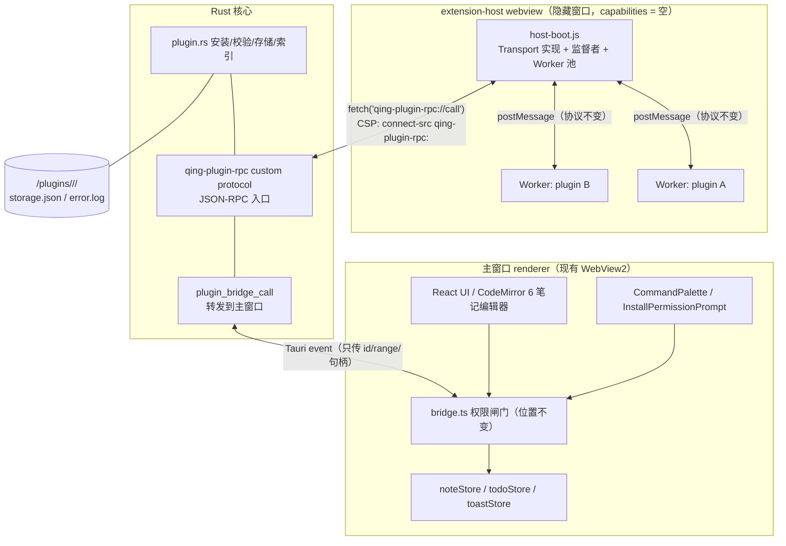

# 计划：P1b 独立扩展宿主（方向甲）

日期：2026-10-27
状态：方案待评审（team-lead），未动代码
上游：`docs/analysis-extension-host.md` §3/§4 P1b（架构评审）、`docs/verification-plugin-l1.md`（L1 验收）

目标口径：把插件执行从主窗口 renderer 搬到**专用隐藏 webview**，拿到「**内存炸弹 / renderer 崩溃只带走扩展宿主，主窗口照常响应**」这条收益；对外 API 面与 P1a 完全一致，插件代码零改动。

> **P1b 的真实收益要说准**（工程师复核后更正）：`while(true)` 跑在 **Worker** 里时卡住的是 worker 线程，**两种模式下都不会"杀死"任何东西**——宿主页面都活着，靠 `RPC_TIMEOUT_MS` 5 s 超时判死并提示（in-process 现在就有）。进程隔离真正救下的是**大内存**（OOM 只炸扩展宿主）和 **renderer 崩溃**。所以验收要拆成两条，见 §7。

---

## 0. 前提已验证（第 −1 步实测，2026-10-27）

P1b 的价值主张完全依赖"隐藏 webview 真的拿到独立 renderer 进程"。这一点已实测成立，**不再是待验证项**：

| # | 命题 | 实测证据 | 结论 |
| --- | --- | --- | --- |
| 1 | **分进程** | 单窗口 12 个 `msedgewebview2` → 开第二个 webview（便签）后 **19 个**（+7）。按 `--type` 分类：3 browser / 5 renderer / 6 utility / 3 gpu | **renderer 是每个 webview 独立的**；browser/GPU/utility 有共享也有新增 |
| 2 | **能单独死** | 杀掉便签的 renderer（PID 59276，90 MB），主窗口照常存活，CDP 正常应答 | 内存独立性成立（我方补充的第二判据） |
| 3 | **冻结不牵连** | 在便签窗口 **JS 线程**（页面主线程，不是 Worker）跑 `while(true)` 25 秒，主窗口 `alive: true`、44 个按钮全部正常渲染 | **页面级 renderer 隔离成立**：一个 webview 的主线程冻死不牵连另一个 |

**由此推出的三条硬约束**：

1. **验收要拆成两条**（见 §7）：「（两种模式都有）超时判死并提示重启」+「（仅 ext-host）内存/崩溃只带走扩展宿主」。`while(true)` 卡死**不是** P1b 的差异化收益——Worker 里跑它，两种模式下宿主页面都活着。
2. **崩溃恢复必须处理 renderer 被 WebView2 自动重启的情况**——实测杀进程后页面仍在，说明 WebView2 会重启 renderer。恢复逻辑**不能假设"进程死了 = 窗口没了"**，要能识别"重启后 worker 状态已丢"并重建 Worker 池。
3. **进程隔离的真实价值是 OOM 与 renderer 崩溃**：内存炸弹只炸扩展宿主、renderer 崩溃只带走扩展宿主。

> 剩余未验证项只有两条（见 §8），不影响开工：`register_asynchronous_uri_scheme_protocol` 与 blob worker 的 CSP 共存时序、隐藏窗口内存基线（参考 30–60 MB，未测）。

---

## 1. 不可动的约束前提

| 约束 | 来源 |
| --- | --- |
| 安装包体积是开发者侧唯一成本指标；当前 26.05 MiB | `analysis-extension-host.md` §2.1 |
| 不自带 Node（+25–30 MiB 且 Node 权限模型自认不防恶意代码） | 同上 §1/§2.2 |
| Worker 是唯一"对象缺失"级隔离（无 `window`/`document`/`__TAURI_INTERNALS__`） | `verification-plugin-l1.md` §1 |
| 权限检查在 `bridge.ts` 强制，数据 API 的状态在主窗口 zustand | `analysis-extension-host.md` §3.3 K2 |
| 大文本**传句柄不传值** | 同上 §3.3 K3 |
| 插件代码是单文件 ESM（CJS 有垫片），对外 API 面 P1a 冻结 | §4 P1a |
| 不碰云笔记（`CloudNoteEditor` 不发布为活动编辑器） | §4 P1a 边界 |
| 默认 Transport = `in-process`，四条验收全绿后由 team-lead 拍切换 | §4 P1b |

---

## 2. 目标与非目标

**目标**
1. 插件执行搬到隐藏 webview（`label: "extension-host"`）内的 Worker 池；
2. 主窗口与扩展宿主之间用 custom protocol `qing-plugin-rpc` 通信；
3. 崩溃/卡死只带走扩展宿主，主窗口照常响应（验收 #2 硬措辞）；
4. 渲染器被 WebView2 自动重启后能重建 Worker 池；
5. `Transport` 抽象落地，`in-process` 默认、`protocol` opt-in。

**非目标**
- 不改任何插件 API 的语义（P1a 的 5 个编辑器方法 + `views` + 命令原样）；
- 不开新权限码（13 个不变）；
- 不碰云笔记、不做 Node 后端（P2）；
- 不做多扩展宿主进程（一个宿主承载所有插件，与 VS Code 同构）。

---

## 3. 架构



**与现状的差别只有一个**：Worker 从主窗口搬到隐藏 webview，`bridge.ts` 的位置与权限语义不变。

---

## 4. 关键设计决策

### 4.1 Transport 抽象（默认 in-process）

> **接口以 `src/plugin/transport.ts` 为准，此处仅为说明。** 下面的形状是实际实现（`1a7f81a`），不是早期草图——草图有三处不成立，已按代码更正。

```ts
export interface PluginTransport {
  readonly kind: "inprocess" | "protocol";

  /** 加载 body（prelude + 插件 main，单文件）并开始投递消息。启动失败从这里 throw */
  start(pluginId: string, body: string): void;

  /** 投递一条宿主 → 插件消息。未知 pluginId 忽略 */
  send(pluginId: string, message: WorkerInbound): void;

  /** 唯一 handler；替换它就是移交 transport */
  onMessage(handler: (pluginId: string, message: WorkerOutbound) => void): void;

  /** 执行上下文已消失且不会再应答：崩溃 / 消息无法反序列化 / 后端进程没了 */
  onError(handler: (pluginId: string, message: string) => void): void;

  /** 停止执行上下文并释放资源。幂等 */
  dispose(pluginId: string): void;
}
```

**与早期草图的三处差异（都有理由，下一个人还会问）**：

1. **`send(msg): Promise<unknown>` → `send(pluginId, msg): void`**。协议里 `init`/`event` **没有响应**，只有 `call` 有；返回 Promise 会变成"永远 resolve undefined 的假承诺"。**请求配对（rid + 5 s 超时 + 崩溃判死）留在 `headless.ts`**——那层与后端无关，抽进 transport 会让两个实现各配一份。
2. **一个 transport 实例管全部插件**（`start/send/dispose` 都带 `pluginId`），不是每插件一实例。架构是「一个扩展宿主 + 一个 Worker 池 + 一次长轮询覆盖所有 worker」，每插件一实例等于每插件一条轮询，与 §3 那张图相反。
3. **`start(pluginId, body)` 与 `onError(handler)` 是草图没有但必需的**：后端要拿 prelude+main 才能建 Worker；崩溃要上报（心跳/epoch 挂这层）。

两种实现共用同一套消息契约与权限表：`bridge.ts`、消息形状、`worker-boot.js` prelude 全部共享，**插件看不出差别**，"一个调用能做什么"不存在第二份实现要同步。

**模式切换**是配置项（设置里一项或启动参数），不是二选一的硬切换。**四条验收全绿前不得改默认值。**

**性能包络（要写进开发者文档）**：protocol 模式下**单次 RPC 5–15 ms**（自定义协议一跳 + JSON 序列化），in-process 约 **0.1 ms**。**批量循环会慢两个数量级**——插件作者若在循环里逐条调 `getText()`/`replace()`，protocol 模式下会明显变慢。缓解是 `getText(range)` 取片段、批量操作走单次调用；这不是 bug，是跨进程的代价。

### 4.2 custom protocol `qing-plugin-rpc`

- Rust `register_asynchronous_uri_scheme_protocol("qing-plugin-rpc", ...)`；
- 请求体 JSON（`{ ns, method, args }`），响应体 JSON（`{ ok, value, code }`）；错误码沿用 `E_*` 体系；
- 背压：单个插件未完成请求数上限（建议 32，**可调、无实测依据**，见 §10），超限返回 `E_BUSY`，避免插件刷爆 IPC。

#### 大文本：**插件 API 形状冻结；"传句柄不传值"只对协议层成立，对 `getText()` 返回值不成立**

**插件侧签名一个都不变**（已发出去的 `.qnp` 不能破坏）：

```ts
qing.editor.getText(range?): Promise<string>          // 仍返回文本
qing.editor.getSelection(): Promise<{from,to,anchor,head,text}>
qing.editor.replace({from,to}, text): Promise<null>    // 参数不变
qing.editor.setDecorations(key, ranges): Promise<null> // 参数不变
```

**口径更正**（原先写"整篇不跨进程回传"是错的）：Worker 跑在扩展宿主进程里，`getText()` 要把文本交给 Worker，**文本就必须从主窗口跨一次到扩展宿主**——句柄省不掉那一跳，只是把它推迟。所以：

| 层 | 规则 |
| --- | --- |
| **协议层**（`host-boot` ↔ `bridge` 报文） | 只放**引用与小载荷**：`{pluginId, message}`、`{noteId, from, to}`、树行结果、命令 id。中间层的重复拷贝（`notes.update` 的 args、往返的 whole-doc 副本）省掉 |
| **`getText()` 返回值** | **唯一大载荷**，必须跨一次（主窗口 → 扩展宿主 → Worker）。`down` 上限 16 MiB 就是为它留位 |
| **Worker 侧** | 拿到的永远是值，句柄对插件与 Worker 都不可见 |

**句柄/结果缓存（同 note 多次读取只跨一次）P1b 不做**（已定）。理由不只是"收益有限"，更硬的一层是：**陈旧文本比慢更糟**——插件拿过期正文去算统计、去 `replace`，产出的是错的内容且**静默**；而慢是可见的。为省一次跨进程引入"插件可能读到旧文本"的状态，是拿正确性换性能，方向反了。**`getText()` 每次跨进程取真实值。** 将来做必须遵守的规则见 §10 第 2 条（现在就写，防止将来有人图省事直接加 Map）。

### 4.2.1 协议形状（已实现，`plugin_host.rs`）

| 项 | 值 | 说明 |
| --- | --- | --- |
| 上行 | `POST /up`，body `{pluginId, message}` | `message.t` 白名单**只收 `ready\|rpc\|res\|log`** |
| 下行 | `GET /down` 长轮询 ≤20 s | 有货回 `{ok, item:{pluginId,message}}`，无货回 `{ok, item:null}`；主窗口用 `plugin_ext_host_send` 推进队列 |
| 预检 | `OPTIONS` → 204 + `Access-Control-Allow-Origin: *` | 扩展宿主页 fetch 在 Windows 上 Origin 是 `http://qing-plugin-rpc.localhost/`，属跨域。**这不是安全边界**（真边界在 `bridge.ts`），是让 fetch 发得出去 |
| 上限 | up 256 KiB / down 16 MiB | 超限 `E_TOO_LARGE` |
| 权限表 | **不在 Rust** | 仍在 `bridge.ts`（K2 不变） |

**为什么是长轮询而不是 Tauri 事件**：`capabilities: []` 的隐藏 webview **连 `core:event:allow-listen` 都没有**，用不了 Tauri 事件。给它开这一个能力就破了 deny-by-default。长轮询的"等到有货才回"对调用方就是推送，延迟≈0，实现无聊——这是优点。

**`init` 被白名单拒绝是故意的（采纳，写进约束）**：`init` 是宿主 → 插件方向的消息。扩展宿主若能发 `init`，就能**冒充宿主启动一个它指定 id 的插件**，而 `bridge.ts` 是按 `pluginId` 查权限的——那是权限混淆。上行只允许 `ready|rpc|res|log`。

**前瞻约束（将来 Track B 必须先做）**：今天只有扩展宿主窗口的 CSP 放行 `connect-src qing-plugin-rpc:`（主窗口、便签、磁贴的 CSP 都不含它），所以 blast radius 正确。**将来若给插件 UI webview（Track B）也放行该协议，必须先加会话令牌**——否则插件 A 的 UI webview 可以在 `/up` 里冒充 `pluginId: B`，白名单挡不住这个。

### 4.3 隐藏 webview 与 capability 划分

- `WebviewWindow` label `extension-host`，`visible: false`；
- 新增 `src-tauri/capabilities/extension-host.json`，`permissions: []` → **deny-by-default**；
- CSP：`default-src 'none'; script-src 'self'; worker-src 'self' blob:; connect-src qing-plugin-rpc:`；
- **不给 `core:*`**：扩展宿主的 webview 里 `__TAURI_INTERNALS__` 存在但 invoke 全被拒（这是与 Worker "对象缺失"的差别，已在 §3.3 记过）；插件代码仍在 **Worker** 里跑，保持"无 `window`/无 `__TAURI_INTERNALS__`"不变。
- **CSP 里自定义协议写法是否被 WebView2 识别属未验证**（Edg/155，见 §8 风险）——`connect-src qing-plugin-rpc:` 若不被识别，宿主页连不上 RPC。

### 4.4 Worker 池与崩溃恢复（含 renderer 自动重启）

这是 P1b 最容易做错的部分，实测已证明 renderer 会被 WebView2 自动重启：

| 事件 | 现状（in-process） | P1b 必须做到 |
| --- | --- | --- |
| Worker 抛错/卡死 | `teardown` + 连崩 3 次停用该插件 | **保持原样**（Worker 级、可归因） |
| 扩展宿主 renderer 被杀 | — | WebView2 可能自动重启页面 → **Worker 状态全丢**，但窗口还在 |
| 扩展宿主窗口被销毁 | — | 心跳超时 → 重建窗口 + Worker 池 |

**恢复识别**：心跳（建议 5 s）带 `epoch` 计数；renderer 重启后 `epoch` 归零或心跳超时，宿主判定"状态已丢"，**丢弃旧 `pending` 调用（返回 `E_HOST_RESTARTED`）并按需重建 Worker**。不能假设"进程死了 = 窗口没了"。

#### 崩溃归属：共享命运，退回 in-process，不做"全局停用"

**扩展宿主是所有插件共享的**——插件 A 把宿主弄崩，B、C 的 Worker 状态一起丢。所以：

- ❌ **不要**按"扩展宿主重启 3 次 → 全局停用所有插件"。那等于 A 一人作恶、全员连坐，而且重启后状态已丢，**根本查不出是谁干的**；
- ✅ **改为**：同一会话内扩展宿主重启 **3 次 → 自动退回 `in-process` 模式 + 明确提示用户**（说明发生了什么、已回退到稳定模式）。理由：退回 in-process **立刻恢复功能**，保住"能用"这条底线；全局停用是把可用性也一起输掉。

**单个插件的"连崩 3 次自动停用"保持原样**——那是 Worker 级、可归因的，语义没变。两条计数维度分开：单插件按 Worker error 计数（现状）；宿主按重启次数计数（回退阈值，不是停用阈值）。

### 4.5 新增错误码：走完整本地化流程

`E_BUSY`、`E_HOST_RESTARTED` 是新码，**必须走完整流程**（我们才修过"新错误码没本地化、超 20MB 中文而 2001 文件英文"的割裂，别再长一次）：

1. `src/plugin/types.ts::PluginErrorCode` 联合类型；
2. `src/plugin/install.ts::describeInstallError` 的映射表；
3. `src/utils/i18n.ts` **三处**：`TranslationKeys` 接口、zh 表、en 表。

> 走完这三处再进代码；漏一处就长出一个英文报错。en 文案按 D 段「en 不得比 zh 窄」的规矩写。

### 4.5 命令执行链路（改动面）

```
CommandPalette
  → headless.executePluginCommand(plugin, id)
    → transport.send(pluginId, { t: "call", rid, ns: "commands", method: "execute", args: [id] })
      → [protocol] host-boot.js → Worker postMessage
      → [inprocess] worker.postMessage（现状）
    ← 响应（含错误码透传）
```

`bridge.ts::dispatchPluginCall` 仍是唯一权限闸门；`protocol` 路径下它跑在主窗口（状态所在处），扩展宿主只做转发。**rid 配对与 5 s 超时在 `headless.ts`**（transport 不返回 Promise，见 §4.1）。

---

## 5. 文件清单

**新增**

| 文件 | 内容 |
| --- | --- |
| `src/plugin/transport.ts` | `Transport` 接口 + `InprocessTransport` + `ProtocolTransport` |
| `src/plugin/host-boot.js` | 扩展宿主页脚本：监督者、Worker 池、心跳、epoch |
| `src/plugin/host-entry.html` + `src/plugin/host-entry.ts` | 第二个 Vite 入口（`vite.config.ts` 多页配置） |
| `src-tauri/src/plugin_rpc.rs` | `qing-plugin-rpc` protocol handler + `plugin_bridge_call` 转发 |
| `src-tauri/capabilities/extension-host.json` | 空 permissions |
| `scripts/verify-plugin-runtime/` 新增 4 条断言 | 见 §7 |

**修改**

| 文件 | 改动 |
| --- | --- |
| `src/plugin/headless.ts` | 抽 `Transport`；`teardown`/`recordCrash` 增加宿主重启分支 |
| `src/plugin/types.ts` | `E_BUSY` / `E_HOST_RESTARTED` 进 `PluginErrorCode` |
| `src/plugin/install.ts` | `describeInstallError` 映射两个新码 |
| `src-tauri/src/lib.rs` | 注册 protocol、创建/销毁隐藏窗口 |
| `src-tauri/tauri.conf.json` | 若需 `bundle.resources` 无改动；CSP 不动（扩展宿主窗口单独 CSP） |
| `vite.config.ts` | 多页入口 |
| `src/utils/i18n.ts` | 两个新错误码三处（接口/zh/en）+ 设置项文案（如需开关） |

**不动**：`bridge.ts` 的权限语义、`plugin.rs`/`plugin_manifest.rs`、13 个权限码、所有示例插件、`worker-boot.js`（Worker 侧协议不变）、**插件 API 签名**（句柄是传输层细节）。

---

## 6. 实施步骤（按依赖排序）

| # | 步骤 | 产出 | 验收 |
| --- | --- | --- | --- |
| 1 | `Transport` 抽象（只抽接口，`inprocess` 填实现） | `transport.ts`；`headless.ts` 改用 Transport | `verify:plugin-runtime` 全绿，**6 个示例无回归**，行为与现状零差异 |
| 2 | 隐藏 webview + CSP + 空 capability | `host-entry.*`、`extension-host.json` | 任务管理器多 1 个 renderer；隐藏窗口里 `__TAURI_INTERNALS__` 存在但 invoke 全拒 |
| 3 | `qing-plugin-rpc` protocol + `plugin_bridge_call` | `plugin_rpc.rs` | **第一件事先验 CSP 自定义协议写法是否被识别**（§8 风险 1）：`fetch('qing-plugin-rpc://ping')` 走通；再验往返与错误码透传 |
| 4 | `ProtocolTransport` + Worker 池搬迁 | `host-boot.js`、`transport.ts` | 插件命令在扩展宿主里执行，`bridge.ts` 权限检查仍生效；**6 个示例行为一致（API 形状不变）** |
| 5 | 崩溃恢复（心跳/epoch/重启识别）**不需要 watchdog**（卡死已有 5 s 超时覆盖） | `host-boot.js`、`headless.ts` | 杀 renderer 后自动重建，返回 `E_HOST_RESTARTED`；**3 次重启退回 in-process + 提示**（不是全局停用） |
| 6 | 大文本句柄 + 背压 | `plugin_rpc.rs`、`transport.ts` | 同一文档会话内**不重复搬运整篇**（首次仍进 Worker 一次）；并发 32 上限生效 |
| 7 | 错误码本地化 + 设置项 + 回退开关 | `types.ts`、`install.ts`、`i18n.ts`、`settingsStore` | 两个新码中英齐全；切 `in-process` 后行为回到 P1a |
| 8 | 门禁补 4 条断言 | `verify-plugin-runtime` | 见 §7 |

> 步骤 1 独立可合（零风险），2–3 可并行（但 3 的第一步是验 CSP），4 是关键路径，5–6 在 4 之后。

---

## 7. 验收标准（四条，硬措辞）

| # | 验收 | 判据 |
| --- | --- | --- |
| 1 | **真独立进程** | 任务管理器里扩展宿主是独立 renderer；`pluginRuntimeProbe` 报告 `hostProcess: "extension-host"` |
| 2a | **卡死由 5 s 超时覆盖**（**两种模式都有**，不是 P1b 的差异化收益） | 插件里 `while(true)` → 5 s `RPC_TIMEOUT_MS` 超时、Worker 被 teardown、命令报 `E_TIMEOUT`；**in-process 与 protocol 下行为一致** |
| 2b | **OOM / renderer 崩溃只带走扩展宿主**（**仅 protocol 模式**，这才是 P1b 的收益） | 插件里内存炸弹（吃满 renderer）→ **只扩展宿主 renderer 死**，主窗口 `alive: true`、按钮可点；**杀扩展宿主 renderer**（WebView2 自动重启）→ 旧调用收到 `E_HOST_RESTARTED`、Worker 池重建、后续命令正常 |
| 2c | **重启 3 次自动退回 in-process** | 同会话内扩展宿主重启 3 次 → **自动退回 in-process + 明确提示**（不是全局停用插件） |
| 3 | **示例不回归** | 六个示例（含 `qing.outline` 4 条命令）在 `protocol` 模式下**插件 API 行为完全一致**（签名与返回值形状不变——句柄是传输层细节，插件看不见） |
| 4 | **回退真能用** | 切 `in-process` 后所有插件恢复工作，无残留状态（含自动回退后的恢复） |

**默认值策略**：四条全绿前默认 `in-process`；全绿后由 team-lead 拍切换默认。

> **2a/2b/2c 的拆分直接影响实施**：卡死已有 5 s 超时覆盖，**第 5 步不需要 watchdog**——只做心跳/epoch 识别 renderer 自动重启与重建 Worker 池，外加 3 次回退计数。

---

## 8. 风险与剩余未验证项

| 风险 | 缓解 |
| --- | --- |
| **CSP 里自定义协议写法在 WebView2 上是否被识别**（Edg/155，未验证）——`connect-src qing-plugin-rpc:` 若不生效，宿主页连不上 RPC，**这是最容易在最后一步才爆的雷** | 步骤 3 第一件事就验这个：宿主页 `fetch('qing-plugin-rpc://ping')` 能否走通。不生效则改用 `postMessage` 经隐藏窗口转发（多一跳，不改语义） |
| `qing-plugin-rpc` 与 blob worker 的 CSP 共存时序未验 | 步骤 3 单独验；失败则退化为经隐藏窗口 `postMessage` 转发 |
| renderer 自动重启导致 Worker 状态丢失 | §4.4 的 epoch/心跳；验收 #2 必须包含"杀 renderer 后重建"分支 |
| **共享宿主的崩溃归属**：A 崩连累 B/C，且状态已丢无法归因 | **不全局停用**（§4.4）：3 次重启后退回 in-process + 提示，保住"能用"底线 |
| 大文本句柄泄漏 | 句柄与文档会话绑定，文档切换 / `dispose` / 宿主重启时统一失效 |
| 隐藏窗口内存基线未测（参考 30–60 MB） | 步骤 2 顺手测，写进文档；若显著超标，考虑按需创建窗口 |

**剩余未验证项只有三条**：① CSP 里自定义协议写法是否被 WebView2 识别；② `register_asynchronous_uri_scheme_protocol` 与 blob worker 的共存时序；③ 隐藏窗口内存基线。其余前提已由第 −1 步实测覆盖。

---

## 9. 明确不做

- 多扩展宿主进程（一插件一进程）——内存代价与 WebView2 进程模型不匹配；
- 扩展宿主里跑 React/DOM 面板（`views` 继续走声明式树）；
- 跨插件 `import`（D6 维持）；
- Node 后端（P2，不随包）；
- **改插件 API 签名或语义**（P1a 冻结；句柄是传输层细节，不得泄漏到插件侧）；
- 崩溃后全局停用插件（改为退回 in-process，见 §4.4）。

---

## 10. 待定问题

1. 设置项的呈现：进"设置-扩展"分区，还是命令面板一项（"切换扩展宿主模式"）？
2. **句柄/结果缓存：P1b 不做（已定）**，列为 P1b 后可选优化。**将来若做，必须同时满足这三条**（现在写死，防止将来有人图省事直接加 Map 就上线）：
   - **失效只能由编辑器事务触发**（任何 `docChanged` 即失效）；**禁止时间失效**——TTL 与防抖都会造成**静默陈旧**，而陈旧文本比慢更糟（插件拿过期正文产出错内容，且不报错）；
   - **缓存必须带版本号**，插件侧可选携带 `expectedVersion` 检测陈旧：版本不符返回 **`E_STALE_TEXT`** 而不是静默给旧值（该错误码同样走 §4.5 的三处本地化流程）；
   - **作用域只限 `getText()` 整篇**，不覆盖 `getText(range)` 与 `getSelection()`（小载荷，无收益）。
3. `E_HOST_RESTARTED` 是否要在 UI 上单独提示（区别于 `E_INTERNAL`）——倾向单独提示，它是"宿主重启了"而非"插件写错了"；
4. 背压上限 32：**可调、无实测依据**（拍的数字），实现时代码注释与本条都要注明；若实测发现正常插件并发超过 32，调大即可。
