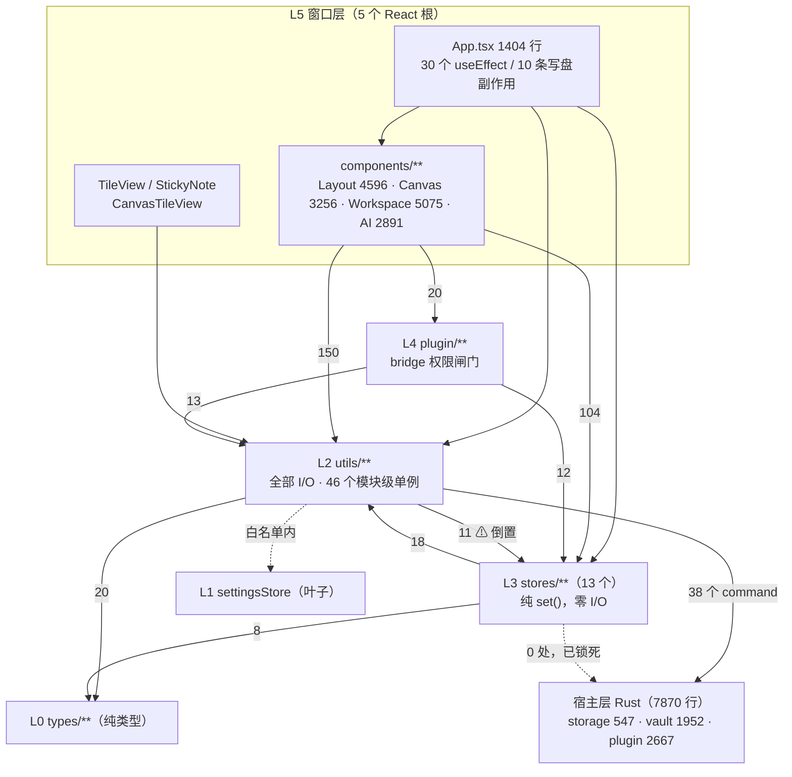

# Qing Notepad 全局架构复核与任务分解

> 复核对象：`D:/Code/Qing-Notepad`，分支 `extension`，0.7.3，`src` 181 个 TS/TSX 文件。
> 作者：高见远（架构师）　复核方式：通读 + 脚本化导入图分析 + 基线命令实测。
> **所有结论均可定位到 `文件:行号`。未验证项在文末单列，不混入结论。**

---

## 1. TL;DR

1. **最大风险不是"分层被破坏"，而是"数据落盘没有失败语义"**：`storage.ts` 里 14 处数据写入有 13 处是 `writeTextFile(目标路径)` 直写，无原子替换、无备份、异常被吞（`storage.ts:1040-1051`、`1668-1676`、`788-796`），上层因此写出**死代码 catch**（`NoteEditor.tsx:213-219`）并在写失败后仍清脏标记。
2. **分层方向整体健康**：脚本实测 181 文件 **0 个循环依赖**；`stores` 对 `@tauri-apps` **0 处**；`utils` 对 `components`/`plugin` **0 处**。真正的倒置只有一条：`utils → stores` 的 11 条边（7 个文件），且因目标 store 是叶子未成环。
3. **P0 不加任何业务行为**：抽出原子写工具 + 接入 5 个高风险写入点 + 把分层/循环/原子写写成可执行门禁 + 契约落盘。预期收益：**使"写失败 = 用户数据消失"从不可见变为不可发生**，并把本次审计固化成 `node scripts/verify-architecture.mjs`。
4. **工作区有 69 项未提交改动**，因此 P0 刻意让 T1/T3 落在**纯新增文件**上，只有 T2 必须碰 `src/utils/storage.ts`（已在途，需协调）。

---

## 2. 现状架构地图

### 2.1 渲染层：6 个层次与实测依赖方向

依赖边由脚本遍历 `from "…"` / `import("…")` / `import "…"` 三种形式统计（含 `@/` 别名与相对路径解析）。

| 层 | 内容 | 规模 | 职责 | **实测出边** |
| --- | --- | --- | --- | --- |
| L0 | `src/types/**`（5 文件） | 587 行 | 纯类型 + 少数常量（`canonicalCanvas` 归一化函数） | 无出边（叶子） |
| L1 | `src/stores/settingsStore.ts` | 382 行 | 除 `zustand` 外**零导入**的叶子 store | 无出边 |
| L2 | `src/utils/**`（含 `utils/graph`、`utils/ai`） | 15K+ 行 | 全部 I/O、Tauri 调用、格式解析、领域算法；持 **46 个模块级可变单例** | → stores 11、→ types 20 |
| L3 | `src/stores/**`（其余 13 个） | 4091 行 | 纯内存状态，动作全部是 `set(...)`，**零 I/O** | → utils 18、→ types 8 |
| L4 | `src/plugin/**`（11 文件） | 3274 行 | Worker 协议、权限闸门、安装事务 | → utils 13、→ stores 12、→ types 3 |
| L5 | `src/App.tsx` + `src/components/**` | 20K+ 行 | 5 个窗口根 + 视图 | → utils 15+150、→ stores 12+104、→ components 34、→ plugin 20 |
| L6 | `src/hooks/**`（2 文件） | 438 行 | 协作网络、流式滚动 | 仅被 components 引用 3 次 |

**实际依赖方向图**（次数为实测）：



**关键正例（本次审计的"不该动"部分）**：
- `utils` **不依赖** `components`、`plugin`（0 处）——分层壳层没有反穿。
- `stores` **不依赖** `@tauri-apps/*`（0 处，仅 `dialogStore.ts:6` 注释里提到）——store 的纯内存属性成立。
- `components` **不绕过 store action** 改状态（`grep "Store.setState("` 在 `src/components/` 命中 0）。
- 图谱工具（`utils/graph/*`）**未外泄**到非图谱模块（`components/`、`stores/`、`App.tsx` 命中 0），与 `decisions-knowledge-graph.md` 的三条隔离线一致。

### 2.2 宿主层：Rust 侧的依赖方向（比渲染层干净，可作样板）

`lib.rs` 声明 9 个模块（`lib.rs:9-17`），注册 **38 个 command**（`lib.rs:135-174`）。模块间 `crate::` 引用**总共 3 条**：

| 引用 | 位置 | 评价 |
| --- | --- | --- |
| `plugin → plugin_manifest` | `plugin.rs:26` | 单向，正确 |
| `plugin → storage::data_root` | `plugin.rs:172` | 单向，取根路径 |
| `vault → storage` | `vault.rs:36` | 单向 |

即：叶子 = `storage / credentials / clipboard / pdf_export / window_bg`；中层 = `plugin_manifest / plugin_host`；高层 = `plugin / vault`。**渲染层应照此收敛**：`storage.ts` 应处在 Rust `storage.rs` 的位置——被所有领域依赖、自己不依赖任何领域。而现实是它反过来读了 `settingsStore`（见 3.3）。

### 2.3 数据流契约（类图）

```mermaid
classDiagram
  class WindowRoot {
    +App / TileView / StickyNote / CanvasTileView
    每个窗口独立 React 根，无共享内存
  }
  class ZustandStore {
    +notes / todos / endpoints …
    动作全部 set(...)，零 I/O
  }
  class StorageFacade["utils/storage.ts（84 exports / 1899 行）"] {
    +saveNoteContent() 吞异常
    +saveNoteIndex() 抛异常 + 写链 + temp/rename
    +saveSettings() 吞异常，直写
    +saveTodos() 吞异常，直写
    +getDataDirectory() 进程级缓存
  }
  class AtomicWrite["utils/atomicWrite.ts（P0 新增）"] {
    +writeFileAtomic(path, data)
    +writeJsonAtomic(path, value)
  }
  class ModuleSingleton["46 个模块级 let"] {
    graphSync.indexStore 绑定单一 root
    chat.providers 隐式全局
    storage.dataDirectoryPromise
  }
  class TauriHost["Rust 38 commands"] {
    storage_* / vault_* / plugin_* / export_pdf
  }

  WindowRoot --> ZustandStore : 渲染读
  WindowRoot --> StorageFacade : 9 个组件直接调用
  ZustandStore --> StorageFacade : 仅 aiStore / workspaceStore / authStore
  StorageFacade ..> AtomicWrite : P0 后必须经此
  StorageFacade --> TauriHost : plugin-fs / invoke
  ModuleSingleton --> TauriHost
  StorageFacade ..> ZustandStore : ⚠ storage.ts:642 反读 trashRetentionDays
```

---

## 3. 依赖方向审计（逐条违规，附证据）

> 判定口径：`utils` 是被所有层依赖的底层，不得反向读上层；`stores` 不得触达 Tauri；`components` 不得持数据生命周期；无循环。

### 3.1 ❌ V1：`utils → stores` 反向依赖，11 条边 / 7 个运行时边

| 文件:行 | 导入 | 类型 | 用途 | 影响面 |
| --- | --- | --- | --- | --- |
| `utils/storage.ts:22-23` | `useSettingsStore`, `TRASH_*` | **运行时** | `storage.ts:642` 读 `useSettingsStore.getState().trashRetentionDays` | 全仓 20 个文件 import storage |
| `utils/noteDeletion.ts:1` | `useNoteStore` | **运行时** | 删除笔记时查分类名、调 `deleteNote` | 2 个组件（NoteTree、Sidebar） |
| `utils/ai/noteWrite.ts:14` | `useNoteStore` | **运行时** | AI 写笔记后同步内存 | 被 `aiStore` 反向依赖 |
| `utils/graph/graphSync.ts:26` | `useGraphStore` | **运行时** | 同步结果直接推 store | 图谱全模块 |
| `utils/tile.ts:49` / `utils/canvasTile.ts:43` | `useSettingsStore` | **运行时** | 新建子窗口时取 `theme`/`customColors` | 磁贴/便签窗口 |
| `utils/announcements.ts:625` | `useSettingsStore` | **运行时** | 读 `announcementsEnabled` 做门禁 | 更新通告全链 |
| `utils/i18n.ts:1`、`theme.ts:1`、`announcements.ts:15`、`ai/emptyState.ts:20`、`shortcutManager.ts:3` | `type` only | 类型 | — | 无运行时成本 |

**为什么是问题**（不是"洁癖"）：
- 这 7 条让"utils 里的纯函数"变成**依赖进程内 UI 状态**的函数。具体后果已可指认：`storage.ts:642` 的保留期读取依赖调用窗口的 store 是否 hydrated，而 **`TileView` / `StickyNote` / `CanvasTileView` 三个子窗口对 `settingsStore` 的引用是 0 处**（实测 grep 无命中），在这些窗口里调用任何走 `readTrashRetentionDaysMs()` 的清理逻辑都会拿到**默认值而非用户设置**。当前唯一调用点 `purgeExpiredNoteTrash` 只在主窗口（`App.tsx:363,601`、`TrashModal`）触发，所以是**潜伏缺陷、未爆**。
- 相邻风险：`tile.ts:49` / `canvasTile.ts:43` 同样从 store 取主题；若将来从子窗口触发"再开一个窗口"，会带着默认主题开窗。
- **未成环**：脚本 Tarjan SCC 结果 `0` 个强连通分量（≥2 节点）。原因是 `noteStore` 只依赖 `zustand`+`types`，`settingsStore` 只依赖 `zustand`。**这条结论重要**：现在改正成本低，等哪天有人在 `noteStore` 里 import `noteDeletion` 就会成环。

### 3.2 ✅ V2：`utils → components` / `utils → plugin` = **0 处**（无违规）

`grep -rn 'from "@/components' src/utils/` 与 `from "@/plugin"` 均无命中。分层没有被反穿，这一条要在门禁里**锁死**（P0-T3 的 R4）。

### 3.3 ❌ V3：`storage.ts` 是唯一"自己会读上层状态"的底层模块

`storage.ts:22` 导入 store，`storage.ts:642` 读它。这与 2.2 里 Rust `storage.rs` 的定位（纯被依赖方）直接矛盾。**这是本仓库唯一的结构性方向错误**，其余都是"职责过大"而非"方向错误"。

### 3.4 ❌ V4：`components` 持数据生命周期（9 个组件直连 `utils/storage`）

| 组件 | 直接调用 | 判断 |
| --- | --- | --- |
| `Trash/TrashModal.tsx:8-18` | `listTrashNotes` / `restoreTrashNote` / `purgeTrashNote` / `emptyNoteTrash` / `purgeExpiredNoteTrash` | ❌ 回收站完整生命周期在弹窗里 |
| `Auth/AnnouncementBoard.tsx:15-22` | `load/markSeen/markDismissed` + `stripAnnouncementImages` | ❌ 通告持久化在展示组件里 |
| `Sticky/StickyNote.tsx:3-10` | `saveNoteContent` / `loadNoteList` | ⚠ 子窗口独立根，**结构性必需** |
| `Tile/TileView.tsx:4`、`Canvas/CanvasTileView.tsx:9` | `loadNoteContent` / `loadNoteList` / `loadSettings` | ⚠ 同上 |
| `AI/AiSidebar.tsx:37` | `loadNoteContent` / `loadNoteSnapshot` | ⚠ 读，风险低 |
| `Settings/SettingsModal.tsx:68-69`、`Settings/StorageSection.tsx:22` | 含 `migrateDataDirectory` 等 | ⚠ 设置页本就是数据页 |

**必须承认的约束**：`main.tsx:15-33` 把 5 个窗口根（App / TileView / StickyNote / CanvasTileView / probe）分支在一个入口里，每个窗口是**独立 React 根、独立 store 实例**。因此"持久化只经 store"在本仓库**原理上不可能**——跨窗口一致性只能靠"落盘 + 重读"。这条要写进契约（§4.3），否则会被当成违规反复返工。

### 3.5 ✅ V5：循环依赖 = 0（实测）

方法：脚本遍历 181 个文件，覆盖 `from` / `import()` / side-effect `import`，解析 `@/` 别名与相对路径，Tarjan 求强连通分量。

```
files: 181   SCC(size>1): 0
```

**因此本条无违规可列**。特别澄清两个易误判点：
- `models`、`stores`、`components` **没有** `index.ts` 桶文件（`find src -name index.ts` 仅 2 个：`types/index.ts`、`utils/ai/chat/index.ts`），所以"桶文件造成全量耦合"在本仓库**不成立**。`types/index.ts` 是纯类型（编译期擦除），`utils/ai/chat/index.ts` 是一个 provider 注册表门面（`chat/index.ts:29` 持模块级 `providers`），不是批量 re-export。
- 真正的"事实上的桶"是 `utils/storage.ts`：**84 个导出、9 个领域、1899 行**，20 个文件 import 它。任何一个文件想读一个笔记标题，都会把 AI 凭据、通告缓存、字体、回收站的代码一起拉进模块图。

### 3.6 ⚠ V6：`utils` 不依赖 `components`，但 `services` 被复制了一份

`utils/canvasStorage.ts:1` 与 `utils/graph/graphFs.ts:35` **各自 import 了 `@tauri-apps/plugin-fs` 的 10 / 5 个函数**，绕开 `storage.ts` 直接读写数据目录。图谱侧是 `decisions-knowledge-graph.md` 明确裁决过的（三条隔离线、vault 只读、renderer 不拿 vault fs scope），**属合法例外**；**`canvasStorage` 未在任何 decision 里被裁决**，只与 `storage.ts` 共用 `img-trash` 分区（`canvasStorage.ts:149-151` → `storage.ts:738`），属**书面规范（`team-collaboration-spec.md` §4.2 B"数据目录读写只经 storage.ts"）的未登记偏离**。→ 需要裁决（待确认 Q5）。

---

## 4. 状态与持久化分层契约

### 4.1 现状（可验证描述）

**内存事实源有三处，不止 store：**

| 事实源 | 数量/位置 | 生命周期 | 失效机制 |
| --- | --- | --- | --- |
| Zustand store | 14 个（4473 行），**每窗口一份** | 窗口级 | 无（窗口关闭即消失） |
| 模块级 `let` 单例 | **46 个**（`utils` + `plugin` + `hooks`） | 进程级 | 基本没有，靠调用方自觉 |
| 磁盘 | `<data>/` + 指针 `%APPDATA%/com.qing-notepad.app/storage.json` | 持久 | 变化目录后 `window.location.reload()` |

46 个单例里带缓存的典型：`storage.ts:60-62`（根目录 Promise）、`graphSync.ts:78-81`（`indexStore` 绑定单一 root）、`chat/index.ts:29`（provider 注册表）、`markdown.ts:312`（asset scope 判定）、`announcements.ts:157-158`（inFlight + seenCache）。

**持久化入口清单（6 条，职责重叠已核）：**

| 入口 | 落点 | 与 `storage.ts` 关系 | 竞争写入风险 |
| --- | --- | --- | --- |
| `utils/storage.ts` | `<data>/` 下 14 个文件 | 权威 | — |
| `utils/canvasStorage.ts` | `<data>/canvas*` | **共用** `getDataDirectory()` 与 `img-trash/canvas` 分区 | 低（目录不重叠），但无原子写 |
| `utils/graph/graphFs.ts` + `graphIndexStore.ts` | `<data>/graph/index/` | 共用 `getDataDirectory()`，自带 `GraphFs` 抽象 | 低（决策已隔离） |
| `utils/authPreferences.ts:28,49` | **`localStorage`** | 独立 | 无 |
| `utils/supabase.ts:27` | **`localStorage`**（会话） | 独立 | 无 |
| `components/Graph/GraphPage.tsx:86,98` | **`localStorage`**（面板折叠） | 独立 | 无 |

结论：**没有发现同文件双写**。`notes/index.json` 已有唯一写链（`storage.ts:968-978`，`noteIndexWriteChain`）；`settings.json` 只有一个写者（`App.tsx:544-597`）。**"竞争写入"不是当前风险，"写坏之后的恢复能力"才是**——见 4.2。

### 4.2 ❌ 现状与应有契约的差距：写失败没有语义（本报告最重要的一条）

**(a) 14 处数据写入，13 处非原子直写。**

`grep "await writeTextFile(path" src/utils/storage.ts` 命中 14 行：`306, 341, 374, 420, 550, 583, 612, 792, 900, 1045, 1647, 1672, 1710, 1808`。
唯一做了 temp + rename 的是 `writeNoteIndex`（`storage.ts:1008 / 1013`），且它的注释（`storage.ts:960-967`）明确记录了这样做的原因：**两个重叠 PUT 共用固定 `.tmp` 导致 index 全文件丢失过**。同类风险在其余 13 处**仍然存在**，且：

- `saveSettings`（`storage.ts:1668-1676`）、`saveTodos`（`788-796`）、`saveUiState`（`1706-1714`）、`saveTodoLists`（`896-904`）、`saveNoteContent`（`1040-1051`）都是 `writeTextFile(目标路径, …)` 一把梭，**无 temp、无 rename、无备份**。
- 读侧不做完整性兜底：`loadSettings` 解析失败 → `catch { }` → 返回 `{}`（`storage.ts:1654-1666`）。一次写入中途崩溃/断电留下的截断 JSON，会被**静默当成"用户没有任何设置"**：主题、快捷键、磨砂、回收站保留期、插件开关全部回默认。`notes/index.json` 有 backup 兜底（`readNoteIndexFile` ×2），**`settings.json` / `todos.json` 没有**。

**(b) 异常吞噬导致上层写出死代码。**

`saveNoteContent` 在 `try` 内部吞掉所有异常（`1048-1050`），从不 reject。于是：

```
NoteEditor.tsx:214   await saveNoteContent(prevId, pendingContent);
NoteEditor.tsx:215-219   try { … } catch (e) { console.error("Failed to save previous note:", e) }
                         ↑ 永不触发（saveNoteContent 不抛）
NoteEditor.tsx:217   markDirty(prevId, false)   ← 即使写失败也标记"已保存"
```

即：**写失败 → tab 显示已保存 → 用户切走 → 下次启动 `loadNoteList` 的 coverage 过滤（`storage.ts:933-936`）把"索引里有、文件不存在"的条目静默剔除**。若失败发生在新建笔记时（`App.tsx:953` 的 `saveNoteContent(note.id, "")` 未 await、未 catch），该笔记在本次会话里能看到、重启后消失。

**(c) 写失败对用户完全不可见。** 全部 13 处走 `console.error`，无 toast、无 dialog、无 UI 状态位。

### 4.3 应有契约（P0-T4 要落盘的内容）

1. **唯一写入出口**：`<data>/` 下任何文件写入必须经 `storage.ts`（或已裁决的 `graphFs`），且必须经 `atomicWrite`。
2. **落盘原子性**：`写入临时文件（同目录 + 唯一名）→ rename 覆盖`。禁止 `writeTextFile(最终路径)`。
3. **失败必须可区分**：写入函数**不得吞掉异常**。可恢复类（缓存、read marks）可降级，**用户数据类（笔记正文、index、todos、settings）必须抛**，由调用方决定 toast。
4. **跨窗口一致性靠磁盘，不靠 store**：任何窗口不得假设另一窗口的 store 状态；需要共享的配置必须显式读盘（或经 command 读 Rust 侧指针）。
5. **底层不得反读上层**：`utils/**` 只允许从 `stores/**` 取**类型**；取运行时值必须改为参数注入。允许的例外仅限 `graphSync → graphStore`（推送派生快照，决策已定），且必须登记在此文件。
6. **进程级单例必须登记**：新增模块级 `let` 需在契约里追加一行"谁创建、谁失效"。

### 4.4 写路径调用流程（现状，含失败分支）

```mermaid
sequenceDiagram
  autonumber
  participant U as 用户
  participant NE as NoteEditor.tsx
  participant ST as utils/storage.ts
  participant FS as Tauri plugin-fs
  participant APP as App.tsx（30 个 useEffect）
  participant B as 下次启动 loadNoteList

  Note("① 正文链：编辑器防抖 / 切 tab")
  U->>NE: 输入 / 切换标签
  NE->>ST: saveNoteContent(id, content)  (NE:157/214)
  ST->>FS: writeTextFile(`notes/${id}.md`)  (ST:1045 非原子)
  alt 写成功
    FS-->>ST: ok
    ST->>ST: markNoteContentDirty(id)
  else 写失败（磁盘满/只读/盘拔出）
    FS-->>ST: throw
    ST->>ST: console.error 并【吞掉】(ST:1048-1050)
    Note over ST: 调用方无法得知失败
  end
  ST-->>NE: resolve（永远 resolve）
  NE->>NE: markDirty(prevId,false)  ← 失败也清脏标记（NE:217）
  Note over NE: catch 分支（NE:215-219）是死代码

  Note("② 索引链：独立 effect，与正文链无事务关系")
  APP->>APP: notes/categories 变化 → noteIndexFingerprint (APP:670-683)
  APP->>ST: saveNoteIndex(index, categories)
  ST->>ST: 串到 noteIndexWriteChain (ST:968-978)
  ST->>FS: writeTextFile(temp) → rename(index)  ← 唯一原子写 (ST:1008)
  ST-->>APP: reject 可传播（writeNoteIndex 会 throw）

  Note("③ 崩溃/断电窗口")
  Note over ST,FS: ①与②之间无事务：可能出现<br/>「index 有 title，notes/*.md 是空或截断」
  U->>B: 重启
  B->>ST: loadNoteList()
  ST->>ST: coverage 过滤 fileIdSet (ST:933-936)
  Note over B: 「索引有、文件无」的条目被静默剔除 → 笔记消失
```

---

## 5. 技术债清单

> 只收有证据项。未验证项在 §9。
> 成本口径：S ≤ 半日、M ≤ 2 日、L > 2 日。**"碰未提交"列**：`是` = 该文件在 `git status` 里已有改动。

### P0（本次必须做，行为不变）

| # | 症状 | 证据 | 触发风险 | 成本 | 碰未提交 |
| --- | --- | --- | --- | --- | --- |
| D1 | 13 处数据写入非原子（唯一正确样板是 index） | `storage.ts:306/341/374/420/550/583/612/792/900/1045/1647/1672/1710/1808` vs 原子实现 `1008/1013` | 写中崩溃/断电 → 截断 JSON；`settings.json` 截断被当 `{}` 静默重置全部设置（`1654-1666`） | M | 是（`storage.ts`） |
| D2 | 笔记正文写失败被吞，上层 catch 死代码仍清脏标记 | `storage.ts:1048-1050` ↔ `NoteEditor.tsx:213-219` | 磁盘满/只读盘 → tab 显示已保存，实际未落盘；重启后经 `933-936` coverage 过滤**笔记消失** | M | 是（两文件均在途） |
| D3 | 底层反读上层状态 | `storage.ts:22 → 642` | 子窗口（`TileView/StickyNote/CanvasTileView` 对 settingsStore 引用 0 处）调用时拿默认保留期 | S | 是 |
| D4 | 分层/循环/原子写无门禁，靠人肉记 | 本次靠临时脚本才得出 SCC=0 | 下次任何一次 import 就可能引入环或反穿，tsc 全绿无信号 | S | 否（新增文件） |

### P1（方向，不展开到可执行粒度）

| # | 症状 | 证据 | 成本 | 碰未提交 |
| --- | --- | --- | --- | --- |
| D5 | `storage.ts` 9 域 84 导出混一文件（AI 482 行 / Notes 494 / Trash 305 / 通告 184 / 基础设施 290） | `storage.ts` 分段注释 `773/799/1293/1598/1624/1653/1678/1716` | L | 是 |
| D6 | 写失败对用户零反馈 | 13 处 `console.error` | S（需 UX 裁决 → Q2） | 是 |
| D7 | `App.tsx` 承担 10 条写盘副作用的调度 | `App.tsx` 30 个 `useEffect`；写盘：`363/464-474/544-597/641-643/658-659/670-683/686-691` | M | 是 |
| D8 | 46 个模块级单例无生命周期；`graphSync.indexStore` 永久绑定首个 root（`graphSync.ts:114-129`） | `graphSync.ts:78-81`、`storage.ts:60-62` | M | 是（graphSync 未跟踪） |
| D9 | `utils → stores` 7 条运行时边（V1 表） | 见 §3.1 | M | 部分（`Sidebar.tsx`） |
| D10 | 3 个子窗口各自 bootstrap（重复 `loadSettings` 逻辑） | `TileView.tsx:4`、`StickyNote.tsx:10`、`CanvasTileView.tsx:9`、`main.tsx:15-33` | M | 否 |
| D11 | `TrashModal` / `AnnouncementBoard` 持完整数据生命周期 | `TrashModal.tsx:8-18`、`AnnouncementBoard.tsx:15-22` | S | 否 |
| D12 | `aiStore` 6 域 40+ 动作（endpoints / chat / conversations / polish / 模型选择 / 错误态），144 个字段 | `aiStore.ts` `interface AiState` | L | 否 |
| D13 | 「视图」枚举散落 3 处，无注册表 | `types/index.ts:62`（`ViewType` 6 成员）、`App.tsx:1257-1329`（嵌套三元）、`ActivityBar.tsx` | M | 是 |

### P2（记录，不在本轮）

| # | 症状 | 证据 | 说明 |
| --- | --- | --- | --- |
| D14 | `i18n.ts` 2838 行 / 113KB / 940 键，三合一（type + zh + en） | `i18n.ts:3/943/1881/2824` | 收益小：字符串体积可忽略；真实代价是 `team-collaboration-spec.md` §3.4 R2 的串行冲突 |
| D15 | `chat/index.ts` 隐式全局注册表，靠 `commitEndpoints` 自觉同步 | `chat/index.ts:29/33`，调用点仅 `aiStore.ts:361/935` | 契约成立但靠约定；建议加 `assertProvidersSynced` 开发期断言 |
| D16 | `App.tsx:953` 未 await 未 catch | `saveNoteContent(note.id,"")` | **已核实当前不触发**：`assertSafeNoteId` 在 try 外抛（`storage.ts:1041`），但 id 来自 `crypto.randomUUID()` 必然合法。仅作记录 |
| D17 | 数据目录迁移后进程缓存不失效 | `markdown.ts:312`、`graphSync.ts:114-129` | **已被 `StorageSection.tsx:118/155/197` 的 `window.location.reload()` 掩盖**；仅当出现不做 reload 的迁移入口才成问题 |
| D18 | 桶文件 | 仅 `types/index.ts`（纯类型）、`utils/ai/chat/index.ts`（门面） | **无 tree-shaking 失效**，与预设假设相反，不需动作 |

---

## 6. 任务分解

### 6.1 P0（4 项，行为不变，总计 ≤ 8 项上限内）

#### T1｜原子写基础设施（纯新增，零业务改动）

- **文件**：新增 `src/utils/atomicWrite.ts`（≈90 行）、新增 `scripts/verify-atomic-write.mjs`（≈120 行）
- **改动要点**
  1. `writeFileAtomic(path, data: Uint8Array|string, fs = tauriFs): Promise<void>`：同目录唯一临时名（后缀 `.tmp`，含 `crypto.randomUUID()`，与 `storage.ts:998-1002` 同构）→ `writeTextFile` → `rename`；`rename` 失败时按 `storage.ts:1008-1014` 的既有兼容路径（`exists` → `remove` → 再 `rename`）；任何分支失败都要 `remove(temp)` 后**抛出**。
  2. `writeJsonAtomic(path, value)`：`JSON.stringify(v, null, 2)` 后转 `writeFileAtomic`，与现有落盘格式**字节一致**（缩进 2，无尾随换行）。
  3. `fs` 可注入（默认 `@tauri-apps/plugin-fs`），使 `scripts/verify-atomic-write.mjs` 可用内存桩跑纯 node。
  4. **不改** `storage.ts`、**不改** `package.json`（用 `node scripts/verify-atomic-write.mjs` 直跑）。
- **依赖**：无
- **验收判据**
  - `node ./node_modules/typescript/bin/tsc --noEmit` → 0 错（实测基线已 0 错）
  - `node scripts/verify-atomic-write.mjs` → 断言全绿：① 成功后目标内容 === 期望；② 临时名同目录且不等于目标名；③ 并发 100 次临时名互不相同；④ 写失败时 `remove(temp)` 被调用且异常向外传；⑤ `writeJsonAtomic` 输出与 `JSON.stringify(v,null,2)` 字节一致

#### T2｜数据写入点接入原子写 ⚠ 触碰在途文件

- **文件**：`src/utils/storage.ts`（**未提交**）
- **改动要点**：5 处高风险写入改为 `writeFileAtomic` / `writeJsonAtomic`，**只换写入原语，不动任何业务逻辑、不改任何落盘路径与格式**：
  | 行 | 函数 | 风险等级 |
  | --- | --- | --- |
  | `1045` | `saveNoteContent` | **最高**（用户正文） |
  | `1672` | `saveSettings` | **最高**（截断即全部设置重置） |
  | `792` | `saveTodos` | 高 |
  | `900` | `saveTodoLists` | 中 |
  | `1710` | `saveUiState` | 低（但改动 1 行，顺手） |
  - 临时文件必须放**同目录**（`rename` 跨目录会失败），且后缀为 `.tmp`：`listNoteFileIds`（`storage.ts:808-820`）只收 `.md`，`recoverNoteListFromFiles` 同样只认 `.md`，因此不会污染索引恢复。
  - `saveNoteContent` 保留现有"吞异常"行为（**行为不变**）；错误语义的变更留给 P1-D6/Q2 裁决。
- **依赖**：T1
- **⚠ 协调**：`src/utils/storage.ts` 有在途改动。**必须先由主理人确认该文件的在途工作已提交或冻结**，否则本任务的 diff 无法单独 review/回滚（`team-collaboration-spec.md` §3.4 R4）。
- **验收判据**
  - `node ./node_modules/typescript/bin/tsc --noEmit` → 0 错
  - `node scripts/verify-graph-index.mjs` → 70/70（存储层改动会波及图谱索引路径）
  - `node scripts/verify-graph-sync.mjs` → `failures: 0`（46 checks）
  - `node scripts/verify-plugin-runtime/run.mjs` → 58/58（`plugin/bridge.ts` 依赖 storage）
  - 尺寸断言：`git diff --stat src/utils/storage.ts` 净增 ≤ 60 行、删除 ≤ 20 行
  - 残留断言：`ls data/notes/*.tmp` 为空（需在有数据的目录跑一次冷启动后人工确认）

#### T3｜架构不变量门禁（纯新增）

- **文件**：新增 `scripts/verify-architecture.mjs`（≈170 行，node 内置模块，零依赖）
- **规则**（每条给出当前实测基线，脚本以后任何偏离都失败）
  | 规则 | 断言 | 当前基线 |
  | --- | --- | --- |
  | R1 | 无循环依赖（Tarjan SCC，覆盖 `from` / `import()` / side-effect `import` / `@/` 别名） | 0 个 SCC |
  | R2 | `src/stores/**` 不得 import `@tauri-apps/**` | 0 处 |
  | R3 | `src/utils/**` → `@/stores/**` 仅允许白名单 `storage.ts, noteDeletion.ts, tile.ts, canvasTile.ts, announcements.ts, ai/noteWrite.ts, graph/graphSync.ts` 的**运行时**导入（`import type` 不计）；且白名单目标 store 自身除 `zustand`/`@/types` 外不得 import `@/utils/**` | 7 个文件 |
  | R4 | `src/utils/**` 不得 import `@/components/**` / `@/plugin/**` | 0 处 |
  | R5 | 新增 `index.ts` 桶文件需登记 | 2 个已登记 |
  - 输出形如 `ARCH OK — 5 rules, 181 files, 0 violations` / 失败列 `文件:行 规则`，非 0 退出。
  - 内置 `--self-test`：用 3 个小样本（含人造环、人造反穿）证明检测器本身有效（**防止门禁永远返回 OK**）。
- **依赖**：无
- **验收判据**
  - `node scripts/verify-architecture.mjs` → 退出码 0，报告 181 文件 / 0 违规
  - `node scripts/verify-architecture.mjs --self-test` → 3/3 样本被正确判负
  - 不修改 `package.json`（在途）；若 Q4 裁决允许，再补一条 `"verify:architecture"`

#### T4｜分层与持久化契约落盘（纯文档）

- **文件**：新增 `docs/decisions-architecture-layering.md`（结论 + 理由 + 暂未确定三段式，照 `decisions-knowledge-graph.md` §8 的增量修订格式）；`docs/INDEX.md`（**未提交**，仅在"日常开发"节追加 1 行导航）
- **内容**：§4.3 的 6 条契约原文 + §3.1 的 7 条白名单及其理由 + `canvasStorage`/`graphFs` 直连 fs 的合法性说明（若 Q5 裁决为"合法例外"）+ 暂未确定清单（Q1/Q2/Q5/Q6）
- **依赖**：无（可与 T1/T3 并行）
- **验收判据**：无命令；人工核对三条 —— ① 每条契约都能指到 `文件:行`；② 不推翻任何既有 `docs/decisions-*.md` 结论（只写增量）；③ `docs/INDEX.md` 摘要 ≤ 3 行且写明"什么时候读它"

**P0 依赖图**


### 6.2 P1 / P2 方向（不展开）

| 任务 | 方向 | 关键约束 |
| --- | --- | --- |
| P1-A | 写失败可观测化（D2/D6）：`storage` 给"用户数据类"写入加 `throw` 语义，`NoteEditor`/`App` 接 toast | 必须先裁决 Q2；改 4 文件，`storage.ts`+`NoteEditor.tsx` 均在途 |
| P1-B | `storage.ts` 9 域拆分（D5） | 必须先落 T4；用 `re-export` 保持 84 个导出面不变，一次一域 |
| P1-C | `App.tsx` 持久化调度下沉（D7） | 与在途改动正面冲突，必须最后做 |
| P1-D | `utils → stores` 7 条反读改参数注入（D9） | 与 T2 同文件冲突，串行 |
| P1-E | 单例生命周期登记 + `graphSync` root 失效钩子（D8） | D17 说明当前被 reload 掩盖，优先级可降 |
| P1-F | `aiStore` 拆分（D12） | 单文件 1488 行，L，需独立轮次 |
| P2 | `i18n` 拆分、视图注册表、`chat` provider 断言 | 只记录 |

---

## 7. 不做什么（Negative Scope）

| 区域 | 理由 |
| --- | --- |
| 壳层几何（`shellLayout.ts` / `sidebarLayout.ts` / sash / 折叠阈值 240/180、AI 280/220） | `MEMORY.md` 硬规则 + `decisions-layout-unification.md` 已定；改版三次，不再兜回 |
| 配色 token / 磨砂分层 / 对比度口径 | `decisions-colour-contrast.md`、`decisions-glass-*.md`；且需 `verify:ui-polish` + 人工目视，本机无 GUI |
| 插件权限面、`plugin/bridge.ts` 协议、`capabilities/default.json`、CSP | 安全边界，`decisions-plugin-system.md` 已定；本次只在 R2/R4 里锁死方向，不改协议 |
| 数据目录语义（指针位置、`storage_migrate` 先移后改指针、`DATA_DIRECTORY_UNAVAILABLE` 绝不重建空目录） | `topics/data-storage.md` 硬规则；D1/T2 只改"如何写"，不改"写到哪" |
| 图谱三条隔离线、节点 id（FNV-1a）、`force-graph` 重绘通道 | `decisions-knowledge-graph.md` §2/§8；本次只读不改 |
| Markdown 信任边界（`utils/markdown.ts` 转义与白名单） | `MEMORY.md` 硬规则 |
| 任何 `src-tauri/**` 改动 | 本次审计确认 Rust 侧分层健康（3 条单向引用），无必要动 |
| `collab-server/**`、`supabase/**` | 不在渲染层架构范围内 |
| `package.json` 依赖 | 明确禁止新增依赖；P0 刻意不新增 npm script 条目 |
| 一切"观感 / 动画 / 焦点 / 拖拽手感"结论 | 本机无 GUI → 只能标「需人工目视确认」，不写"已验证" |

---

## 8. 待确认问题

| # | 问题 | 阻塞关系 | 我倾向的默认 |
| --- | --- | --- | --- |
| Q1 | `src/utils/storage.ts`、`src/App.tsx`、`src/components/Editor/NoteEditor.tsx`、`src/utils/i18n.ts` 均有在途改动。**T2 是否等这些落地后再开始**？还是让工程师在现状上直接改（diff 会与在途工作混合，无法单独回滚）？ | **阻塞 T2** | 等 `storage.ts` 的在途工作提交后再做 T2；T1/T3/T4 不等 |
| Q2 | 写失败要不要弹窗？笔记正文写失败是"静默重试 + 状态栏红点"还是"立即 dialog"？决定 P1-A 形状，也决定 `saveNoteContent` 是否改为抛出 | 阻塞 P1-A | 正文/index/settings 三类**必须抛**；UI 用 toast（非阻塞），因为 dialog 会在保存风暴里连续弹 |
| Q3 | 允许 `data/notes/` 出现瞬时 `.tmp` 残留（进程被杀时）吗？备份/同步脚本若按 `*` 拷贝会带上它 | 不阻塞 T2，但影响 T2 的临时名后缀设计 | 允许，后缀固定 `.tmp`，并在 `listNoteFileIds` 现有 `.md` 过滤下天然被忽略 |
| Q4 | 允许给 `package.json` 加 `"verify:architecture": "node scripts/verify-architecture.mjs"` 吗？（`package.json` 在途） | 不影响 T3 交付，只影响可发现性 | 本轮不加，用完整 node 路径直跑；下次 `package.json` 干净时补 |
| Q5 | `utils/canvasStorage.ts` 与 `utils/graph/graphFs.ts` 直连 `@tauri-apps/plugin-fs`，与 `team-collaboration-spec.md` §4.2 B"只经 storage.ts"冲突。图谱侧有 decision 背书，**画布侧没有**。是否补进 `docs/decisions-architecture-layering.md` 作为"合法例外"？ | 阻塞 T4 的一条内容 | 作合法例外登记（画布资产有自己的回收分区与引用计数，收回 storage.ts 会引入反向依赖）；**不重构** |
| Q6 | 子窗口（Tile/Sticky/CanvasTile）不 hydrate `settingsStore`，而 `storage.ts:642` 依赖它。是"冻结为仅主窗口可调用"，还是"保留期改为显式参数"？ | 不阻塞 P0 | 冻结 + 在 T4 写下"禁止子窗口调用依赖 settings 的清理逻辑"，P1-D 再改参数 |
| Q7 | `docs/plan-plugin-system.md` 处于删除态（用户决定）。本次新增的 `docs/decisions-architecture-layering.md` 引用插件决策时，是否只引用 `docs/decisions-plugin-system.md`（不引用已删除的 plan）？ | 不阻塞 | 只引用 decisions，不引用 plan |

---

## 9. 验证记录（我实际跑过的命令）

| 命令 | 结果 | 用途 |
| --- | --- | --- |
| `node ./node_modules/typescript/bin/tsc --noEmit` | **exit 0**，输出 0 行 | 基线绿，P0 的"无回归"判据成立 |
| `node scripts/verify-graph-index.mjs` | exit 0，**ALL PASS 70/70** | 存储层基线 |
| `node scripts/verify-graph-sync.mjs` | exit 0，**checks 46 / failures 0** | 存储层基线 |
| `node scripts/verify-graph-scan.mjs` | exit 0，**ALL PASS 112/112** | 存储层基线 |
| `node scripts/verify-plugin-runtime/run.mjs` | exit 0，**OK 58/58** | `plugin/bridge.ts` 依赖 storage，基线绿 |
| 自建导入图脚本（181 文件，Tarjan SCC） | **SCC(size>1) = 0** | §3.5 结论来源 |
| `git status --porcelain` | 69 项（43 M / 25 ?? / 1 D） | 每个任务的"碰未提交"列 |

**未验证 / 需人工目视（不写成结论）**
- `.tmp` 残留对真实备份脚本的影响（Q3）—— 未验证，取决于用户侧的同步工具。
- 子窗口主题是否真的会错（`tile.ts:49`）—— 需要 GUI 打开磁贴窗口目视，本机无法验证；本报告只陈述"子窗口对 settingsStore 引用为 0"这一静态事实。
- `storage_migrate` 中途断电的实际表现 —— 需要物理断电场景，未验证。
- `data/` 真实体量与写失败频率 —— 未统计。

---

> **维护**：本文的"应有契约"部分在 T4 落地后以 `docs/decisions-architecture-layering.md` 为真源；本文保留为审计快照，行号会漂移，引用时以符号名（函数名/导出名）为准。
