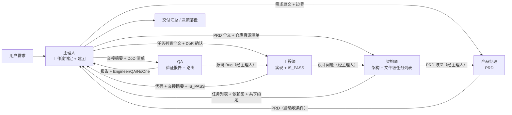
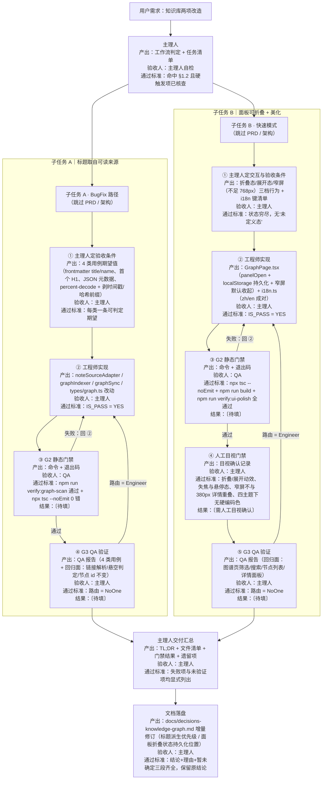

# 开发团队协作规范与交付流程（Qing Notepad）

> **TL;DR**
> - 本文是**执行手册**，不是宣言：每一节都给可勾选的动作、可跑的命令、可交接的产物格式。
> - 三条铁律：① **所有跨成员信息必经主理人中转**；② **没有门禁结论的交付不算交付**（IS_PASS / QA 路由必须写出来）；
>   ③ **本机无 GUI 时一律写「需人工目视确认」，禁止写「已验证」**。
> - 与代码不一致时**以代码为准**，并在对应 `docs/decisions-<topic>.md` 补一行偏差说明（`docs/INDEX.md` 现状真源排序）。
> - 现状真源排序：`.workbuddy/memory/MEMORY.md`（硬规则）> `.workbuddy/memory/topics/`（机制细节）>
>   `docs/decisions-*`（决策原文）> `.workbuddy/memory/archive/`（历史流水）。

---

## 1. 适用范围与原则

### 1.1 五条原则

| # | 原则 | 违反后的具体后果 |
| --- | --- | --- |
| 1 | **信息必经主理人中转** | 成员直连会让架构师拿到未定稿 PRD、工程师拿到未定稿设计，返工无法定位在哪一环 |
| 2 | **结论落 `docs/decisions-*.md` 才算定案** | 只在对话里"说定了"，下一轮会被重新翻案（本仓库已发生过多次） |
| 3 | **改动前先读真源** | 硬规则散落在 `MEMORY.md` + `topics/`，不读就会重复踩坑（如 `text-white`、`filter: blur`、`flex` 行 `w-auto`） |
| 4 | **最小变更** | 顺手重构无关区域 → QA 无法判定回归范围 → 轮次翻倍 |
| 5 | **能跑的命令必须跑，不能跑的老实说** | 本机无可交互桌面，写"已测试"等于伪造证据 |

### 1.2 工作流判定（可操作口径）

判定对象是**本次改动**，不是仓库规模。Qing Notepad 本身早已超过 10 个源文件，用"项目大小"判定会永远走标准 SOP。

先看硬触发项（任一命中 → 直接升级，不再往下判）：

| 硬触发项 | 为什么必须升级 |
| --- | --- |
| 触及 `src-tauri/`（Rust 侧任何改动） | 需要 `cargo check` / `cargo test`，且可能影响 `fs:scope`、CSP、capability |
| 触及 `src/utils/storage.ts`、`src-tauri/src/storage.rs` | 数据目录唯一读写入口，写错一次损坏用户数据 |
| 变更 `data/` 下的持久化格式（`notes/index.json`、`settings.json`、`graph/*`） | 需要兼容性与回滚策略 |
| 新增 / 升级 npm 或 crate 依赖 | 必须过 `architect`（体积、许可、目标地区可用性） |
| 触及插件权限面、`capabilities/default.json`、`src/plugin/bridge.ts` | 安全边界，需评审 |
| 涉及主题 token / 磨砂 / 对比度 | 需要 `npm run verify:ui-polish`，且要按"合成表面"口径复核 |

无硬触发项时，按下面的表判定：

| 场景 | 判定条件（同时满足） | 工作流 | 参与角色 |
| --- | --- | --- | --- |
| **BugFix 快捷路径** | 用户报告的**明确缺陷**；有可复现路径；根因在单一模块内；不新增依赖、不碰 `src-tauri/` | 主理人 → 工程师（定位+修复）→ QA（回归） | 主理人 / 工程师 / QA |
| **快速模式** | 改动 **≤ 3 个源文件**；不新增依赖；不碰 `src-tauri/`；不碰 `storage.ts`；不改持久化格式 | 主理人 → 工程师（一次做完）→ QA | 主理人 / 工程师 / QA |
| **标准 SOP** | 改动 **≥ 4 个源文件**，或**跨前端 + Rust**，或新增依赖，或改数据格式，或**触及共享文件**（见 §3.4） | PM → 架构 → 工程 → QA | 全员 |
| **部分工作流** | 只要 PRD / 只要架构评审 / 只要代码 / 只要测试 / 市场调研 | 按需拉单一角色 | 主理人 + 1 个角色 |

> **快速模式的边界要卡死**：改了 1 个文件但触及 `i18n.ts`、`App.tsx`、`types/index.ts`、`shellLayout.ts`
> 这类共享面，虽然文件数少，也要按 §3.4 串行排他，且 DoR/DoD 一条不减。

### 1.3 判定示例（本仓库真实需求）

| 需求 | 判定 | 理由 |
| --- | --- | --- |
| 知识库导入条目显示成 UUID/编码串 | **BugFix 快捷路径** | 明确缺陷、单一模块（图谱标题派生）、无新依赖 |
| 知识库左侧面板改为可折叠 + 美化 | **快速模式** | 3 个源文件（`GraphPage.tsx` + `i18n.ts` + `index.css`），无新依赖、不碰 Rust |
| 新增「图谱目录监听」 | **标准 SOP** | 碰 `src-tauri/`、新增 `notify` 依赖、改索引写路径 |
| 改主题配色 | **标准 SOP** | 硬触发项：触及 token 与对比度口径 |
| 改一句错别字 | 不起团队，直接改 | 属于 `grill` 允许跳过的 trivial 情形 |

---

## 2. 角色与职责（RACI）

### 2.1 职责表

| 角色 | 输入 | 产出 | 决策权 | **不做什么** |
| --- | --- | --- | --- | --- |
| **主理人**（齐活林 · 交付总监） | 用户需求 | 工作流判定、团队建立、任务分派、交付汇总 | 工作流路由；是否升级/降级；轮次裁定；最终交付口径 | 不写 PRD、不写架构、不写代码、不写测试（代写即违规） |
| **产品经理**（许清楚） | 用户需求 + 主理人给的上下文 | PRD（含验收条件、需求池 P0/P1/P2、待确认问题）；市场/竞品研究 | 需求优先级（P0/P1/P2）；验收条件定义 | 不选技术栈、不拆文件任务、不写代码、不估工时人天 |
| **架构师**（高见远） | PRD | 架构方案 + **文件级任务列表**（路径、依赖、实现顺序）+ 数据结构 + 调用流程 + 共享约定 | 文件划分、任务顺序、依赖选型建议、模块边界 | 不写业务代码、不改 QA 用例、不替 PM 改需求口径 |
| **工程师**（寇豆码） | 任务列表（或 BugFix 的复现路径） | 代码改动 + 全局一致性审查结论（**IS_PASS: YES/NO**）+ 交接摘要 | 具体实现方式；发现设计问题时可**退回架构** | 不擅自扩大范围、不新增未批准依赖、不改 PRD 验收条件 |
| **QA**（严过关） | 工程交接摘要 + DoD 清单 | 验证报告（命令 + 结果 + 失败特征）+ 智能路由判定（**Engineer / QA / NoOne**） | 判定是否达标；判定 Bug 归属（源码 or 测试） | 不改源码、不替工程师修 Bug、不因为"看起来没问题"就放行 |

### 2.2 RACI 矩阵

R = 执行，A = 最终负责，C = 咨询，I = 知会。

| 活动 | 主理人 | PM | 架构 | 工程师 | QA |
| --- | --- | --- | --- | --- | --- |
| 工作流判定 | **A/R** | I | I | I | I |
| 需求澄清（grill） | A | **R** | C | I | I |
| 技术选型（architect） | A | C | **R** | I | I |
| PRD | A | **R** | C | I | I |
| 架构设计 + 任务列表 | A | C | **R** | C | I |
| 代码实现 | A | I | C | **R** | I |
| 全局一致性审查（IS_PASS） | A | I | I | **R** | C |
| 静态门禁（tsc / build / verify:*) | A | I | I | **R** | **R** |
| 人工目视验收 | **A/R** | I | I | C | C |
| QA 报告 + 路由判定 | A | I | I | I | **R** |
| 决策文档落盘 | **A** | R（产品类） | R（技术类） | C | I |
| 交付汇总 | **A/R** | I | I | I | I |

> **A 都在主理人**：这是"所有跨成员信息经主理人中转"的制度化表达 —— 任何环节出问题，主理人负最终责任，
> 而不是"某个成员没说清"。

---

## 3. 协作方式

### 3.1 标准 SOP 信息流



**节点表（产出物 + 验收人 + 通过标准）**

| # | 节点 | 产出物 | 验收人 | 通过标准 |
| --- | --- | --- | --- | --- |
| N1 | 工作流判定 | 判定结论 + 参与角色清单 | 主理人自检 | 命中 §1.2 某一行，且硬触发项已核查 |
| N2 | PRD | 产品目标（3 条正交）、用户故事 3–5 条、需求池 P0/P1/P2、UI 描述、待确认问题 | 主理人 | 每条 P0 都能转成一条可判定的验收条件；待确认问题已列尽 |
| N3 | 架构 + 任务列表 | 文件列表（含路径）、数据结构/接口、调用流程、任务顺序与依赖、共享约定、依赖包清单 | 主理人 | 任务可**按文件**分派；每个任务写明"目标文件 + 依赖 + 验收命令" |
| N4 | 实现 + 审查 | 代码改动 + **IS_PASS: YES/NO** + 交接摘要 | 主理人 | IS_PASS = YES，且摘要能回答"改了哪些文件、为什么、怎么验" |
| N5 | QA 验证 | 验证报告 + 路由判定（Engineer/QA/NoOne） | 主理人 | 路由 = NoOne，且每条结论都带命令或"需人工目视确认"标注 |
| N6 | 交付汇总 | TL;DR + 文件清单 + 门禁结果 + 遗留项 + 下一步 | 主理人 | 失败项与未验证项**全部显式列出**，不隐藏 |

### 3.2 交接物格式（缺项即退回）

#### 3.2.1 PRD 必含项

| 项 | 硬性要求 | 缺了会怎样 |
| --- | --- | --- |
| 产品目标 | 3 条，互相正交（不能是同一件事的三种说法） | 架构师会按错误目标拆任务 |
| 用户故事 | 3–5 条，`As a … I want … so that …` | 无法判断"哪些行为算达标" |
| 需求池 | P0/P1/P2 分级 + 每条的**可验收表述** | QA 无从写用例 |
| UI 描述 | 布局、交互、**状态**（默认/悬停/禁用/空态/折叠态） | 视觉改动必然返工（本仓库历史上 3 次侧栏改版都因此多跑一轮） |
| 待确认问题 | 显式列出，标注"阻塞 / 不阻塞" | 架构师只能猜，猜错就是重新设计 |
| 不涉及项 | 明确"本次不动 X" | 工程师顺手改 X，扩大回归面 |

#### 3.2.2 架构任务列表必含项

| 项 | 硬性要求 |
| --- | --- |
| 目标文件 | **具体路径**（`src/utils/graph/noteSourceAdapter.ts` 这种，不能只写"修改图谱模块"） |
| 依赖关系 | 每个任务的前置任务 ID；给出关键路径与可并行项 |
| 验收命令 | 该任务能跑的命令（`npx tsc --noEmit` / `npm run verify:graph-scan` / `cargo test` / "需人工目视"） |
| 共享约定 | 跨文件一致的命名、类型、错误码、i18n 键命名 |
| 风险与逃生舱 | 若方案 A 失败，替换哪一层（本仓库惯例：写明"替换点只有 X 一个文件"） |

#### 3.2.3 工程师交接摘要必含项

```
1. 改动文件清单（新增 / 修改 / 删除）
2. 每个文件的改动意图（一句话）
3. 未改但相关的文件，以及为什么没改
4. 执行的命令与结果（逐条，含失败后如何绕过）
5. IS_PASS: YES / NO（NO 时列出问题与修复轮次）
6. 需人工目视确认的清单
```

#### 3.2.4 QA 报告必含项

```
1. 复现/验收步骤（针对每条 P0 验收条件）
2. 每条结论的证据：命令 + 退出码 + 关键输出片段，或「需人工目视确认」
3. 失败特征（写清"什么样算失败"，便于下一轮一眼判定）
4. 回归面：本次改动可能影响的既有功能，逐条勾选
5. 路由判定：Engineer（源码 Bug）/ QA（测试或脚本 Bug）/ NoOne（全部通过）
6. 轮次：第 1 轮 / 第 2 轮；第 2 轮仍不过 → 输出遗留问题清单，禁止继续延长
```

### 3.3 反馈回路

| 触发 | 走向 | 必须携带 | 禁止 |
| --- | --- | --- | --- |
| QA 发现**源码** Bug | QA → 主理人 → 工程师 | 失败用例 + 期望 vs 实际 + 相关文件/行号 | QA 直接改源码；工程师不看失败用例就"重写一遍" |
| QA 发现**测试/脚本** Bug | QA 自修 | 修完在报告里记一行 | 把脚本问题算成源码问题（会把工程师拖进无效轮次） |
| 架构发现 **PRD 歧义** | 架构 → 主理人 → PM | 歧义原文 + 两种解释各自导致的实现差异 | 架构师自行选一种解释继续设计 |
| 工程师发现**设计问题** | 工程 → 主理人 → 架构 | 冲突点 + 最小修订建议 + 影响的任务 ID | 工程师擅自偏离任务列表 |
| PM 在实现期想加需求 | PM → 主理人 → 重新判定工作流 | 新增项 + 影响面 | 直接塞给工程师（会绕过 DoR） |
| 主理人发现门禁未过就想交付 | 主理人自纠 | — | 把"未验证"写成"已验证" |

> 反馈回路**不是**返工许可：每轮都必须说明"这次改动相对上一轮变了什么"，否则第 2 轮只是重新掷骰子。

### 3.4 并行开发的边界规则

**R1 —— 同一文件不并行改。** 两个成员同时改同一文件，后写入者的 `Write` 会静默覆盖前者（本仓库已发生过）。

**R2 —— 共享文件串行排他。** 下列文件是"多处引用的公共面"，同一时刻只允许一个任务改：

| 共享文件 | 影响面 | 约定 |
| --- | --- | --- |
| `src/utils/i18n.ts` | 全应用文案 + `TranslationKeys` 强类型 | 一次只允许一个任务加键；加键必须 zh/en 成对 |
| `src/App.tsx` | 视图路由、数据装载、自动保存、侧栏状态机 | 改视图分支/侧栏状态机时排他 |
| `src/types/index.ts` | `ViewType` 等全局联合类型 | 加成员是"加宽"，但仍要串行，避免冲突 |
| `src/index.css` | Tailwind v4 `@theme` token、动效、磨砂 | 改 token 时排他，且必须跑 `verify:ui-polish` |
| `src/components/Layout/shellLayout.ts` | 壳层几何（pad/gutter/top-gap 全 6px） | 几何只在这里改，其他文件不许出现魔法数 |
| `src-tauri/capabilities/default.json` | 权限面 | 只增不改语义，改动需安全评审 |
| `package.json` / `package-lock.json` | 依赖树 | **dev 进程运行时禁止 `npm install`**（EBUSY 会把包换到半截） |

**R3 —— 无文件交集才可并行。** 并行前由主理人做一次交集检查：把两个任务的目标文件清单取交集，
交集必须为空。**有交集 → 串行**，不允许"我改上半段你改下半段"。

**R4 —— 不把别人的在途改动卷进自己的提交。** 并行协作时 `git status` 会快速膨胀（本仓库实测 5 分钟从
3 个文件涨到 40+）。提交前逐文件确认归属；不确定就**不提交**（`topics/git-release.md`）。

**R5 —— 提交前先看 `git status`。** 工作区里的未提交改动不属于任何分支，merge 会静默漏掉它们。

---

## 4. 交付标准（DoR / DoD）

### 4.1 DoR —— 开工前检查（Definition of Ready）

- [ ] 需求**可验收**：每条 P0 都能写成"给定…当…则…"的判定句
- [ ] 边界清楚：明确写了**不涉及项**（本次不动哪些模块/视图）
- [ ] 技术选型已过 `architect`（仅当涉及新依赖、存储层、状态/同步模型、托管部署、构建工具）
- [ ] 涉及 UI 的，有**交互说明**：默认态 / 悬停态 / 禁用态 / 空态 / 折叠态 / 窄屏行为
- [ ] 涉及文案的，给出 zh + en 两份措辞（或明确"复用既有键"）
- [ ] 已读对应真源：`MEMORY.md` 硬规则 + 相关 `topics/*` + 相关 `docs/decisions-*.md`
- [ ] 硬触发项（§1.2）已核查，结论写进任务说明

> 任一项不满足 → 主理人退回 PM 或架构，**不得开工**。

### 4.2 DoD —— 交付前检查（Definition of Done）

**A. 静态门禁（必跑）**

- [ ] `npx tsc --noEmit` 通过（PowerShell 被执行策略拦时改 `node node_modules/typescript/bin/tsc --noEmit`；
      不要 `| head` 后取 `$?`，那是 head 的退出码）
- [ ] `npm run build` 通过（**用 PowerShell**，不用 Git Bash；小写 `d:` 会让 `import.meta.glob` 失败）
- [ ] 构建前确认源码静默：`find src scripts -newermt "-20 seconds"` 连续 6 次为空（约 90 秒），构建后再复核一次
- [ ] 触及 Rust：dot-source `env.ps1` 后 `cd src-tauri && cargo check`（及 `cargo test`）
- [ ] 触及配色/token/磨砂：`npm run verify:ui-polish` 通过
- [ ] 触及图谱：`npm run verify:graph-scan` / `verify:graph-index` / `verify:graph-layout` / `verify:graph-sync` 中相关的都跑
- [ ] 触及插件：`npm run verify:plugin-runtime` / `verify:plugin-e2e` / `verify:plugin-snippet` 相关项通过

**B. 代码规范（必查）**

- [ ] i18n 中英齐全：新键已加进 `TranslationKeys` 类型，且 `zh` / `en` 双份都有
- [ ] 无 token 违规：不写 `text-white`（色块上用 `text-on-*`）、`text-accent` 一律写 `text-accent-text`、
      flex 行容器不写 `w-auto`、侧栏 sash 不用 `filter: blur`
- [ ] 组件样式优先用既有 token（`bg-bg-primary` / `text-text-muted` / `bg-accent` / `border-border`），
      不在 `className` 里硬编码 hex
- [ ] 动效只用 `--ease-*` / `--dur-*`（手写 `cubic-bezier` 会被审计脚本判失败）
- [ ] 数据目录读写只经 `src/utils/storage.ts`；指针文件只由 `src-tauri/src/storage.rs` 读写
- [ ] 新增 Tauri API / 新窗口 → 已更新 `src-tauri/capabilities/default.json` 与 `src/main.tsx` 路由
- [ ] 没有顺手重构无关区域

**C. 文档（必落）**

- [ ] 技术决策落 `docs/decisions-<topic>.md`（"结论 + 理由" 格式 + 暂未确定清单）
- [ ] 与既有决策冲突时，在该文档里写**增量修订小节**，不改写历史结论（照
      `decisions-knowledge-graph.md` §8 的做法）
- [ ] 用户可见功能变了 → 同步 `docs/user-manual.md`；AI 语料变了 → 同步 `docs/user-faq.md`
- [ ] 新增/改动 `docs/` 文件后更新 `docs/INDEX.md`（摘要 3 行内 + "什么时候读它"）

**D. 验收诚实性（本仓库最容易被违反的一条）**

- [ ] **本机无 GUI** 时：流式输出、拖拽手感、窗口行为、模糊观感、折叠动效一律标注「**需人工目视确认**」
- [ ] 禁止写"已测试""已验证"——除非确实有命令 + 退出码 + 输出
- [ ] 样式类结论必须用 `dist/assets/index-*.css` 复测，**dev 结果不算**（构建期 CSS 压缩会改语义）
- [ ] 未验证项集中列在交付汇总里，不藏在正文

### 4.3 质量门禁（三级）

| 门禁 | 执行人 | 通过条件 | 不通过时 | 轮次上限 |
| --- | --- | --- | --- | --- |
| **G1 全局一致性审查** | 工程师自审 | 输出 `IS_PASS: YES` | `IS_PASS: NO` → 自行修复后重新审查 | **2 轮**，仍 NO 则上报主理人 |
| **G2 静态门禁** | 工程师跑 → QA 复核 | §4.2 A 组全绿 | 打回工程师（源码问题） | 计入 QA 轮次 |
| **G3 验收路由** | QA | 输出 `NoOne`（全部通过） | `Engineer` → 源码 Bug；`QA` → 测试/脚本 Bug；共 **2 轮**回归 | **2 轮**，仍不过则输出遗留问题清单 |

**G3 的硬约束**：第 2 轮仍失败，**停止加轮次**，改为在报告里列出遗留问题、影响面、建议下一步。
无限回归是流程失效的信号，不是"再试一次就好"。

### 4.4 命令矩阵（按改动类型取行，不要凭记忆敲）

| 改动类型 | 必跑 | 备注 |
| --- | --- | --- |
| 任意前端 TS 改动 | `npx tsc --noEmit` | PowerShell 拦截时用 `node node_modules/typescript/bin/tsc --noEmit` |
| 任意前端改动 | `npm run build` | 必须 PowerShell；构建前确认源码静默 |
| Rust / Tauri | `. .\env.ps1` → `cd src-tauri && cargo check` | `cargo` incremental lock "拒绝访问"警告无害 |
| 配色 / token / 磨砂 / 动效 | `npm run verify:ui-polish` | 15 条静态审计 + 对比度分组 |
| 知识库 / 图谱 | `npm run verify:graph-scan` `verify:graph-index` `verify:graph-layout` `verify:graph-sync` | 纯 node 脚本，无 DOM 依赖 |
| 插件 | `npm run verify:plugin-runtime` `verify:plugin-e2e` `verify:plugin-snippet` `verify:plugin-note-tree` `verify:plugin-api` | CSP 只在 release 生效，dev 下无效 |
| 安全 / CSP / capability | `npm run verify:batch3`（+ `:probe`）`verify:batch4` | 属硬触发项，需评审 |
| 手册 / 检索语料 | `node scripts/smoke-manual-bm25.mts` | — |
| 安装包 | `npm run tauri build` | 产物：`src-tauri/target/release/qing-notepad.exe`、`bundle/nsis/QingNotepad_<ver>_x64-setup.exe` |
| 单元逻辑（纯函数） | 独立 node `.mjs` 脚本放 `scripts/` | 仓库**没有** vitest/jest，别引入 |

---

## 5. 本仓库专属检查清单

从 `MEMORY.md` 与 `topics/*` 提炼，按"改了哪一类东西"取用。

### 5.1 布局与壳层

- [ ] 顶栏统一 `h-9` + 单一共享 `border-b`；头像 28px、按钮 `h-7 w-7`
- [ ] Shell = 三浮卡 + gutter；pad / gutter / top-gap **全部 6px** 挂 sash，**不用 flex gap**
- [ ] 几何只在 `src/components/Layout/shellLayout.ts`；改一个量要同步另外两个 + `index.css` 的 `:root` 与 720px 媒体查询
- [ ] 侧栏 sash = hover 才出现的 2px 主题色渐变线（`.seam-line`）；热区靠 `.seam::after` 撑到 14px
- [ ] 折叠阈值语义不变：可用下限 240，拖到 **< 180** 判折叠（`SIDEBAR_COLLAPSE_THRESHOLD`），展开用同一阈值
- [ ] 折叠/展开过渡 200ms `cubic-bezier(0.33,1,0.68,1)`；普通拖拽仍即时跟手（`transition: none`）
- [ ] 折叠瞬间**不卸载拖拽把手**（卸载会释放 pointer capture）
- [ ] **禁 `filter: blur`**，要发光用 `box-shadow`
- [ ] AI 侧栏宽度下限 **280 / 折叠阈值 220**，与左侧栏 240/180 独立

### 5.2 磨砂与颜色

- [ ] 磨砂只在 `.surface-glass::before`（`z-index:-1`），绝不放卡片上
- [ ] `.app-root` 持**唯一** `isolation: isolate`
- [ ] 模糊可见度 ≈ 1 − tint：**禁止抬 tint 换对比度**，要可读性用文字层级（`data-contrast="boost"`）
- [ ] `text-accent` 一律写 `text-accent-text`；色块上写 `text-on-*`
- [ ] 正文对比度按**合成表面**算（侧栏卡片真实底色 = `bg-sidebar` 80% over `bg-shell`）
- [ ] 只写无前缀 `backdrop-filter`（同时写两条会被 minifier 删掉标准属性，生产环境磨砂全灭）
- [ ] 画布内图形填充可用 `--color-accent`，但**画布外的文字**必须 `text-accent-text`

### 5.3 JSX / Tailwind 陷阱

- [ ] **flex 行容器禁写 `w-auto`**：会让子项 `w-full` 静默退回 `max-content`，无滚动条、tsc/构建零信号，只能量尺寸
- [ ] `scrollbar-width` 必须留在 `@supports not selector(::-webkit-scrollbar)` 内
- [ ] 没有根错误边界 → 扩展 `PanelErrorBoundary`，不新增根边界
- [ ] Markdown 是信任边界：转义裸 HTML + 链接/图片白名单（`src/utils/markdown.ts`）

### 5.4 数据与持久化

- [ ] 数据默认 `<安装或项目目录>/data/`；指针在 `%APPDATA%/com.qing-notepad.app/storage.json`
- [ ] 指针**只由 `src-tauri/src/storage.rs` 读写**，且必须在数据目录之外
- [ ] 自定义根目录必须同时注册 fs scope **和** asset-protocol scope，否则笔记图片加载失败
- [ ] 目录缺失抛 `DATA_DIRECTORY_UNAVAILABLE`，**绝不重建空目录**（拔掉的硬盘不能看起来像空笔记本）
- [ ] `storage_migrate` 先移动、校验文件/字节数，**后**改写指针
- [ ] `.md` 文件不保证是 Markdown（可能是 TipTap HTML）；`loadNoteContent()` 两种都要吃
- [ ] 笔记 id 白名单 `NOTE_ID_PATTERN = /^[A-Za-z0-9_-]{1,64}$/`

### 5.5 图谱专项

- [ ] 三条隔离线不越：① 不造"幽灵 Note"（vault 笔记不进 `noteStore` / `index.json` / 文件树 / 回收站 / AI 语料）；
      ② vault 文件只读，零写入；③ renderer 不拿 vault 的 fs scope，全走 Rust 命令
- [ ] 节点 id 用**同步 64 位 FNV-1a**（renderer 无同步 sha256）：native `n-<uuid>` / vault `v-<vaultKey8>-<16hex>` / dangling `d-<16hex>`
- [ ] **判断悬空一律用 `kind === "dangling"`，禁止按 id 前缀推断**（悬空节点 id 也可能以 `v-` 开头）
- [ ] 图谱页不占 sash 侧栏，vault 列表与筛选是画布内 overlay（`leftSidebarListVisible` 排除 `graph`）
- [ ] `force-graph` / `react-force-graph-2d` **没有 `refresh()`**，唯一重绘通道是样式 prop identity 变更；
      自定义 handle 只许出现 `.d.ts` 里有的成员（`as unknown as` 塞幽灵 API 会 tsc 绿、运行时 TypeError）
- [ ] 索引是派生缓存，删 `data/graph/index/` 必须能重建；`vaults.json` 是权威，不进 `index/`

### 5.6 环境与 Git

- [ ] **dev 进程运行时绝不 `npm install`**
- [ ] Vite dev 缓存半写模块（报 `X is not defined` 而 tsc 全绿）→ `touch` 该文件，别改源码
- [ ] Rust/Tauri 构建先 dot-source `env.ps1`（首次 `Copy-Item env.example.ps1 env.ps1`）
- [ ] 禁止分支同名 tag；从 `main` 切分支、squash 合并；`main` 在 GitHub 与 Gitee 可能分叉，两边都 fetch
- [ ] `release.yml`：tag `v*` 才发布，`workflow_dispatch` 只构建不发布

---

## 6. 文档与记忆规范

### 6.1 三者的分工（别混）

| 载体 | 放什么 | 不放什么 | 谁维护 |
| --- | --- | --- | --- |
| `docs/decisions-<topic>.md` | **结论 + 理由**；"暂未确定"清单；增量修订小节（§8 形式） | 流水账、逐轮排查过程、行号（会漂移） | 作出决策的角色 |
| `.workbuddy/memory/MEMORY.md` | **违反就踩坑的硬规则**，一行一条，附真源指针 | 任何解释性长文、当天做了什么 | 主理人 |
| `.workbuddy/memory/topics/<topic>.md` | 机制细节、数值来源、口径（如对比度五组、磨砂参数） | 决策的"为什么选 A 不选 B"（那归 decisions） | 主理人 + 相关角色 |
| `.workbuddy/memory/archive/<date>.md` | 当天流水账、排查过程 | 硬规则（会被埋掉） | 主理人 |
| `docs/prompt-*.md` / `prompts-*.md` | **一次性任务书**，写完即过期 | 当现状读（行号/文件名会漂移） | 派发者 |

### 6.2 什么进 decisions

- 有**两个以上可行方案**且做了取舍的（选型、阈值、交互模型）
- 结论会**约束未来代码**的（如"折叠阈值 180，展开用同一阈值"）
- 用户或主理人**拍板**的（写清"由谁拍板"）
- 与既有结论**冲突**的 → 写增量修订小节，**保留原文并标注删除线/取代关系**，不静默改写

### 6.3 什么进 memory

- 一句话能说完、但违反就会踩坑的（如"flex 行容器禁写 `w-auto`"）
- 有**非显然后果**的（"tsc 全绿但运行时崩"这类）
- **必须指向真源**：每条后面挂 `→ topics/xxx.md` 或 `→ docs/decisions-xxx.md`

### 6.4 禁止事项

- ❌ **把流水账写进 `MEMORY.md`**：会挤掉硬规则，让文件从 40 行涨到 400 行后失去"必读"性质
- ❌ **在 decisions 里贴大段代码**：代码会变，decision 记录的是取舍理由
- ❌ **写行号当坐标**：`prompt-*` 与 `verification-*` 已记过多次"与提示词的偏离"，坐标一律用符号名/文件名
- ❌ **只在对话里说"定案了"**：下一轮会被重新翻案
- ❌ **文档与代码不一致却不动**：以代码为准，并在 decision 里补一行偏差

---

## 7. 实例走查：本次知识库两项改造

本次需求被主理人拆成两个子任务，按 §1.2 判定走了两条不同路径：

| 子任务 | 判定 | 目标文件 | 门禁 |
| --- | --- | --- | --- |
| **A｜导入条目名称为 UUID / 编码串** | **BugFix 快捷路径**（明确缺陷、单一模块、无新依赖） | `src/utils/graph/noteSourceAdapter.ts`、`graphIndexer.ts`、`graphSync.ts`、`src/types/graph.ts` | G1 → G2（`verify:graph-scan` + tsc）→ G3 |
| **B｜左侧面板可折叠 + UI 美化** | **快速模式**（2 个源文件、无新依赖、不碰 Rust） | `src/components/Graph/GraphPage.tsx`、`src/utils/i18n.ts` | G1 → G2（tsc + build + `verify:ui-polish`）→ G3 + **人工目视** |

**并行性判定（§3.4 R3）**：两任务目标文件交集为空 → **允许并行**。但 `i18n.ts` 只有 B 触及，
所以实际可安全并行；本次由同一工程师串行执行（先 A 后 B），串行不引入额外风险。



### 7.1 这两次走查暴露的规范要点

| 观察 | 对应条款 |
| --- | --- |
| 缺陷类需求不需要 PRD/架构，但**验收条件仍必须写**（否则工程师只能猜"什么算修好了"） | §1.2 BugFix 行、§3.2.1 |
| UI 类需求的验收条件必须包含**状态穷尽**与**窄屏行为**，否则人工目视时无判定依据 | §4.1 DoR 第 4 条 |
| 纯函数模块的验证靠 `scripts/verify-*.mjs` 断言，不靠"看起来对" | §4.4、§4.2 A 组 |
| 折叠动效无法在无 GUI 环境断言 → 只能标「需人工目视确认」，**不能写"已验证"** | §4.2 D 组 |
| 两任务文件无交集才可并行；`i18n.ts` 是共享面，需按 R2 串行 | §3.4 R2/R3 |

---

## 8. 附：常见违规对照表

| 违规表现 | 为什么是违规 | 正确做法 |
| --- | --- | --- |
| 主理人直接写代码/PRD | 破坏"成员结论为准"，责任无法追溯 | 分派给对应角色，主理人只编排 |
| 成员之间直接对话 | 信息流绕过主理人，返工无法定位 | 经主理人中转（见 §3.1） |
| `IS_PASS: YES` 但没跑 tsc | 门禁造假 | 附命令 + 退出码 |
| QA 报告写"功能正常" | 无判定依据 | 写"哪条验收条件 + 什么命令/目视 + 通过标准" |
| 把未验证写成"已验证" | 本仓库最严重的一类违规 | 写「需人工目视确认」 |
| 顺手重构无关模块 | 扩大回归面，QA 轮次翻倍 | 最小变更；发现的问题另开任务 |
| 只在对话里定案 | 下一轮被翻案 | 落 `docs/decisions-*.md` |
| `MEMORY.md` 越写越长 | 硬规则被埋掉，失去"必读"性质 | 硬规则一行一条 + 指针；细节下沉 `topics/` |
| 两任务并行改同一文件 | 后写入者静默覆盖 | §3.4 R1/R3：交集为空才并行 |
| dev 在跑时 `npm install` | EBUSY 把提升包换到半截 | 先停 dev |
| 用 dev 结果下样式结论 | 构建期 CSS 压缩会改语义 | 用 `dist/assets/index-*.css` 复测 |
| `git status` 里别人的改动被卷进提交 | 把在途工作带进 PR | 逐文件确认归属；不确定就不提交 |

---

> **维护本文件**：本文随流程变化更新。改动后请在 `docs/INDEX.md` 的「新人上手」或「日常开发」中加入一行导航
> （摘要 3 行内 + "什么时候读它"），否则新人不会读到它。
